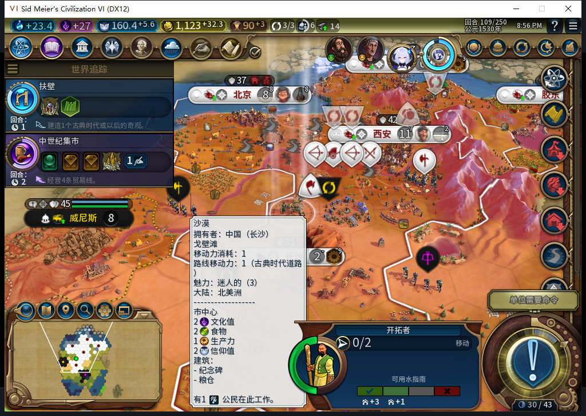
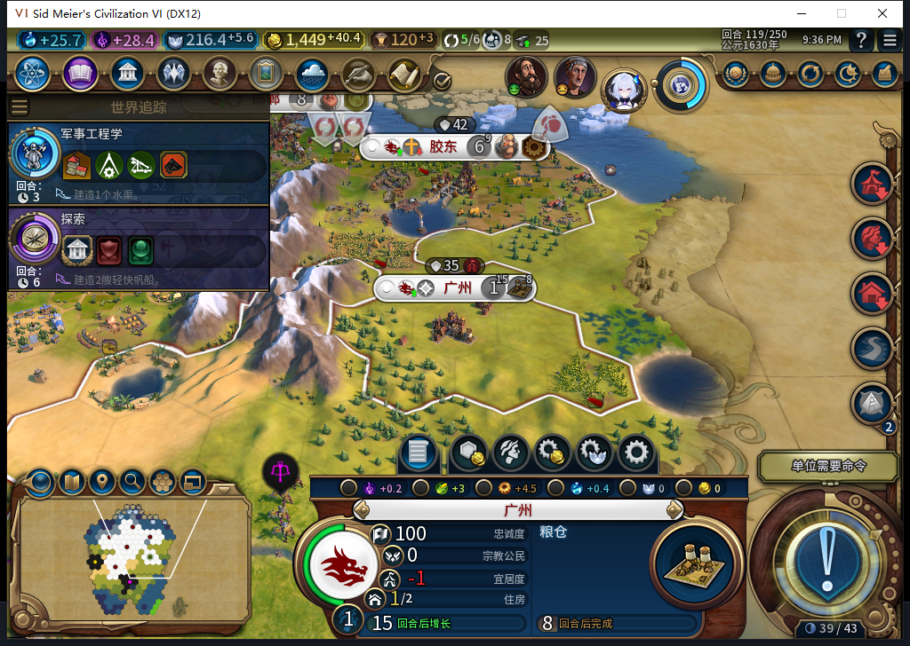
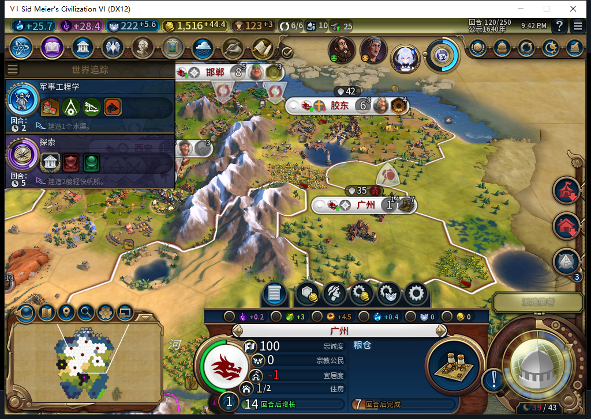
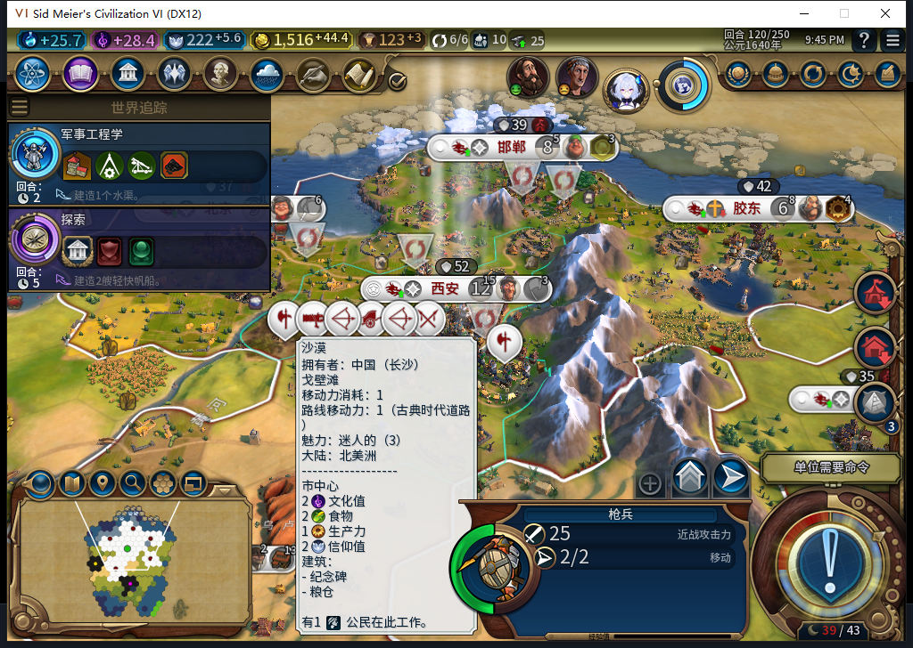

# 94实机：自动行军、建立广州与完成态重载

后续已完成[雨林建太原与黑暗时代130](baiqi-rainforest-dark-age-native-94.md)。下文保持120交付切点，不能覆盖后继已证事实，长期与旧恢复仍开放。

94离线冷读93的109回合保存档。同一名移民1572869自动离开原位置，119回合在59,32建立广州；120粮仓自然从0推进到4/32，忠诚仍100、每回合+17。原版正式保存、加载并继续后，同一120回合的六城、17单位、资金及已报告队列／资产／可见地块状态保持。[62行城市队列](feature94-109-120-queues.csv)、[62行城市状态](feature94-109-120-vitals.csv)、[逐项证据](../research/baiqi-p6-feature94-native-guangzhou120-evidence-2026-11-08.json)。

**本轮通过行军、新城初期生产和完成态重载的窄样本。长期保城、旧未决建城恢复与完整40项未通过。** 广州最终建在无地貌地块，不能将它写成雨林建城正案；地貌修复的实机正案是109确实接受雨林49,27为目标并移动，后续改目标的确切原因未截获。

冷读后第一次采样已是53,32、0移动力，保存目标2047@49,27；93保存前为54,33、2移动力、目标0。109初始移动发生在观察器安装前，不能补称已数出该命令。110继续到52,30；112目标变为空，113改为2427@59,32，此后54,30→56,30→57,30→58,30→58,31，119到址建城。测试玩家没有移动、建造、护送或指定文职目标。图中原版定居透镜及悬停提示不是本模组的忠诚预测。

广州完整城市ID393221，人口1。实际观察到119一次FOUND_CITY，原移民消失，保存目标清理；119粮仓0/32、忠诚100／+17、产出4.5。118该地已可见、无主、非城／非水／非不可通行、无地貌。116／117它虽已揭示却在雾中，QA读取没有越过可见性去取地块归属或地貌；提案坐标来自己方保存属性。最初雨林目标改选的原因保持未知，没有拿113几何读数冒充先前拒绝调用点。

120实际4/32，忠诚仍100／+17，玩家只查看。其他城市也继续：邯郸工业区112完成、长沙工业区118完成，胶东灯塔116、北京灯塔和邯郸工作坊117完成；120首都自动新选移民0/115，这个新训练尚未完成。没有把当前队列选择冒充训练完成，也没有玩家补装内政。

保存ACKtrue、1354086字节、SHA256 39708269c1e7efe09a63250b66a8d6af7d5fa1ef088055c86089f4b36858398e，连续读取稳定；正式加载一次ACKtrue，原版继续一次后实际active120。WORLD1、CITY6、UNIT17、BUILDING／DISTRICT／PLOT对应行逐字段一致，城市状态逐字段一致；这是报告范围相同，不是完整世界或零启动订单证明。UI／Core己方原属性都保存同一移民记录OBSERVED／119／2427／59,32，目标0、移民0。没有调用私有Inspect／Prepare／RunNow或重放建城。私人存档不入库。

观察器仅覆盖BaiqiExecutor绑定，从冷109初次采样后至120，1866样本：1786招募检查、14城市操作、65单位操作、1单位命令，0错误／丢弃。移民13MOVE_TO、2SKIP、1FOUND_CITY；有些移动可能属于让位等分支，不把每个MOVE_TO都说成已隔离的扩张调用。另一条单位命令是116大商人2228228的ACTIVATE_GREAT_PERSON，Hash374670040已按实际元数据核实；完整收益未隔离，不授宗教或军队通过。观察类型只有移民、建造者、商人和大商人；该范围内无军令／后台外交。120已恢复原绑定、撤下namespace并清理议会QA标记后才保存。

测试玩家31次军队待命、12次普通结束输入，实际推进11回合；无UserForced／Shift+Enter、新军事移动或手补内政。110原版世界议会打断：玩家各投免费A1大科学家、A1港口，但111实际通过的是B大预言家禁点和A剧院广场加成，不能把所投选项当成生效结果，也不能用此窗口证明先知点自然获取。112巴西交易拒绝及告别各一次，115罗马议程对话告别一次，119巴西大使馆接受与告别各一次；它们是测试玩家外交，未重放对应END。大使馆有正向UI回应，精确关系getter未另验。

114第一次普通结束停在本回合。新鲜pending显示部分军队原生待命不可用，实际阻塞是派遣使者：8枚、尚未考虑。玩家通过原版ActionPanel查看城邦，确认按钮禁用后原版关闭，8枚保留、已考虑=true；随后一次新普通结束才到115。查看入口的DoEndTurn分支是原版外交导航，未另计普通结束输入；没有直接改考虑标记或分配使者。最初96次只读等待改为24次，遇到下一回合仍忙则另起只读确认，不重发结束。原失败回执保留。

负责人适配工具的路径及exec命名空间错误分别发生在游戏点击／加载意图前，或只读场景检查后、点击前，修正后使用新的合格现场，不冒充模型故障。最初截图激活API失败，未生成PNG；实际激活情况未知，后续使用自有窗口UIA焦点并重新截图。全部四张是已查看的原图，无裁剪、合成或改数字。

source／install／runtime94与e78546412cef62c82472d67d4ebf2485275983f4一致，104文件、82Lua5.1；1339运行／1338通过／1SDK跳过为已完成的软件基线，本次未重复。新增HTTP、OpenCode原生生成及软件case均0，原模型0Native；累计仍545／508完整JSON／34截断／3最终传输失败／575HTTP含30额外尝试，未知成本null。

本机Steam14904同实例在UTC12:50:12.083192独立后台读到“上线…”后才启动94，查询无输入／激活／焦点变化／移动／截图，正式菜单头部导航另记。旧93保存后正式退出残留超过180秒、无窗口／端口且CPU两秒不变，只清理自己的22392残留；Steam与他人游戏未被终止。其他设备占用禁令持续，全段0模式切换／上线／登录／下载／上传器初始化／上传，公开Alpha2仍82／12图。

下一步从重载120继续检查广州跨时代忠诚与正常生产；旧92成都130保城FAIL、旧ARMED／LEGACY、宗教采购／创教、Base／RF兼容、性能及完整40项仍开放，不因本样本关闭。
