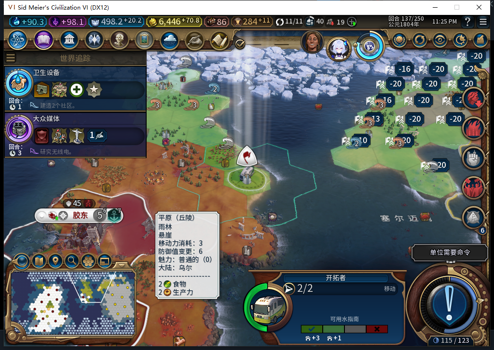

# 82旧档移民：保守迁移与保存通过，续建仍受限

在82正式加载一份77版136回合保存点，其中有正常训练出的移民7274546，位于28,17，12城。该存档早于建城持久日志功能。模组自行给这名既有移民建立`LEGACY_UNKNOWN`，令牌`settle:0:1`、创建回合136、序号1；没有伪造空地见证，也没有把未知旧操作当作从未发令。UI与Core均读回同一记录，测试查询未调用初始化或恢复函数。

## 结果与代价

测试玩家跳过20个合法军事单位，普通结束一次；途中拒绝亚历山大的珍珠／双耳瓶交易并告别。实际到137回合，其他城市继续生产；既有移民仍在28,17，2行动力，12城不变。没有人工文职移动或建城，没有强制结束回合。

**保守迁移避免了未知命令被重发，但这名旧移民会停止扩张。**同一配置限制一个存活移民，这也可能阻碍后续移民训练。旧档不能据此称作扩张恢复通过，不提供清日志或手动解锁入口。新局首个移民尚未完成实机验收。

## 非空记录确实保存了

将137回合世界正式保存，文件593519字节，SHA256 `230c1a70cede0a65bb20489291e5a8ed9a7cd8d49643ca96bed7bc10307303e2`。正式重载、继续后，UI与Core均仍读到创建于**136回合**的同一未知记录、同一令牌和序号；世界仍137回合、12城，移民同位置／2行动力。如果日志丢失后在137重新初始化，创建回合会变为137，因此这次不是空日志或相同回合重新初始化的模糊样本。UI自有单位52、Core53分别记录，不强行混成同一数量。

这只验一份旧档的保守迁移和持久化。上一项“建城已ARMED、效果尚未进入存档”的[续建失败](baiqi-settlement-lifecycle-recovery-82.md)仍未修复；长期忠诚、其他中断窗口和完整40项验收仍有缺口。

## 验收工具修正

首次加载脚本拼出重复分号，被游戏解析器整体拒绝，0加载动作；修正后经Lua5.1编译，并核对原标志未设置，再以新尝试正式加载一次。首次UI读取误写`UI.IsSavedGame()`，在打印有效迁移记录后只读报错；源码原消费者实际使用`GameConfiguration.IsSavedGame()`，产品没有这个错误。独立诊断后正确读回true。原失败记录保留。

普通结束的ACK不等于已换回合：8次轮询未就绪时停下后续动作，实际截图显示交易来访；由TEST_PLAYER处理外交后独立确认137，没有重发结束。这个用例未装SDK代理，不据此宣称后台全局零军令。

源码／安装／运行仍82，产品1153项软件检查沿用此前通过结果；本次无产品改动、无新增模型调用，不重复计算通过数。工坊仍Alpha74，本轮0 Steam联网／上传。[结构化证据与边界](../research/baiqi-p6-settlement82-legacy-migration-evidence-2026-11-06.json)。
