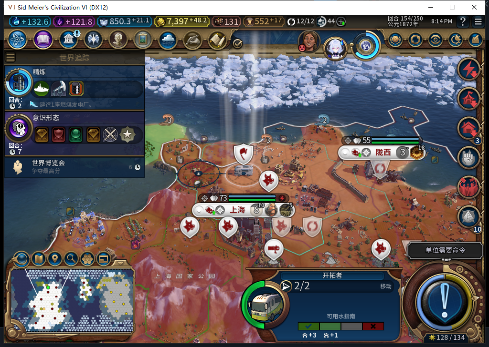
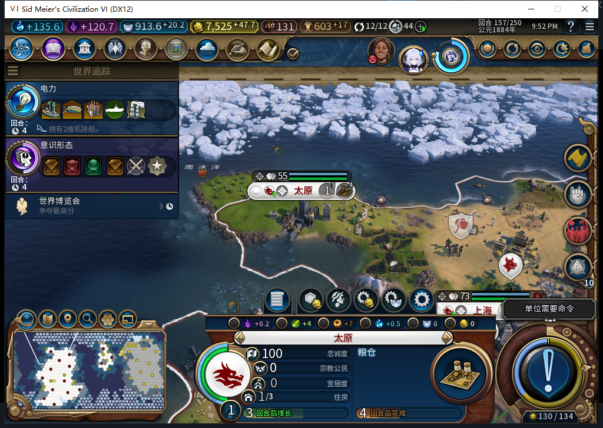
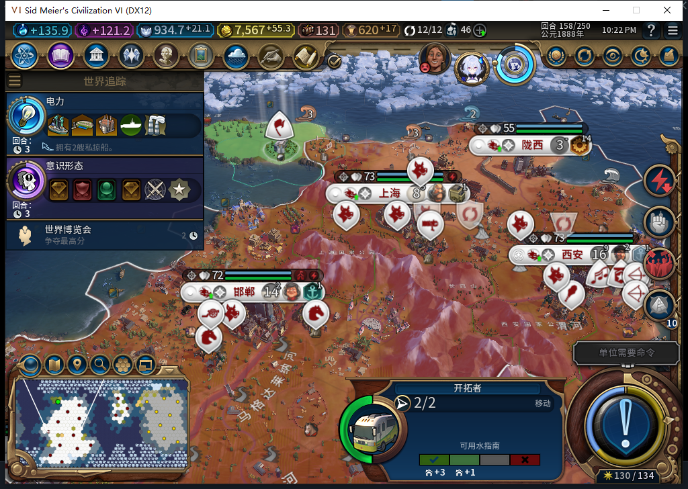

# 82自然建城通过；一种中途保存的续建恢复未通过

82实机已完成自然训练、行军、建城和新城生产。但在“建城日志已ARMED、原生效果尚未进入存档”的保存窗口，重载后移民仍等待：**非空记录确实恢复、防重复有效；经过两个普通回合仍未续建，这个窗口记FAIL，完整恢复不通过。**源码仍8d6b901的82版，工坊仍Alpha74，本轮没有Steam联网或上传。

## 正常链路确实运行

西安65536／16,14的移民进度从148回合0/205，到149的85、150的132、151的181。152出现真实新单位8650807，人口16→15；两次人口通知都读到15，只计一次扣减。完成事件为unit row0、canceled=false，完成前读到233/205，后续移民成本为220，不能混作原成本。

移民自行行军。后段观察捕获153回合14,17→14,18→13,18，并排队12,18；154实际到12,18后排队11,19；156再到10,19并提交一次FOUND。原生正式结束可能先执行排队而留在本回合，只有读回确认后才提交新的普通结束；没有Shift+Enter、队列取消或人工文职操作。SDK安装前152初始移动未计入计数。

156在10,19／plot846建成太原1048590，14→15城；请求0:156:173、持久令牌settle:0:1。157时UI和Core均读到OBSERVED、原完整移民ID查找nil且名册不存在。后段106个后台单位调用中，该移民5次MOVE、1次FOUND，其他100；非文职、未知类型、错误、样本溢出均0。城市SDK共21次BUILD，其中4次训练均为建造者；新城粮仓由模组在156安排。

太原一人口，粮仓7/32、食物2，原生忠诚度100／每回合+24。此时金币7525.671875。短样本不保证长期忠诚度，78历史自由城市丢失仍记FAIL。完成现场已独立保存为638028字节、SHA256 `6ab27eafb323dbbc7ae657d40e454d4aa95566027aed0fde00f6bffb547483a2`。

## 真正重载后发现的缺口

测试玩家的临时透明观察器，在实际后台FOUND调用返回后，读取合法ARMED和同一令牌，执行一次官方普通保存。保存ACK为true，文件630077字节，SHA256 `6273f4b586a6b1ec77fed64bcc94d3ec00383ed3fa4be646886ca84d87f9d6f5`。观察器保留原调用次数、参数、返回值及异常，不重发命令；保存输入与后台建城分别记账。

正式重载后，点击继续之前的新日志已出现同一单位／令牌的ARMED恢复，证明非空日志确实入档，不能归为空日志重新初始化。实际Core世界却是156回合14城，原移民8650807仍在10,19，行动力1、单独编队、未死亡，无太原。**文件保存了效果尚未生效的世界；保存前原世界后来正常建成，并不保证文件里已经建成。**

继续普通156→157→158两个回合后，UI和Core仍为14城、同一ARMED／令牌／请求ID，移民10,19、2行动力、单独编队、无移动排队。后装SDK计48个调用：原移民0MOVE、0FOUND、2次后台待命，其他46，非文职／未知／错误／溢出0。其他城市内政及回合仍正常进行，但这个移民没有恢复建城；配置同时限制一个存活移民，可能进一步阻碍扩张。

这不证明引擎队列内部已经丢弃操作，也不证明永远不能恢复。当前结果只证明本窗口在两个普通回合内没有完成。不能用超时、健康移民、空地或CanStart=true推定旧命令失败后清ARMED重发。本轮未这样救场。失败现场另存630355字节、SHA256 `ed4f331cd0675e44a7a3627034d585dfefb3677df74cd25c0b73469b57ce9441`，完成现场未被覆盖。

## 下一修复边界

Core的UnitManager.RequestOperation和CanStartOperation实际均不存在，不能简单把UI发令移进Core解决原子性；同名UnitOperationStarted事件对象仅确认存在，签名、时序、因果及保存保证均未验。还需要找到能证明排队／执行状态的原生依据，或验证可靠的保存与回执机制；没有这种依据之前不自动重放。

模型476整稿没有作为修复采用：一回合未完成不能证明“命令已丢”，OWN_CITY本身也不能代替城市与原移民消耗的合取证明。保留有限普通回合观察建议，实际完成两个回合，不据此授安全重试。8197+549 tokens、完整stop/DONE/VALID、0retry；累计476次逻辑任务／443完整／30截断／3最终传输失败，HTTP506／额外重试30，未知成本保持null。

本轮额外修正了验收工具的原生版本差异：游戏标识2013.2.0 r13768，table.unpack不存在而全局unpack可用。初观察器在安装前拒绝依赖，未保存或发令；修正注入方式后35个合同场景通过（原33＋新增2，不重复算），再对实际出生单位安装。出生适配器另12个模拟场景。它们不是新增产品1153项检查，也不是原始模型475代码进实机。

[完整结构化证据、调用边界、负责人查询与流程修正](../research/baiqi-p6-settlement82-native-lifecycle-recovery-evidence-2026-11-06.json)、[82软件合同](baiqi-settlement-persistent-82.md)、[82空日志初始化](baiqi-settlement-native-init-82.md)。新局首移民、旧档已有移民迁移及其他中断窗口仍待验；82不能据本轮称作稳定发布版。

补充调查：Core真实函数名枚举中发现单位对象HasPendingOperations与GetOperationType。负责人独立只读器经16个隔离场景后，对当前158回合的8650807实际读到false及-1；日志仍ARMED，未改变队列或属性。它们提供了操作状态的原生读数，但尚无正向排队对照，也不能证明覆盖发令尚未入队的网络窗口。因此这不是重发许可，恢复FAIL未解除。[API与模型477边界证据](../research/baiqi-p6-settlement477-operation-read-evidence-2026-11-06.json)。

随后478补到自然排队正例：158回合只读扫描自有58个单位，其中5名建造者和1名移民。建造者8519734在17,4的UI排队目的地非nil；随后Core同一完整ID读到HasPendingOperations=true、GetOperationType=1477390184。另五名文职，包括8650807，均为UI无目的地／Core false、-1。两次读取分属UI与Core，并非原子快照；数字操作类型未映射名称。全程0命令、0属性改变，没有人为制造队列。这验证了当前单位操作状态的一个正例，仍未证明网络预分发窗口，因此ARMED不清除，恢复FAIL不变。[478对照证据](../research/baiqi-p6-settlement478-positive-queue-evidence-2026-11-06.json)。
