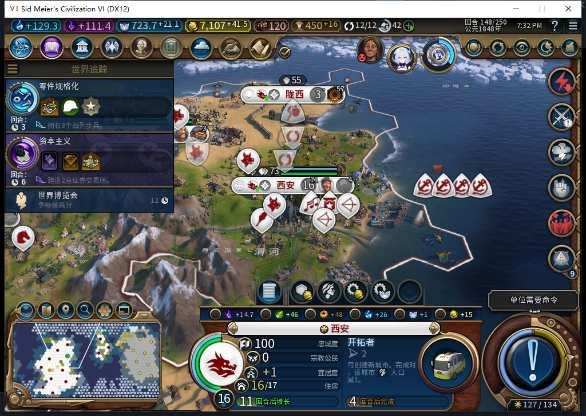
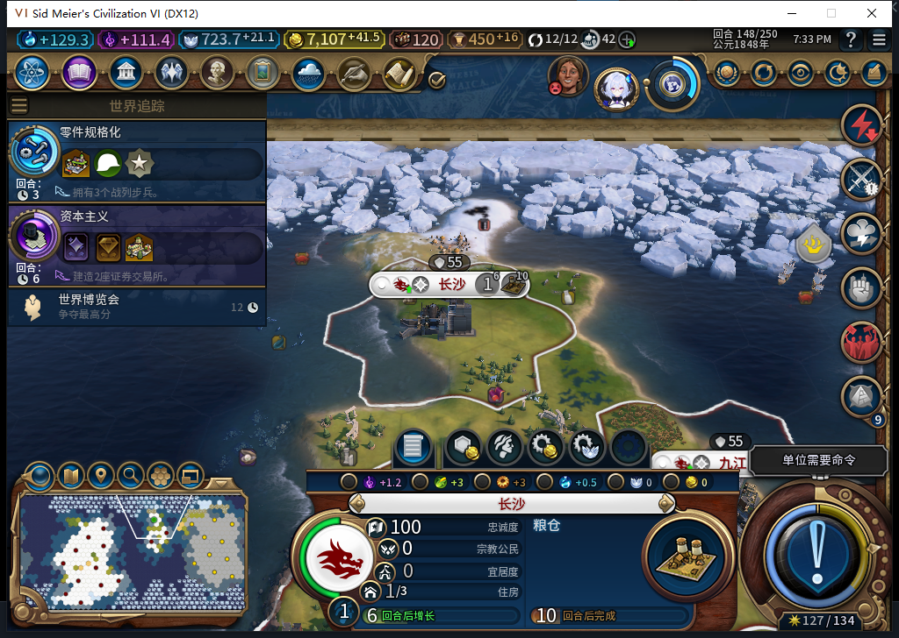

# 82冷启动与空日志读回：尚未授未决建城恢复

82已冷安装运行，93个文件与8d6b901源码一致。实际从80版148回合保存点加载，14城、55个本方单位、0个存活移民。模组自行创建合法空日志；UI和Core均完整读回version1、owner0、serial0、0条记录，跨上下文Snapshot返回READY，UI原生IsSavedGame为true。验收查询没有调用Initialize、Prepare、Commit或Inspect，也没有补写日志。

正式保存得到617488字节文件，SHA256 `3dfa0bd927d78e12b83e392b0569940e5eabacece9d117225d96803f8a2aec08`；一次普通加载、一次原版继续后，UI和Core完整返回相同世界与合法空日志，未见Lua脚本错误。**空日志也可能在加载后重新初始化；目前不能据此证明持久反序列化，更不能授未决FOUND恢复通过。**后续必须核对保存前后唯一令牌和真实世界效果。

## 这两张图显示什么

西安完整城市ID65536，148移民0/205；正常推进到149后实际85/205，当前仍0个存活移民。148由测试玩家让18名原生允许的本方军事单位普通跳过，再普通结束，实际149活动／空闲读回；没有Shift+Enter、手动移民、生产或资源补装。早先交接把65536叫作Beijing是文字误记，原生城市面板读到的是“西安”；北京是另一座城市，不能混用名称。

长沙完整ID983053、26,20、一人口，生产和市民管理入口锁定。它由先前80版自然移民建成；这张82读档图证明世界延续，不能冒充82新建城或未决恢复证据。两图均为当前自有验收窗口原始截图，只做城市查看与镜头移动，没有修改图片内容。

## 验收查询本身的一次错误

第一次82进程的综合只读查询，在读到合法空日志和READY后，把生产哈希传给了要求单位索引的进度／成本getter，随后超时；同一自有进程后来发现EXCEPTION_ACCESS_VIOLATION对话框。负责人保留原查询和回执，修正为已有合格消费者使用的UnitIndex，并拆开查询。原生内部崩溃原因没有独立证明，不把这次错误归罪于模型或直接记成模组功能FAIL。

异常对话框按正式OK处理，原进程后来确认不存在，未强杀进程、未关闭Steam或其他游戏。第二次使用完全相同82源码冷启动，精简元数据查询与正确索引查询都完整返回；异常启动不算一次稳定验收通过。

Steam首次模式查询不可用时启动被拦住，未把旧离线回执当成当前证明。分别导航官方菜单后，独立后台只读确认当前实例实际显示“上线…”才启动；确认无输入、激活、焦点变化、移动或截图。两次82启动都没有联网，工坊仍Alpha74。

模型475给出定时普通保存观察器候选，但7个隔离反例均失败：void原始返回不触发保存、丢失多返回值／nil洞、原错误内容丢失、保存异常改变原始调用、nil配置在验证前抛错、缺Snapshot及未验证日志仍保存。整稿未采用、未进实机；只保留“发令后普通保存一次、重载必须实读ARMED”的方案要求。下一步实现并验证透明观察器，再跟踪自然训练的新移民。

[原生、模型与负责人查询错误的结构化证据](../research/baiqi-p6-settlement82-native-init-evidence-2026-11-06.json)、[82软件实现及风险](baiqi-settlement-persistent-82.md)、[80已完成的自然训练—建城链](baiqi-natural-settler-founded-80.md)。
