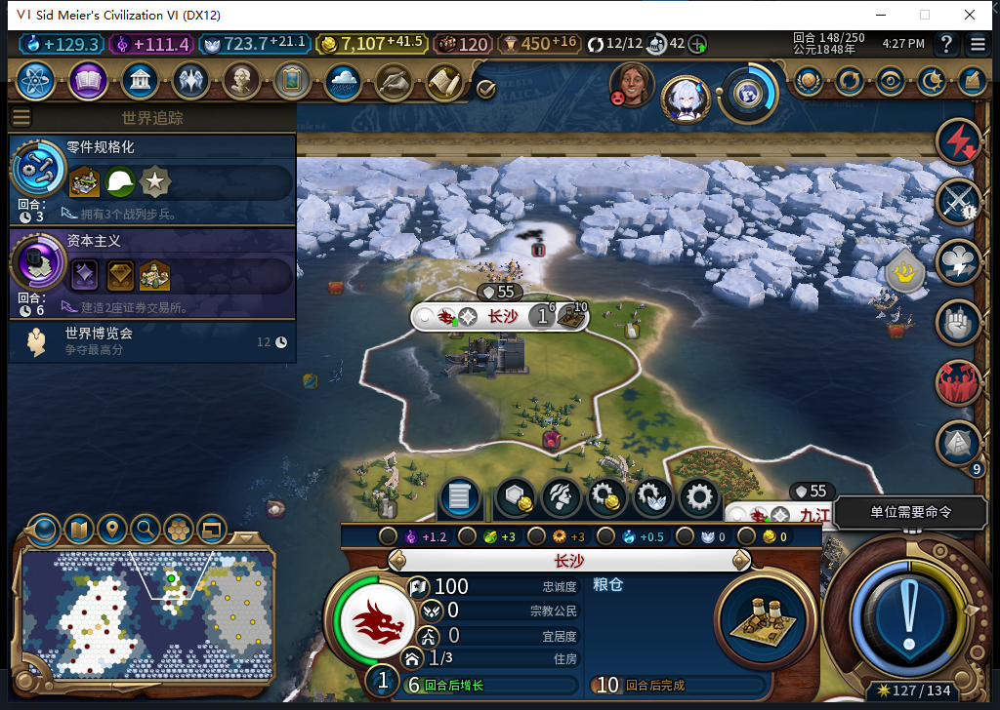

# 82建城持久授权：软件已接线，实机恢复待验

82把建城日志接入Core、前端控制器和加载入口。目标是修复“建城命令发出后丢失内存记录，读档再次发令”的风险。**本提交仅授软件通过：完整1153项检查通过60.371秒，93文件包逐项匹配源码；82尚未安装、未授原生保存或中途恢复通过。**上次实际运行仍80，148回合长沙已建成并正常生产；该验收进程已从正式入口退出，37.507秒后确认原PID／创建时间组合不存在，无强制结束。工坊仍Alpha74。

## 发令前保存，确认后观察

Core先写PREPARED，保存完整移民ID、城址空地见证、回合、请求ID及新令牌；这个阶段不能发原生命令。Commit重新核对同一活移民、行动力、单独编队和可见空地，仅在新PREPARED转为ARMED且属性回读一致时返回一次授权。重复提交、重建Core工厂或读到已有ARMED，都不会重新授权。

前端收到授权后，再核原生CanStart、当前本地回合、完整单位ID、编队、位置、空地、安全和已知边界。守卫失败保留ARMED；实际FOUND调用抛错也保留记录，其他内政继续。命令是否发出或生效不能由超时判定。

加载后从有界日志枚举恢复记录，即使原移民已经不在当前名册；不覆盖其他种类的本地未决操作。新局／旧档来源只接受UI原生getter给出的明确布尔值，缺失、异常和字符串不会变成“新局”。旧档没有日志时，既有移民标记LEGACY_UNKNOWN；已存在日志不会被false标志清空。

## 什么才算完成

观察要求同时满足：持久记录有发令前的空地见证；目标格现在可见，原生地块、城市及本方城市查询都给出同一完整ID／坐标／所有者；原完整ID移民有可核对的消耗形态，或原始查询确为nil且有界本方名册也无该ID。曾看见外国城市则持久锁存冲突，以后占领它也不能改记为原建城成功。

80实机曾出现两种不同状态：147回合Core仍列出原移民，但它处于-9999、延迟消耗状态；148回合旧ID却指向另一名商人。82软件分别处理，商人别名仍是未知，不能当作单位消失。两个事实读取组件共62个隔离场景，持久协议43个场景，前端另16项恢复／写前拦截回归；这些数字不是新增游戏验收数。

上图为已发布证据的80实际保存点，82接下来从这个保存点冷加载。新局首移民、旧档有移民时的未知迁移、真正未决命令重载以及日志原生保存仍需实测。

## 目前会卡在哪里

- 授权确认丢失、ARMED后最终守卫失败、永久单位ID别名或效果证据不足，会让对应移民持续等待；没有安全的超时重试。
- 旧档缺日志时，现存移民保持LEGACY_UNKNOWN，可能停止这些单位的扩张。不能以清日志、手动内政或重发命令冒充修复。
- 日志最多256个历史完整单位ID，尚无回收规则。
- 80的九格已知边界规则仍是保守启发式，不能保证忠诚度；78历史自由城市丢失仍记FAIL。
- 跨上下文表返回、Core属性序列化、UI新局false来源及中断窗口尚未取得82原生证据。

模型471被3200token截断，原件未拼接采用；472缺end不能编译，负责人补语法、无主地块-1及第三返回值后部分采用，语法修复后原稿仍有2个合同反例。473整稿拒绝：字面消费者9个场景失败，另外兼容接收者的诊断还揭示缺失／异常枚举或查询会误报ABSENT；这不等于原生错误参数实验。474提出超时清待决和缺城市时放宽证明，均拒绝，保留上面的真实等待风险。

首次完整检查1151项有14处旧Executor测试桩接口错误；补桩并增加2项原生布尔值来源检查后，本轮完整1153项通过。测试过程、负责人测试工具修正及模型成本分账保留在[结构化证据](../research/baiqi-p6-settlement82-persistent-software-evidence-2026-11-06.json)。[81未接线组件](baiqi-settlement-storage-81.md)、[80自然完整链](baiqi-natural-settler-founded-80.md)。
