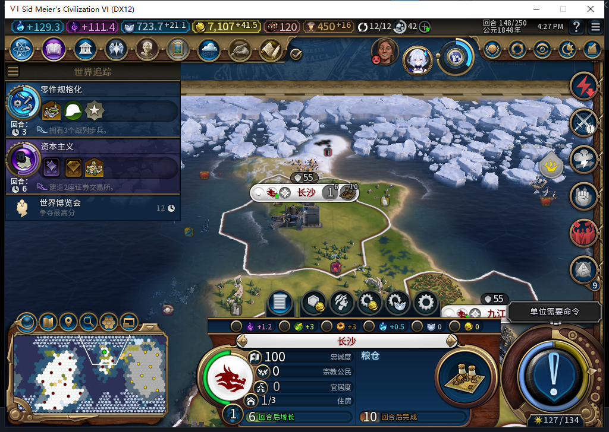

# 80建城中途恢复：接口边界已核，持久协议仍待实现

长沙建城完成后，148正式读档已经保持城市、粮仓3/32和金币；它没有证明“建城指令结果未确认时重启”可靠。80的pendingUnits及空地见证仍只在UI内存，本轮继续核对持久恢复需要的接口，没有改产品或热注入游戏功能。

现有成功判据需要写前空地见证、同址精确新自有城和原移民消耗共同成立。只有“城在这里”或“移民不见了”都不够。147实际Core还保留离图延迟对象，148旧查找返回另一完整ID商人，完整ID判断不能省略。

本地模型467给了协议候选，但用城市存在或单位消失就可变OBSERVED／CONSUMED；还缺持久空地见证、外国城冲突锁存、缺失演员记录枚举及可靠迁移。把旧80存档缺日志直接初始化为空，不能证明旧命令从未发出；只看重载后的UI pending也找不回已经丢失的内存。整套协议未采用。

468只读探针候选也未运行进游戏。Lua53可解析，但隔离验证发现依赖不存在的全局unpack、直接索引可能缺失的PlayersVisibility，并给实际声明为点调用的静态函数增加接收者。在严格软件合同下，6次静态调用都参数错、0次读到IsCity。此结果不是在游戏里试过错误参数；原稿0实机执行、0产品采用。

负责人另写有界只读探针，先在UI确认两格当前可见／已探明，再到Gameplay读取18个标量，错误／未知均0：

| Core实测 | (25,19)，861 | (26,20)，906 |
| --- | --- | --- |
| 所有者 | 白绮0 | 白绮0 |
| IsCity | false | true |
| CityManager.GetCityAt点调用 | 成功返回nil | 精确自有城983053，坐标／归属一致 |
| IsVisible／IsRevealed | 均true | 均true |

这次两格的原生Plot／City返回table；探针保留对象在本地，只输出有限标量，没有导出Native对象、扫描外国城市清单、写属性或注册事件。单个已知场景的getter通过，不等于新协议有了动作授权。

另读当前自有商人的Core方法，行动力0、编队数1可用；GetPlotByIndex(906)也与长沙一致。CityAddedToMap／CityInitialized事件存在，但参数签名、触发顺序及能否作建城关联证据仍未资格，不能直接照名字使用。

初始化发现了实际上下文差异：**Core的GameConfiguration.IsSavedGame不存在**，受保护调用只能保持未知；UI同名方法在当前148读档场景实际为true。不能把Core缺方法当false／新游戏，也没有从这一次true样本授新局false通过。未来接入须明确UI新局／读档信号和Core持久确认的职责，旧档未知记录不清空，新局首个移民还须独立测试。

467／468均完整stop／DONE／合法JSON、各1次HTTP、无重试，整稿未采用。第一次467准备脚本在POST前因负责人缩进错误终止，修正后才实际请求，不计模型传输失败或HTTP重试；两次真实POST并未重叠，实际峰1。后续469纯数据helper候选另账，尚未进入产品。

本轮没有结束回合、重发建城、改生产或写游戏属性。当前仍80、148稳定保存点；0 Steam上线／上传，工坊仍Alpha74。完整1130项软件检查沿用上一产品提交，本轮三项隔离反例不算三项游戏验收。下一步实现严格持久日志及恢复入口，再测旧存档、新局首都、未发指令及已发未确认等窗口。

[结构化候选、隔离反例、Core／UI资格及限制](../research/baiqi-p6-settlement467468-recovery-contract-evidence-2026-11-06.json)、[长沙完整窄链及148正式重载](baiqi-natural-settler-founded-80.md)。
