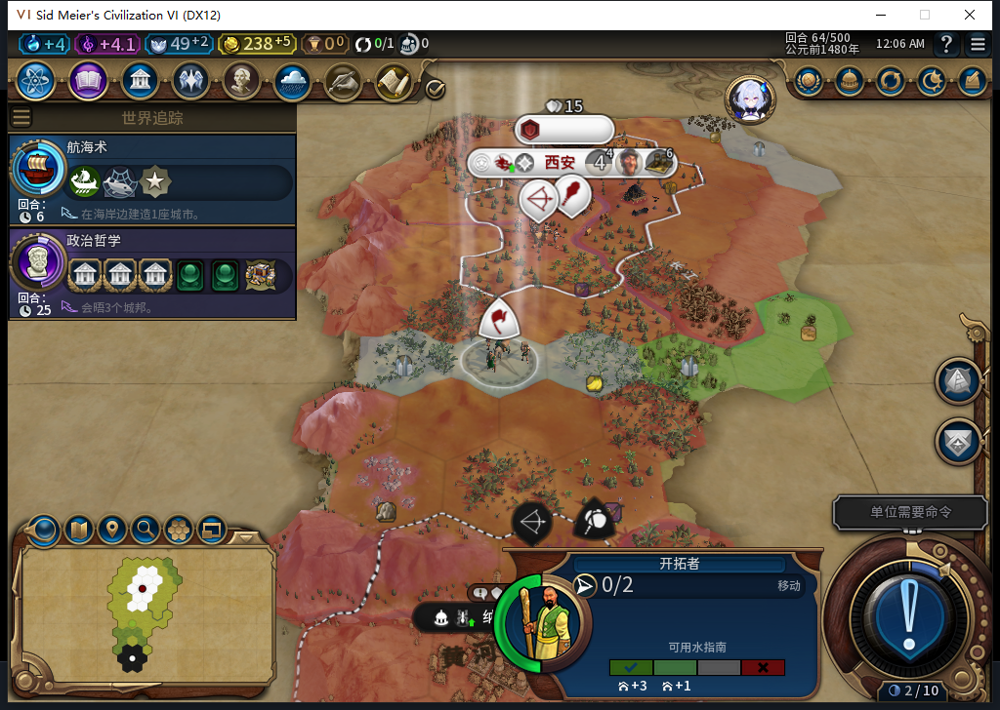
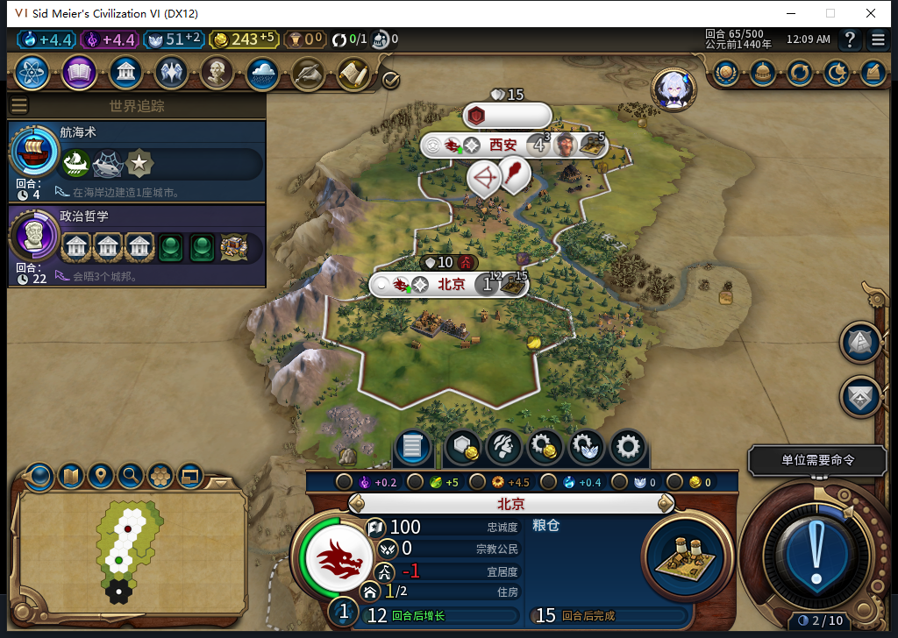
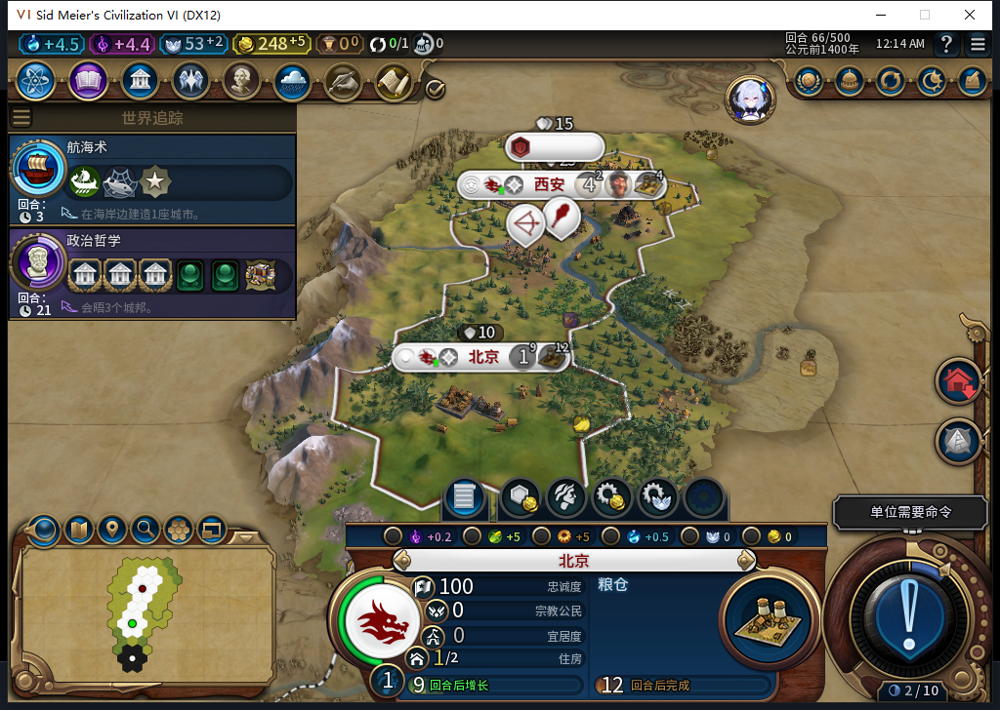

# 83实机：第二城北京成立，完成状态重载保持

83从原82第56回合私人存档冷启，使用同一名自然训练移民393216，没有赠送、揭图、目标注入或文职输入。测试玩家只处理可见交战蛮族、军事待命与普通结束，共推进10回合。

61移民自行走出首都至59,29，62早读仍有原生排队目的2132；63已走到59,27，不能把早读当永久卡死。64继续到59,26，行动力0；此后的完整3条原生推荐已没有1983。推荐是在移动后读到，未在原生派发瞬间原子采样，因此本次授自主行军结果，不把它单独当作旧推荐消失先后顺序的完全因果证明。[83条件分支软件回归](baiqi-settler-target-continuity-83.md)独立成立。

65后台一次FOUND_CITY建立北京131073，人口1，归白绮。原移民完整ID的日志已OBSERVED／settle:0:2，新城自行排粮仓0/65。Core短暂保留同完整ID的离图延迟对象，与新城／日志联合核对；没有把别的单位槽别名当作原移民。

66北京粮仓5/65，首都粮仓38/65，余额248。全钩精确撤下后正式保存1126483字节，SHA256`c8a27cdc4b8fd57466ee4a6e8d26d1612b88fc4b326f0b2dbf4e259c67b4dae7`。正式加载、继续后，UI／Core均保持两座城、人口4和1、余额、队列进度、两支原军队与两条OBSERVED记录；所有诊断为空，私人存档不上库。

未来原生寻路观察器共12调用，其中8条属于目标移民，返回路径长5、5、5、5、5、4、3、2；没有额外寻路或行动。财务观察器270样本完整读回：254招募资格、2城市、14文职操作、0单位命令，错误／丢样0；军事请求只在此Executor范围为0。FOUND一次，其后同移民还有一次SKIP请求，其745019656实际来自GameInfo行，不在枚举表；原请求0返回值不能当成功布尔。真实效果以独立世界读回为准。[全部指纹与范围](../research/baiqi-p6-source83-native-and-goals498500-evidence-2026-11-08.json)。

本轮只授同一自然训练演员的行军、建城、新城接管与完成状态存读档窄通过。人口成本4→4仍未解释；跨读档行军目标尚不持久化；ARMED中途保存、旧档等待FAIL和完整40项仍开放。Steam／GitHub公开Alpha2保持82／12图，83未再上传。

模型498没有解决计划持久化而重复FOUND交易；499原稿18合同10失败且没导出全局，负责人私有schema原型18通过；500把每玩家可见性API当全局方法，实际Core全局为nil，构造器隔离检查即拒绝，另有护送／目标编号／读回比较缺口。三稿均未入游戏。Nov8首次500调用前由canonical共享入口新鲜检查OpenCode1.19.5，无需更新；维护不授生成能力。累计500任务／465完整stop／32length／3最终transport／530HTTP，额外重试30，未知成本null。
