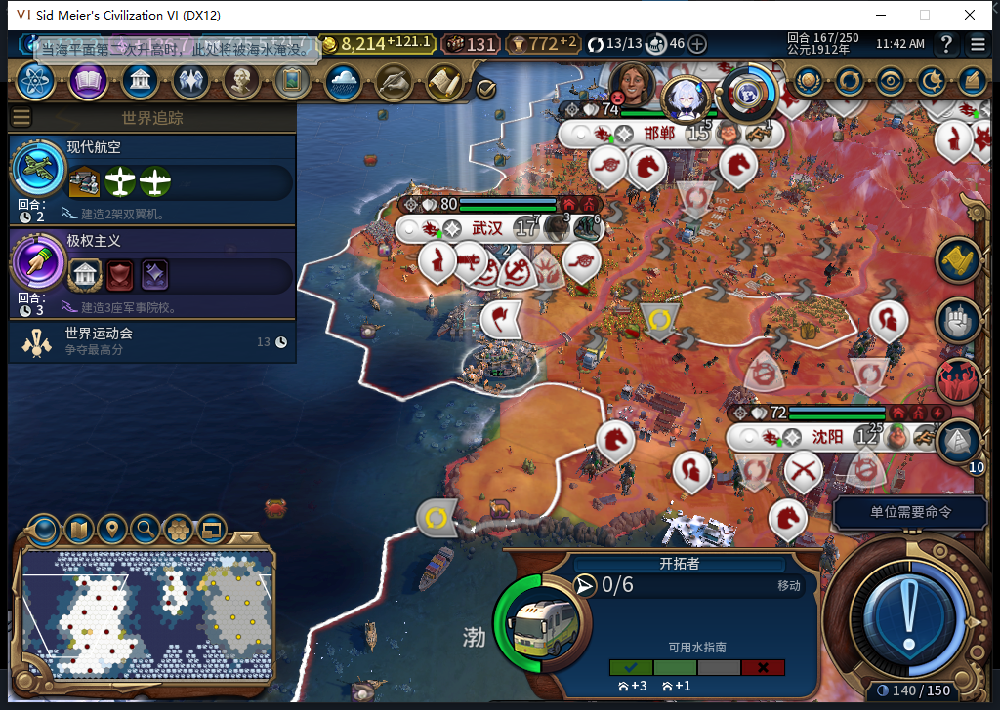
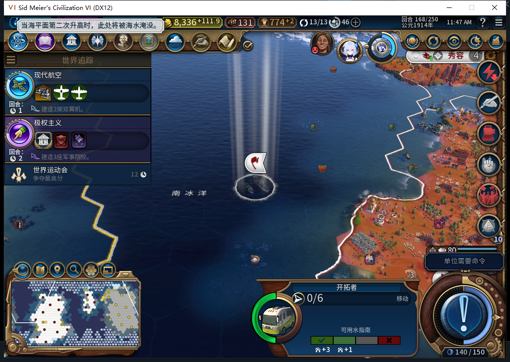
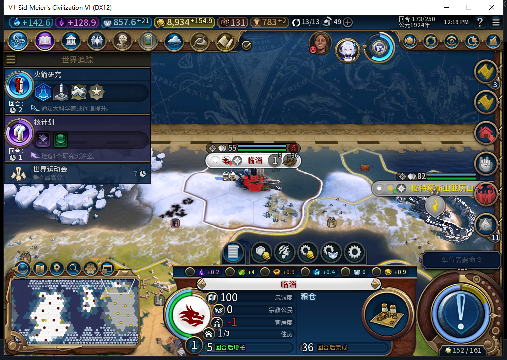
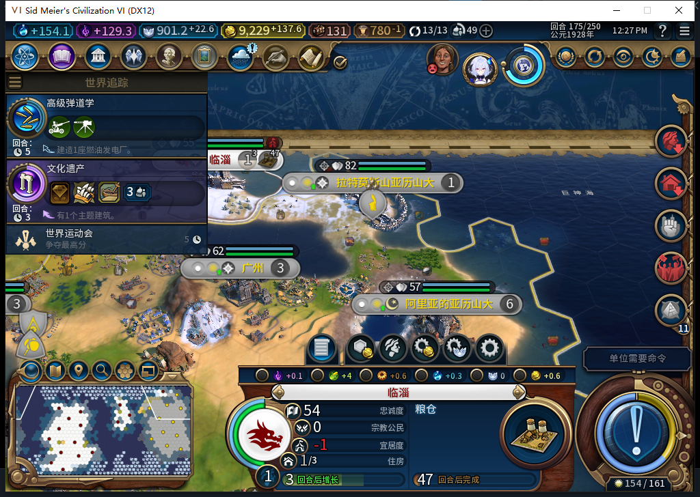
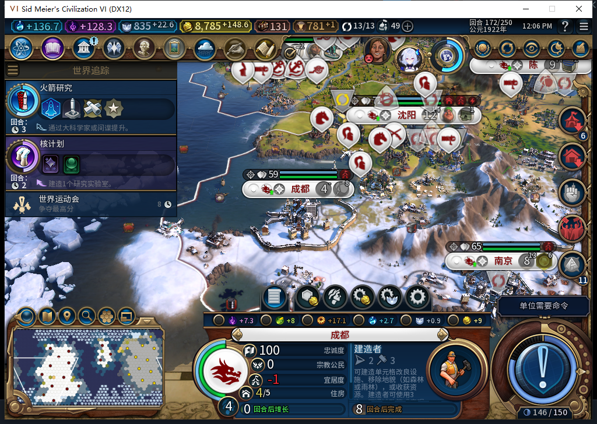
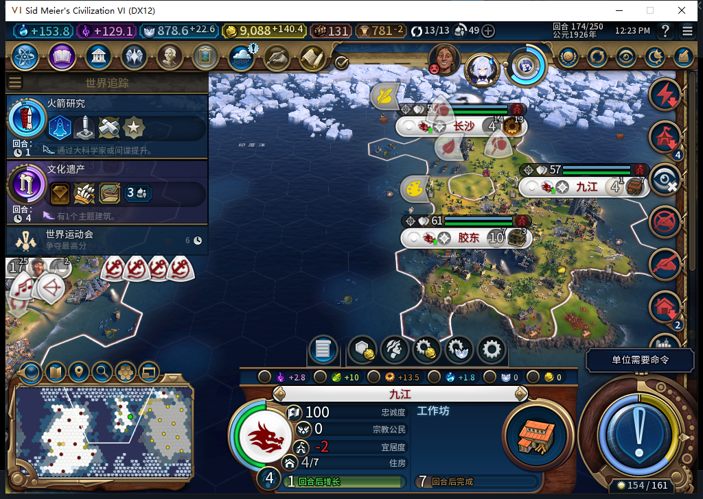

# 78同档实测：绕过先知、远行建城，也暴露忠诚风险

后续普通回合已确认[178临淄实际叛离](baiqi-new-city-loyalty-loss-78.md)，不是仅有预测风险。下文175切点证据保留，绕行／建城／初期生产／读档窄通过不授长期保城；选址质量记实际FAIL。

78已经在77保存的真实167现场完成绕行：移民没有挪走挡路先知，自行走向同一推荐城址，173建成第16城临淄。175粮仓产能确实增长，正式存读档后城、生产和两个新完工区域保持一致。**本次占格故障的窄链通过，完整扩张仍未通过：新城每回合忠诚−23，而且模组建城完成回执存在缺口。** 工坊仍是Alpha74，此处均为78开发版实测。

## 从堵住的一步走到新城

同一移民9764928在77正常训练160、出生164，原167位于(9,8)、2行动。原路首步(8,9)站着己方先知5111847，77连续等待。保存现场后安装78，87文件与产品提交eaad727e73474e9be107295145a20ab5992a79e2一致，冷加载同档，没有移动阻塞者或代做文职。

167后台改走相邻(8,8)水格，行动2→0；原先知仍(8,9)，两支原侦察兵位置也保持。启动阶段SDK调用总数未知，这些具体位置不能扩大为全军／全上下文零命令证明。

168到(4,13)，随后沿海并跨地图接缝继续前进。171最后一步到(37,24)的请求仍在排队，172没有重发；173才收到原移动观察，再实际发出一次建城。后续路径每步重新规划，不能把最初27点线路写成全程固定路线。

173原生单位调用观察器记录1次FOUND_CITY。UI／Core随后都确认临淄1114127归白绮、(37,24)、人口1，城市15→16；旧移民查找缺失且自有完整单位清单中为0。原来早于建城的173快照仍15城，不能用回合就绪就假定后台已经完成。

AI在173自行排普通粮仓，0/32；174仍0/32，175达到1/32，粮食0→1.703125→3.40625。这是原版建筑，不是已删除的粮仓经营权。城面板生产／市民管理控件保持禁用，测试玩家未手选生产。

## 两处区域走完建造链

成都589832的港口3407922位于(6,3)，77人口增长恢复名额后162自动放置，78运行到172原生IsComplete=true，AI接着训练建造者。学院并未因此建成，容量重新满时仍拒绝另加学院。

九江917516的工业区3211311位于(28,16)，77的156开始建设，78到174确认完成，下一项工作坊。两处均有实际完成事件、UI完整ID／完成标志与Core地块ID／类型／归属交叉核对。原生完成事件各重复送达两次，只按一处区域计。

175清理全部观察器后正式保存675586字节，SHA256 dc041a95d2b6fa6c11e7ee0fa22b9aaada16e3d43f4b2d5fb7a304d745cc00ad。正式加载一次并继续，实际活动回合仍175，UI／Core均16城、金币9229.44921875，临淄ID／坐标／人口和粮仓1/32保持，两个区域仍完成。私人存档不公开。

## 仍然存在的问题

**选址的忠诚风险已实测成立。** 175原生读回54/100、每回合−23、预计3回合后叛离；附近公民压力−20、幸福感−3。17项压力来源完整读回，0错误／截断。第一次16项上限确有截断，原件保留，之后提高到32上限才得到完整17项。这里尚未声称叛离已经发生，也没有手动派总督、挪军队或补属性保城。

当前代码沿用原生推荐排名，并自行检查探索、地形、归属、已知城市距离与可见威胁，没有独立忠诚筛选。不能据此猜原生推荐内部完全没有忠诚评分，但这个实际候选确实不适合无干预长期保有；选址质量要继续修复和复测。

**建城的模组回执未闭合。** 实际新城、移民消耗和生产已证明，但请求0:173:193日志仍为unit_request_not_observed／unit_unavailable。单位消失本身不能证明成功，也不能用这条日志否定已经读到的新城。当前没有重发FOUND，没有伪造observed。模型461修复原稿错用kind／operation字段，且缺少请求前无城证据，已拒绝，待另作最小修复。

移民是77训练、78完成路线／建城的混合链；继承存档含已披露历史测试单位，不是完整78新开局或平衡验收。需要等距离绕行／后退的障碍、护送压力、长期扩张、科技独立恢复及完整TC-009／015／017仍未补齐，全部40项没有改成通过。

## 调度与环境边界

启动后两个连续单位窗口分别34次（目标移动6）和180次（目标移动18、建城1）；两窗非文职、未知、错误、溢出、匹配错误均0，启动前SDK次数未知。城市窗口23次BUILD，包括5次单位生产，其中174野战加农炮和反坦克组2次军事生产；训练军队与指挥军队分开。43条原生事件、0错误／丢弃；原派发函数精确恢复、3个事件移除，读档后观察器全部nil。

全部结束回合走原版普通入口；173 AI回合的亚历山大来访由TEST_PLAYER实际拒绝停止定居承诺并告别，随后回合到174。没有后台外交／军令、UserForced、人工文职补单或未知动作重放。

冷启动前取得当前Steam后台只读离线证明，距启动0.002295秒，本轮0上线／0上传。旧77自有进程正式退出、关窗后441.68秒仍残留，保存哈希核对后仅终止这一自有测试进程；Steam及其他游戏终止0，不授干净退出通过。两个加载中Continue守卫拒绝均0输入，后来新鲜继续按钮匹配才输入一次。只读Core脚本曾错用UI方法，失败原件保留，依据已验证Core接口修正后重新读回。

模型461／462均完整stop／DONE／合法JSON、各一次HTTP，无重试；原稿均未直接进入游戏／产品。462只采用实际原版忠诚API参考，负责人补了归属、完整ID、可见性、有限来源及错误检查。累计462逻辑、430完整、29截断拒绝、3最终传输失败，HTTP492／额外重试30；新OpenCode原生生成0，未知缓存和成本保持null。

[结构化证据与原件哈希](../research/baiqi-p6-detour78-native-founded-and-loyalty-evidence-2026-11-06.json)、[78软件修复及1084项检查](baiqi-settler-detour-78.md)、[77原始阻塞现场](baiqi-settler-occupied-detour-gap-77.md)。
