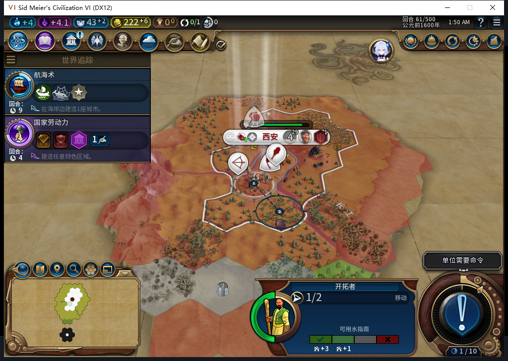
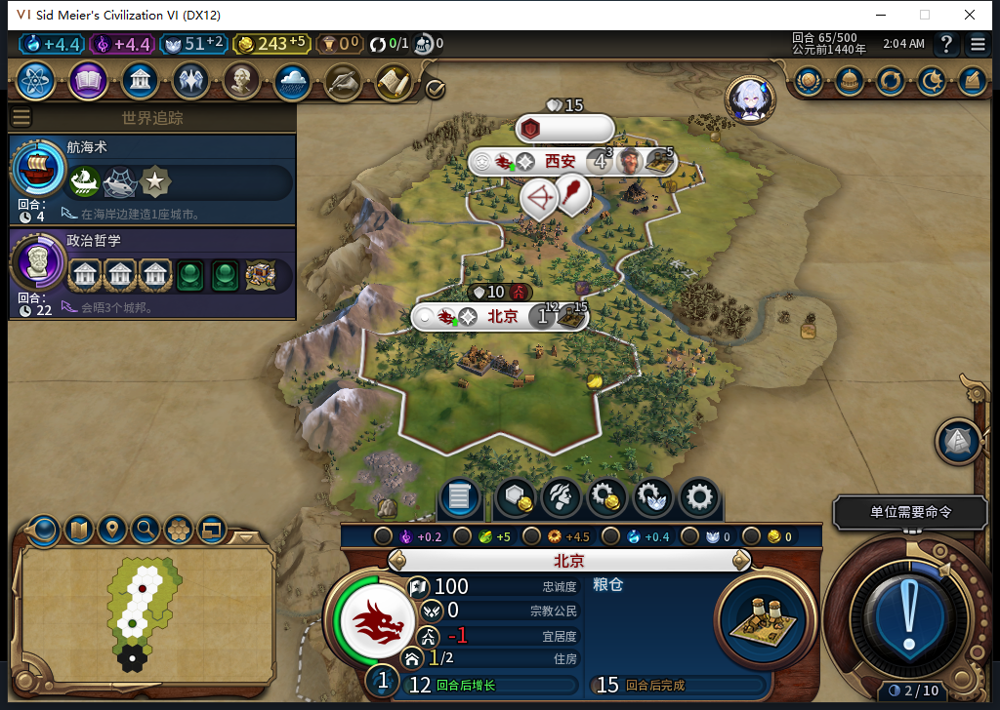
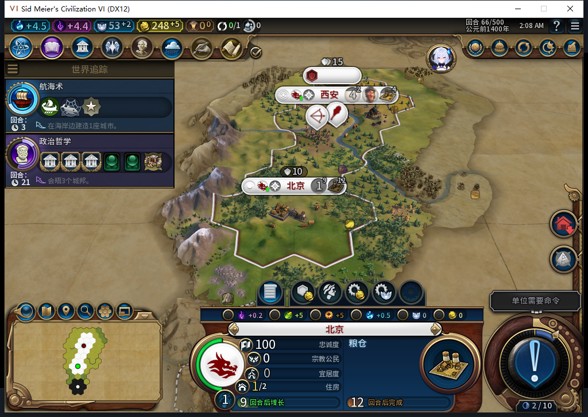

# 85实机：读档后继续行军，自动建城并清理目标

84保存的第61回合交给85冷读：移民393216在59,29，行动力1，原生队列目的2132；独立计划仍为1983／59,26。建城日志只有首都成功记录，没有把行军计划当作已获准FOUND。原生接口实际返回一个编号或一个nil，与85守卫相符；nil仍不能证明所有引擎队列都为空。

未来观察器安装后，第62回合早读仍有旧队列；此观察窗口没有向该移民提交新请求。随后63自行到59,27，64到59,26且行动力用完，目标仍为1983。测试玩家共做5次普通结束和10次军队待命，没有移动文职、指定生产、注入目标、赠送或强制结束。

65后台一次FOUND建立北京131073，人口1，自动排粮仓0/65。独立行军计划清空，建城日志保留OBSERVED／settle:0:2／request0:65:10，两个记录各司其职。原移民在Core短暂为离图延迟对象，完成态重载后消失；城市ID与军队ID同为131073属于不同命名空间。

66新城粮仓5/65，首都38/65，余额248。撤下全部观察器后正式保存1126552字节，SHA256`0f7511f8233dc41f3b6bf9a8db10c80bd5815508bb4fd9f4b868383a58aa76c9`；正式读取、继续后，UI／Core保持两城、人口4和1、生产进度、余额、两支军队、成功日志。空的嵌套行军计划表也保存下来，没有恢复旧目标。

观察范围为安装后的原Executor调用：266条全部读回，含254招募资格、2城市请求和10文职操作；一次FOUND、一次移民SKIP，错误／丢样0。原请求零返回值，不当作成功布尔；效果由世界读回确认。路径观察器6次原调用中3条属于目标移民，路径长4、3、2。没有额外寻路或行动，也不把这个范围说成全局零军令。[指纹与完整范围](../research/baiqi-p6-source85-native-and-population504-evidence-2026-11-08.json)。

存档前检查曾误用Core专有校验函数，尚未调用保存便停止；负责人改为UI自身数据检查，另立v2意图，原失败记录保留。加载中几次继续按钮资格检查没有输入，LSQ超时没有发CMD；实际继续只执行一次。

本轮授84真实计划升级冷读、保留原队列、自动行军建城、清目标和完成态重载窄通过。ARMED中途保存恢复、旧档等待FAIL、人口成本及完整40项仍开放。人口观察器候选504虽编译通过，但隔离运行零注册却打印“installed”，还发明Players.GetLocalPlayer、丢nil参数孔；已拒绝，未入游戏。累计504任务／469完整stop／32length／3最终transport，534HTTP／额外重试30；OpenCode新原生生成0、未知成本null。

GitHub和Steam Alpha2仍为82／12张实机图，85尚未发布；本轮Steam持续离线。

## 后续人口成本样本

[另一个85分支](baiqi-settler-population-cost-native-85.md)已记录51出生时4→3→4与粮食33→2，补得1人口成本和出生态重载窄通过。它与本篇queued61→65建城并非同一分支，不因393216相同拼接历史；旧恢复FAIL和完整40项继续。
