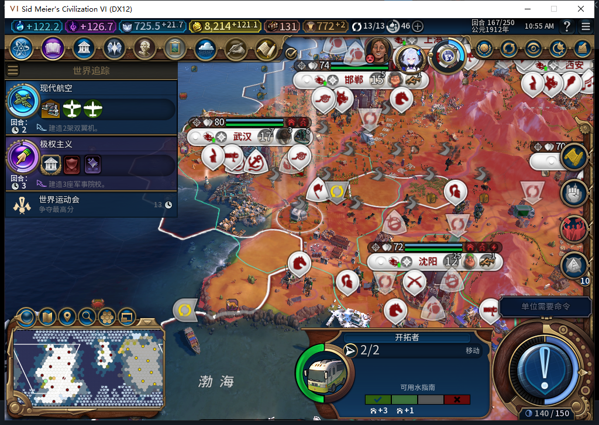

# 77版移民完成训练，但同一城址绕行仍有缺口

本轮没有授予移民建城通过。77版正常训练的新移民164出生，165—167在(9,8)等待。实测发现唯一通过地形和已知城距筛选的推荐城址有27点原生路径，首步被己方先知占格；77会拒绝该步并寻找其他城址，尚不能绕过占格继续前往同一城址。邻接处有原版允许进入的空格，但完整绕行、后续建城尚未验证，正在修复。

## 训练与出生已核对，不能当成建城

160沈阳13人口时后台实际提交UNIT_SETTLER，原版两种生产资格均true。164原版完成事件的单位行号为0，同时新增完整ID9764928、UNIT_SETTLER，从沈阳(11,6)出现，城市人口13→12。整个训练阶段运行77，区别于此前76训练／77路线的混合版本样本。

另一处南京同回合训练出的9830465为建造者，不能把其单位行号2凭旧印象认作移民。165及167通过UI／Core分别核对9764928：归属白绮、移民、地图内健康、2行动力、无护送、无排队目的地。没有因为单位数量变化就猜建城或消耗。

## 为什么停在这里

167只读原生AI推荐实际返回2点。1093(37,24)已探明且可见，是无地貌的无主陆地，距已知城市超过3格；1052(40,23)有受保护地貌而被过滤。这只能说明当前推荐中的候选，不能据此宣布整张地图没有其他城址。

到1093的原生路径共27点，首尾与当前单位、目标一致，未超过48点限制。逐点核对已探明、归属为己方或无主；每点半径2内只查询当前可见的普通／宗教两层单位，实际0敌方威胁、0读取错误。没有直接调用模组私有Safe、PathStep或规划器。

路径第一步404(8,9)有己方先知5111847，属于普通文职编队类别。原版移动资格仍true，模组的占格守卫因此很必要；但守卫拒绝后没有给同一城址寻找替代首步。目前邻接360(8,8)是可见水格、无普通文职占格，原版允许进入，并与原路径后续403相邻。这里只证明存在可走的相邻格和重接线索，不能把后续所有边的通行资格先写成通过。

165安装至167清理的连续单位观察：51次后台请求，目标移民0移动、0建城、2次待命，其他49次；非文职、未知、错误、溢出均0。另有北京建造者与陈城研究实验室两项城市排产，其他内政继续。该计数只覆盖BaiqiExecutor，不能扩成全游戏上下文或早先164启动移动次数。

## 保留现场，继续修复

未移动先知、军队或移民，没有改人口、地形、生产或未知回执。精确恢复单位和城市派发函数、移除3个事件后正式保存167：652585字节，SHA256 068e8b9f43abe30edf1636a293411e5a9cfc33fc666e50c5b96ab43da0943f86。15城、金币8214.828125，移民仍在原位置。私人存档不公开。成都港口108/187、九江工业区96/177仍未完成，武汉水上乐园已完成。

模型456—459四份均完整stop／DONE／合法JSON，代码正确性另审：456把pcall状态布尔值当数组读取；457引用私有／未定义辅助且漏有界与城距；458助手声明顺序与未定义ctx等导致实际隔离运行失败，459缺失对象o且没有行为断言。原文均未进入游戏或产品。负责人保留原生接口与身份分类，另补一个隐藏目标守卫，未知不会伪装成城市不存在。

下一修复限定移民、限定“原生首步被己方文职占格”条件：有界检查已知安全替代步，与原目标保持可检的进展及路径重接依据，第一步必须真实原版资格，并保留写前重验、护送拒绝与军队隔离。修复、回归及冷加载实机尚未通过；不能把方案写成78已完成。

当前产品仍77，没有产品代码改动，既有1064项软件通过未重跑。完整TC-015和40项保持部分；Steam离线、0上传、工坊Alpha74未变。[结构化诊断、计数、模型反例与原件哈希](../research/baiqi-p6-settler456459-native77-occupied-detour-gap-evidence-2026-11-06.json)。
