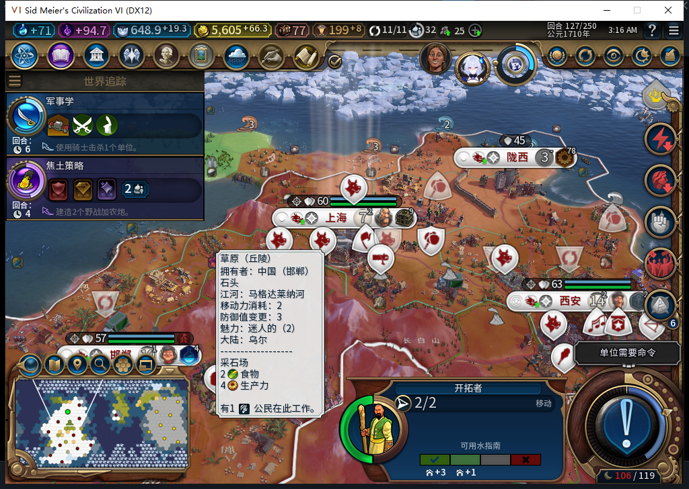

# 77修复：移民遇到文职占格后继续尝试其他城址

第127回合实机发现，76版新训练的移民停在上海内，仍有2行动。首选城址的下一格被自有建造者占用，派发时正确拒绝移动；但规划阶段没有排除这条路径，随后直接待命，没有尝试另一个已探明、安全且下一格空闲的城址。这是本轮自动扩张FAIL，不能用已通过的训练和人口成本抵消。

| 独立读回 | 首个可用城址 | 可用替代城址 |
| --- | --- | --- |
| 目标 | 28,17，地块776 | 10,19，地块846 |
| 与已探明城市最短距离 | 4 | 4 |
| 原生路径长度 | 18 | 5 |
| 下一格 | 14,16，地块718 | 12,17，地块760 |
| 下一格文职占用 | 建造者6291501；另有侦察兵1114120 | 无 |
| 路径视野、边境与可见威胁检查 | 通过 | 通过 |
| 原生移动资格查询 | true | true |

推荐列表第一条因地貌被原有规则排除；表中776是首个通过当前必要城址条件的候选。原生移动资格true不允许模组忽略文职占格。检查使用真实可见的主层和宗教层单位，没有读取迷雾单位，也没有命令侦察兵、搬开建造者或代替移民移动。

77把已有的“下一步文职占格检查”同时用于移民和建造者，让占用的路径在规划阶段返回不可用。调度器沿用已有的候选排除与跨回调继续搜索，再检查下一城址；没有放宽安全、地貌、城距或护送规则，派发前的新鲜占用检查继续保留。

新增6项真实控制器回归：76有2项失败；77全部通过，既有10项路径安全检查也通过。完整1064项检查通过，测试报告141.997秒，外层进程墙钟147.492秒。覆盖首路被堵改走替代、全部被堵待命、军队同格不误拦、资格查询后新占用仍拒绝、迷雾单位不窥读、护送编队不动。模型补丁条件经过审阅采用，测试原稿混杂Python／Lua语法并错误期待远程建城，未采用。

失败现场已正式保存，582016字节，SHA256 7203bd55dbe94437691d405791887203bf27c309415e69550a12826b2e2bf6d2。临时观察绑定已清除，自有76游戏按正式入口退出；252秒后仍留下无窗口、无监听、2秒CPU增量0的自有进程，原因未知，不能算干净退出。Steam和他人游戏未动。

本页交付时是77源码／软件通过，安装仍76；77冷启及同一保存点复测尚未完成。接下来继续验证这名正常训练出的移民能否选替代路线、实际建城、被消耗及存读档保持，不授TC-015全链或完整40项通过。工坊Alpha74未更新，Steam保持离线。[结构化证据和模型审阅](../research/baiqi-p6-settler436437-occupied-route-source77-evidence-2026-11-06.json)。[此前正常训练与人口成本](baiqi-natural-settler-training-76.md)保持已取得的窄通过。
