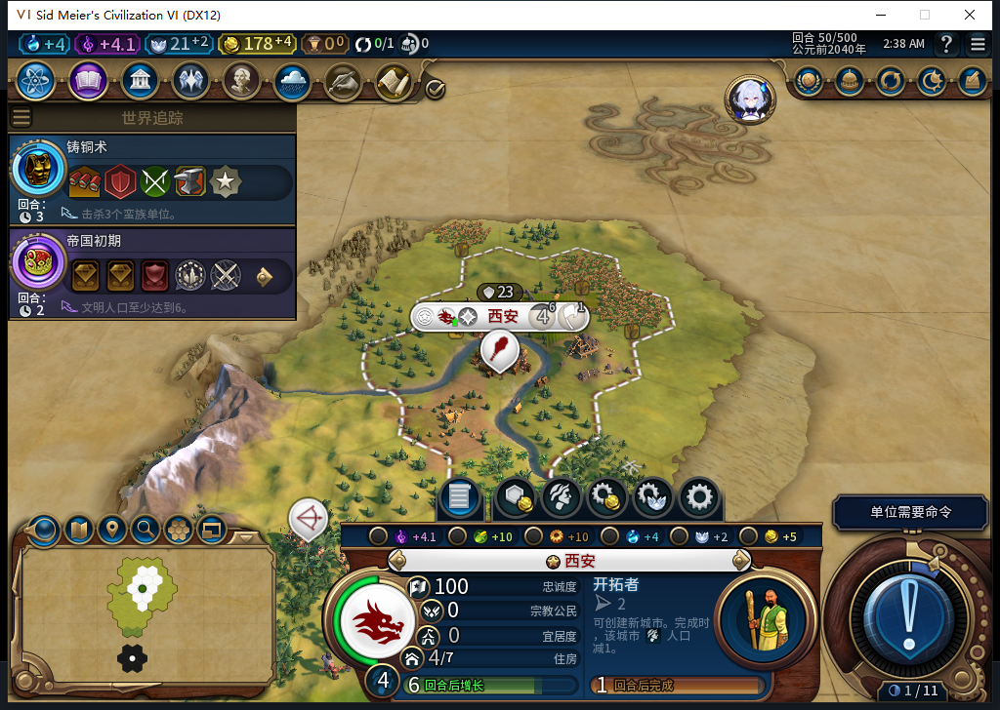
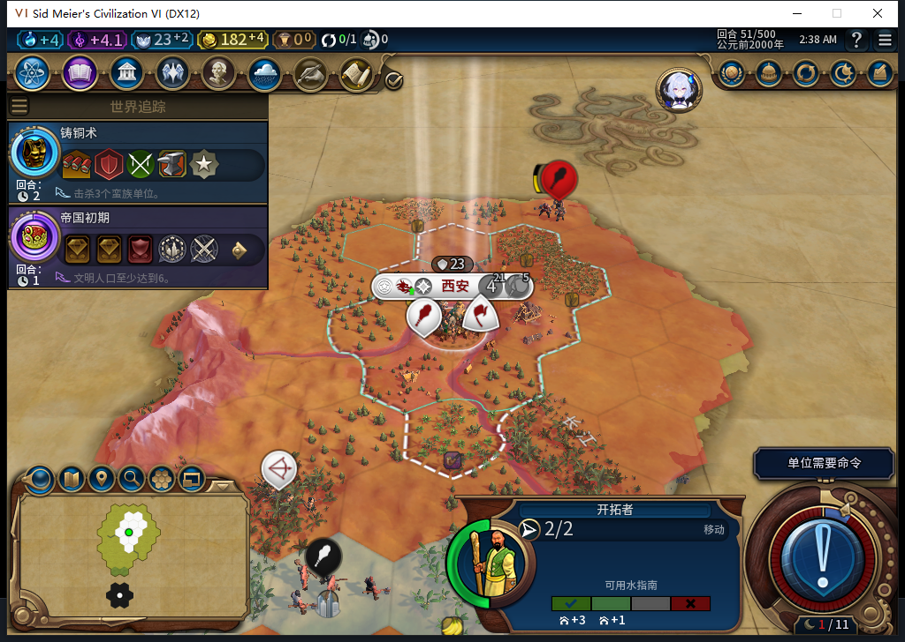
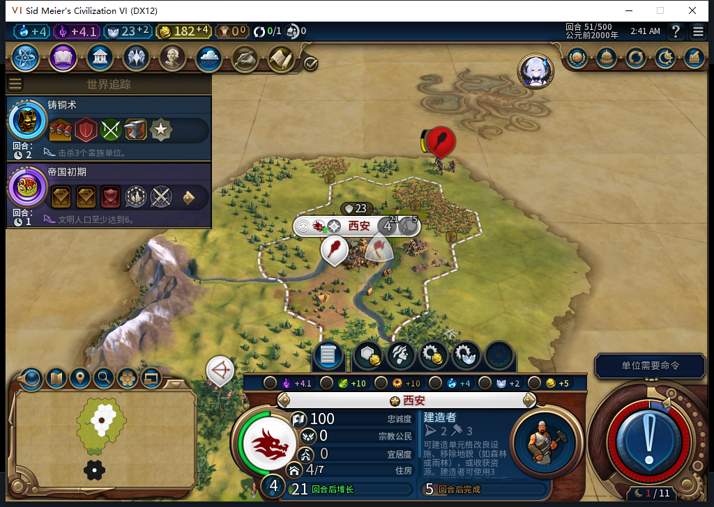

# 85实机：移民确实扣人口，4→4来自同回合增长

第50回合仍是4人口，第51回合移民出生后也是4人口，单看两张截图无法判断成本。本次从已核验的82第38回合档载入85，用只读事件观察器记录训练完成窗口。

这是一条新的85分支：测试玩家38、39各移动一次弓箭手，没有手动排产、文职命令、赠送或揭图。43AI自行训练移民0/80；50达到77/80，人口4，粮食33/44，界面显示6回合后增长。训练时点与旧82样本相同，军事路线并非逐动作重放。

51的回调按实际先后读到以下状态。人口列来自当时真实`GetPopulation()`，粮食与门槛也各读一次；未拿额外事件参数的猜测名称代替世界读回。

| 顺序 | 事件 | 人口 | 库存粮 | 增长门槛 |
| --- | --- | ---: | ---: | ---: |
| 16 | 移民393216加入地图 | 4 | 33 | 44 |
| 17 | 人口变化 | 3 | 33 | 33 |
| 18 | 再次人口回调，同样为3 | 3 | 33 | 33 |
| 19 | 生产完成 | 3 | 33 | 33 |
| 20 | 人口增长 | 4 | 2 | 44 |
| 21 | 回合稳定后的只读快照 | 4 | 2 | 44 |

训练完成窗口确实扣了1人口。人口变为3时，增长门槛降到33，已有33库存粮；同一回合又长回4，最终剩2粮。两个“人口3”回调没有形成第二次扣减。这组读回解释了重现中的4→4；不能再把两帧相同人口当成免成本，也没有假设总督减免。这里是回调顺序证据，不宣称看到了引擎内部原子事务；82旧现场也没有补写不存在的历史事件。

新移民393216位于首都60,30、行动力2、0伤害、未编队；城市自动接续建造者0/54。完整读出21条记录、撤除三个自身回调后正式保存1062791字节，SHA256`42a0a504397e6216d335745777955ce401650a7dd956fc6d94434d9ea096b1ad`。正式加载、继续后，UI／Core保持移民、两支军队、人口4、粮食2/44、余额182、建造者队列和首都成功日志；观察器均为空。

前一次分支把侦察推迟到47、48，因此49才开始训练、51尚为22/80，没有出生；它的13＋6条记录已分别完整读回和撤钩，未拿它授人口成本通过。两段各13次普通结束、24次军事待命、2次玩家侦察；0文职／内政／强制／赠送／揭图／交战输入。第二段共21条事件，三组累计40条，错误、未知、丢样和参数截断均0。独立观察器及延长窗口版本各14项隔离检查通过。504原模型稿仍是拒绝／0实机执行；本包没有新增HTTP调用。[完整证据](../research/baiqi-p6-population504-native-evidence-2026-11-08.json)。

本轮授85首个自然训练移民的1人口成本和出生状态存读档窄通过。它与另一分支的排队61→建城65是分开的演员历史，不能因完整ID相同就拼接。ARMED中途保存恢复、旧档等待FAIL及完整40项仍开放。公开GitHub／Steam Alpha2仍82／12图，85未上传，本轮持续离线。
