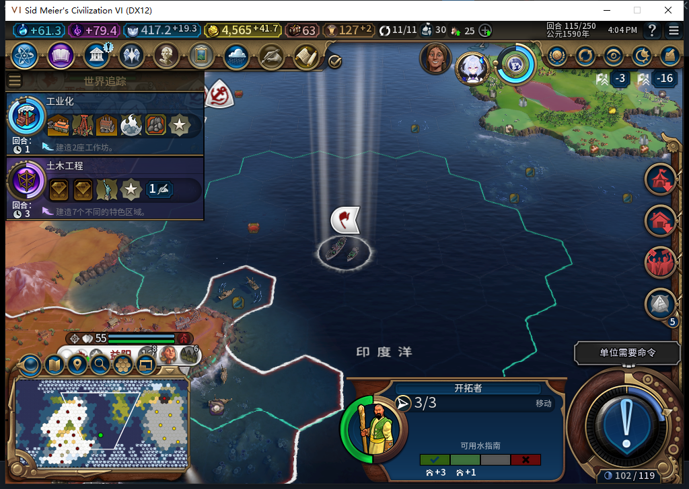
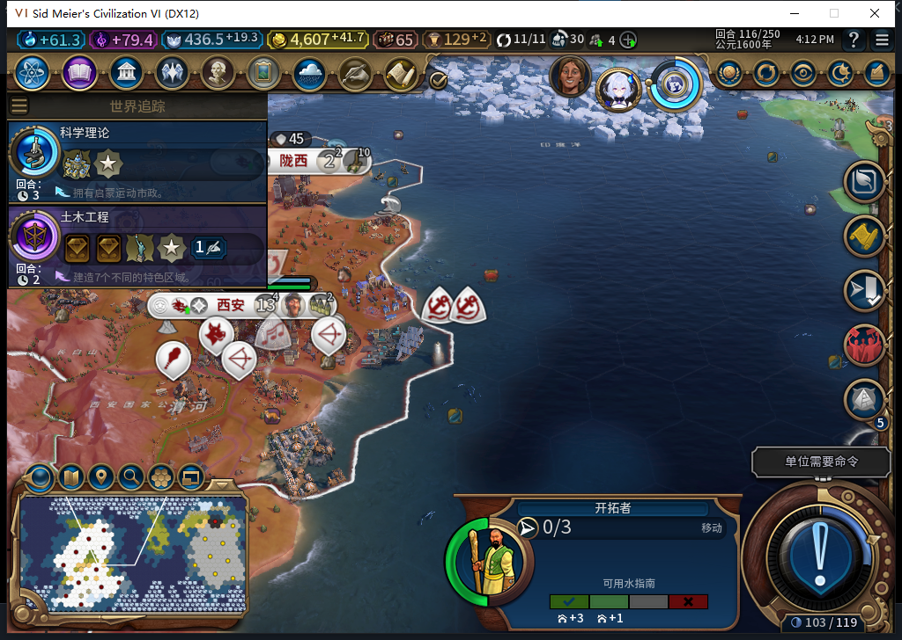

# 74版：指定移民资格被拒后的等待与恢复

2026-11-05，BF-202609141645，离线owned12052／产品74未改。从原正常Farm114开始，仅在115的BaiqiExecutor CanStartOperation资格入口拒绝移民6684713的MOVE_TO／FOUND_CITY。实机只命中MOVE_TO一次；其他对象、操作和回合透传。115移民原地待命、其他内政继续；移除钩子后正常到116，后台实际移动到23,12。本例为受控资格失败，不是自然无城址、寻路失败或实际建城通过。[结构化数据与模型410](../research/baiqi-p6-site410-refusal-recovery-evidence-2026-11-05.json)。

| 项目 | 115资格拒绝窗口 | 116撤去故障后 |
| --- | --- | --- |
| 移民位置 | 21,9／417，3行动，无排队目标 | 23,12／551，0行动，无排队目标 |
| 此移民实际请求 | 移动0、建城0、待命1 | 新增3次MOVE_TO、建城0 |
| 其他请求 | 21条文职操作继续 | 累计35条其他文职操作 |
| 非白名单／未知类型／观察错误 | 0／0／0 | 仍0／0／0 |

两个115观察点相隔94.660975秒，计数保持1次资格拒绝、22次实际请求（含该移民1次SKIP），没有无限重发。不能照候选说成“所有请求为零”或“行动与114相同”：正常新回合行动0→3，待命合法透传。RequestCivilian之前产品可能更新reservation／target，本测试未清任何缓存或预留，也不声称它们没变。

116真实请求依次到22,10、22,11、23,12，日志分别observed；没有测试玩家文职命令、属性修改或人工重放。两个正常换回合均用新鲜active／idle／CanEndTurn门内无REASON的ACTION_ENDTURN，并将ACK和后续实际回合分开；各有6个有限军队Skip／DoEndTurn步骤，不授全物理按钮矩阵。计数器只覆盖BaiqiExecutor的UnitManager.RequestOperation，不能冒充引擎全部动作或其他Lua上下文。

钩子与观察器均核所有权恢复，已另存恢复116：570337字节，SHA-256 `b4ebee87f232dd8aee7b2fc290c5281c41d64b2a2226c3b402a1604a5b711b77`。现在保留此干净分支继续真实建城观察，尚未恢复正常114；原正常文件未改。

410候选install／cleanup均Lua53编译，但install引用Controller私有PlayerContext／CoreIdle和错误unit:GetQueuedDestination，实际UI只读返回均nil；正确UnitManager方法为function。负责人重写资格范围与前态／fresh身份检查，7项隔离诊断含11透传子例通过，非新增产品测试。cleanup六行按解码候选字符串原样采用，来自给定既有参考，不授新颖性。负责人首次落盘时CRLF转换使SHA门拒绝，0NativeCMD；保留原件、恢复准确UTF8LF字节后才以新标签清理，不归模型／产品错误。

TC-013／016／036整体仍部分；本例没有实际FOUND_CITY拒绝命中、正常训练成本、自然城址竞争／模型服务中断或战略资源压力。产品及Alpha附件未改，完整软件套件未重跑。

后续：[411实际119建城及新城托管](baiqi-settler-recovery-founded-74.md)已通过此恢复分支的窄样本和正式重载；原410在116尚未建城的切点不改。之后已独立恢复原正常114。
