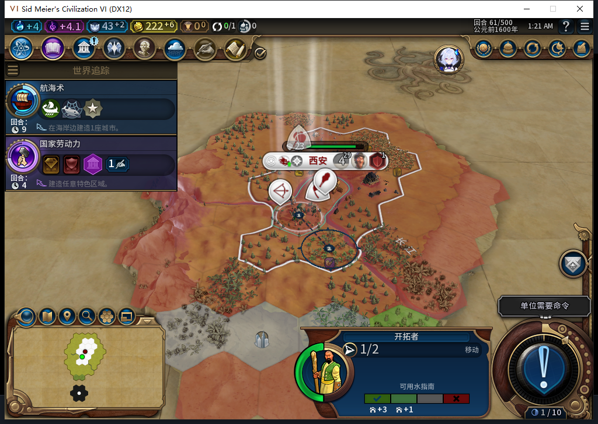

# 85：保留原生移民队列，84真实计划现场待冷读

84从原56档冷启，第61回合移民393216自行出城到59,29，行动力1，原生排队目的2132。Core真实读到独立计划：地图74×46、目标1983／59,26；原建城日志仍只有首都OBSERVED，没有把行军计划变成FOUND授权。

5次普通结束、4次军事待命和8次测试玩家军事动作后，全观察器撤下，正式保存1111447字节，SHA256`d94187488d0599829087b081dee1105c50c37f60a7065e15634820af23159611`。4条未来Executor操作均为文职，6条目标移民原生路径样本，错误／丢样0。这里授计划真实生成与排队状态保存窄通过，尚未授冷读。

审阅发现local pending在读档后丢失时，单凭已恢复目标可能重新规划并覆盖已有原生目的。85增加负向守卫：已有目的、查询缺失、异常或未知返回形状时，移民的新移动／建城／跳过／待命均等待；写入预算／Prepare前及最后原生命令前再次核对。授权确认后才出现队列的，保留ARMED并0新命令；没有取消原队列、清日志或超时重发。nil只是一项额外条件，不能证明整个引擎／网络派发队列为空。

503候选3锚点均存在并通过5.1编译，但在真实Commit之后注入排队目的，隔离替身仍收到FOUND，因此整稿拒绝。负责人补最后边界，8个新方法通过；原84最初8方法有6方法失败、8条子案失败记录，均保留。完整1211运行中1210通过、1官方SDK环境检查跳过；74Lua51、96文件包匹配。[完整证据](../research/baiqi-p6-queued-goal503-source85-evidence-2026-11-08.json)。

85行军计划数据及Core与84逐字节相同，下一步将**84保存的真实排队61现场交给85冷读**，验证计划保持、等待原队列和后续正常扩张。85尚未安装／实机，不能把软件守卫或84保存当作冷读成功。旧ARMED／旧档等待FAIL、人口成本和40项仍开放；GitHub／Steam Alpha2保持82／12图，本包0联网或新上传。

## 后续实机：85冷读及完成态存读档已核对

[85实际验证](baiqi-settler-goals-native-85.md)确认84保存的计划／队列保持，65自主建北京、清目标，66粮仓5/65及同85重载保持。上文“尚未安装／待冷读”属于原源码交付切点。266未来样本与3条目标路径已读回／撤钩；不补授ARMED恢复、人口成本或40项。
