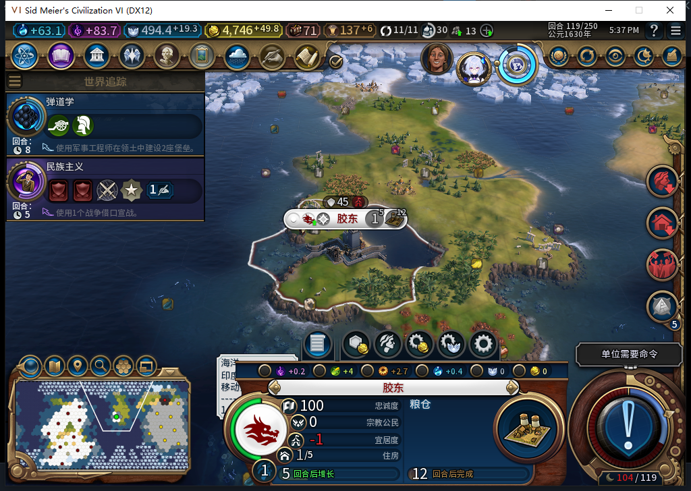

# 74版：受控拒绝后，移民实际建城并接入生产

2026-11-05，BF-202609141645，离线owned12052／产品74。接[410资格拒绝与恢复](baiqi-settler-qualification-recovery-74.md)的干净116分支，已有移民6684713继续由后台移动，119在25,15真正建立新城胶东，并自动排产粮仓。正式存读档后新城、人口和队列保留，最后已恢复原正常Farm114。[结构化读回、实际请求及模型411／412分账](../research/baiqi-p6-site411-founded-reload-evidence-2026-11-05.json)。

| 回合 | 实际移民／城市状态 |
| --- | --- |
| 116起点 | 23,12、0行动，己城11座；上一回合的受控故障已移除 |
| 117 | 后台三次移动到23,13→24,14→24,15，实际终点24,15／0行动 |
| 118 | 后台移动到25,15，0行动，仍11城 |
| 119 | 原位25,15提交FOUND_CITY一次；新增己城0／851979／25,15，人口1，己城12座 |
| 新城 | 自动粮仓队列1项；Native数据库类型BUILDING_GRANARY／基础成本65，尚未完工 |
| 119正式重载 | 新城、人口1、粮仓队列保持，无活在地图上的原移民 |

观察器在原调用前记录完整单位ID／owner／类型与原位，FOUND参数的x/y为空也能关联25,15；新城ID不在旧11城集合中，Core及UI再独立核对位置、所有者和人口。不是仅凭11→12或单位缺失宣告成功。新城生产与市民控制实际禁用，AI另有BACKGROUND粮仓请求和queue_observed，测试玩家没有建城、移动文职或手选生产。

UI中原移民已缺失；Core却仍能按同完整ID／owner找到对象。独立读取是坐标-9999,-9999、IsDead=false、IsDelayedDeath=true，已无地图位置；119重载后同坐标与延迟移除标记仍存在。不能把它写成Core FindID=nil或已最终删除。负责人第一次过严的nil断言失败原件保留，之后按真实原位／延迟移除状态资格核对，没有重放动作或改游戏数据。完整ID／owner本身不足以证明对象仍可行动，这个边界另进入征城恢复审计；本例是移民，不预授军事恢复故障。

三个正常换回合共5次无REASON／UserForced的ACTION_ENDTURN。116和117的第一次正常动作先执行已有建造者排队移动，实际回合未换；读回新的位置／行动／队列后，才用新标签提交下一次普通结束。每回合另有6个有限军队Skip／DoEndTurn步骤，不授全部军队提醒／物理按钮矩阵。一次忙碌时的只读队列门拒绝也保留，不当产品故障或换回合证明。

116→117遇到亚历山大来访：以4金币／回合和开放边境换4煤炭。测试玩家物理拒绝一次，并在“真可惜”后关闭“再见”一次；模组没有自动接受／拒绝外交。图片门因差异／时效拒绝的尝试均0输入，最后同次取新图并匹配已查看字样后完成。

本窗口UI UnitManager.RequestOperation透传计数60＝目标4移动＋1建城＋其他55；非白名单、未知类型、诊断错误、采样溢出均0。只覆盖BaiqiExecutor这一入口，不冒充引擎全部动作。原日志FOUND后仍是unit_unavailable，保留其普通读回缺口；新城实效另有独立正证据，未伪造自动成功日志。观察器已核所有权恢复后保存119，578475字节／SHA-256 `546e22137ef99d10e3e7875dcd53029f072240dc44e89d5f997e6b234a530c5a`，正式加载及独立回读通过。

随后正式恢复原正常114，并三上下文读回11城、金币4524.2734375／信仰397.94140625、原建造者1次数／0移动、农场539／538无改良、骑手10,12／4行动、原敌城和守军、征城账本nil及测试绑定清除；原文件hash保持。

411候选三段Lua编译，但实例ID误当类型索引，所有单位消耗24采样额度且漏记FOUND原位；负责人修正，7项隔离观察器检查通过，原install／reader0游戏执行，cleanup六行字符串原样采用、来自给定参考。412另一次广审计输出length，整份不读／不拼／不采用，改为413真实夹具窄反例任务；不把模型状态算成本例Native结果。完整40项仍未完成，本例不授新移民正常训练成本、全部城址竞争／危险／护送、战略资源或完整恢复矩阵。
