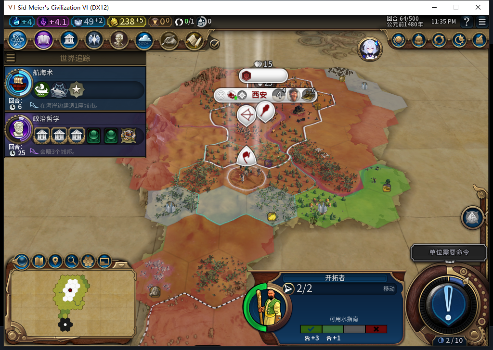

# 83：已选城址不随推荐列表变化而中断行军

82新局的移民在61回合自行出城，63走到59,27，64又等待。发布后正式冷读64，旧址59,26仍为已探明、当前可见的空地，距首都4格；可见三圈没有城市，但完整3条原生推荐已不包含旧址。另两条可见推荐有地貌，剩余一条只记隐藏数量。

源码保留旧目标，却只把它用于“是否到达”，下一步移动仍重新从当前推荐挑选。因此推荐消失后，即使旧址仍合格，也可能停止继续向它走。原进程私有目标表未直接读取；冷读会重建该表，不能把读档后的数据当作原决策瞬间的完整因果证明。

83把同一进程已选目标优先加入候选，按编号去重并保留原生最高评分。目标每次仍须通过探明、陆地、通行、城市、地貌、所有权、可见危险与已知城市支撑检查；路径及最终原生命令守卫照常执行。招募不使用旧目标，其他移民预留和本轮已排除目标仍生效。没有新开关、内政手操或军队后台命令。

新增9项行为检查。82先跑23项有3处失败；83移民相关98项通过，全量1173项运行中1172通过、1项官方SDK环境检查跳过。首次全量18错误来自负责人遗漏对照工具版本白名单与断言，补齐后重跑通过；原失败保留。71个Lua文件通过5.1编译，93文件独立包逐字节匹配源码。[结构化证据](../research/baiqi-p6-target495497-continuity-source83-evidence-2026-11-07.json)记录全部边界和指纹。

83此刻尚未安装、冷启或实机验证。它不保存行军目标，不能修复冷读后的目标记忆丢失，也不关闭ARMED中途保存／旧档等待FAIL、人口成本或完整40项。已发布的GitHub及Steam Alpha2仍是82／12图；不会把83软件结果写成Alpha2实机通过。下一步从较早56存档冷启83，让后台重新自然选址，继续普通回合验收。

本次还把此前未知操作147469951核对为实际REPAIR枚举；缺少维修前后损坏和次数证据，仍不授维修通过。Core集合多出的建造者458754位于离地图坐标且标为死亡／延迟对象，不计为新的活单位。模型495发明私有函数导出、496缺end且漏守卫，均未执行原稿；497仅修改采用目标候选方向与调用，负责人修正优先级及去重。
