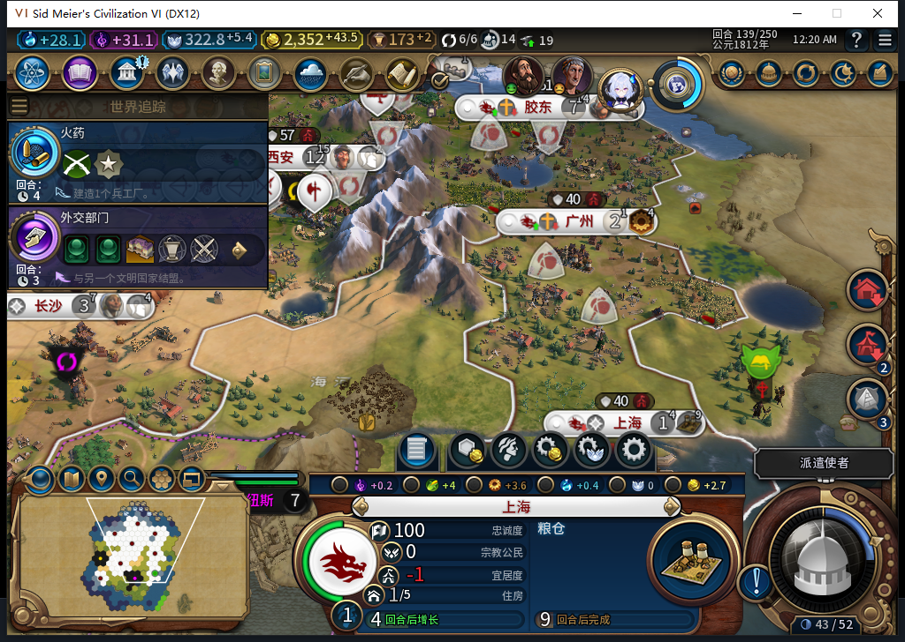
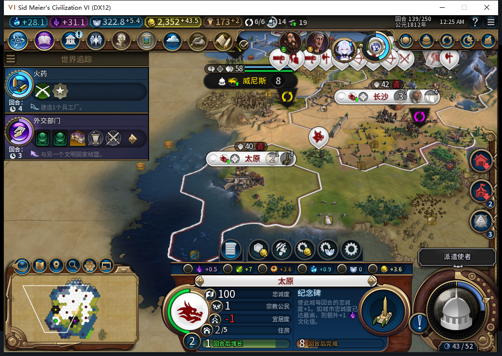
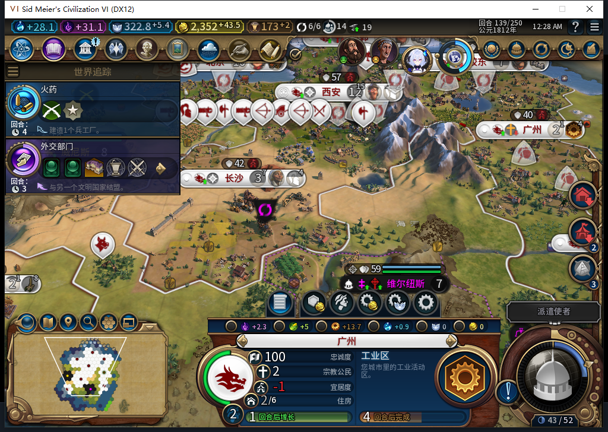
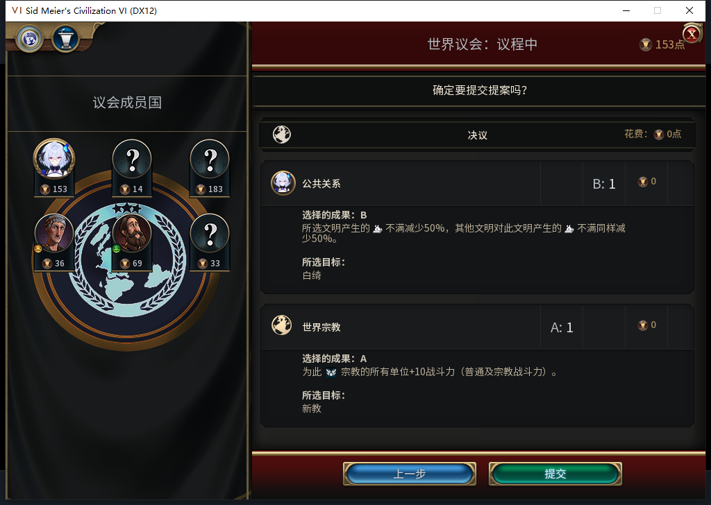
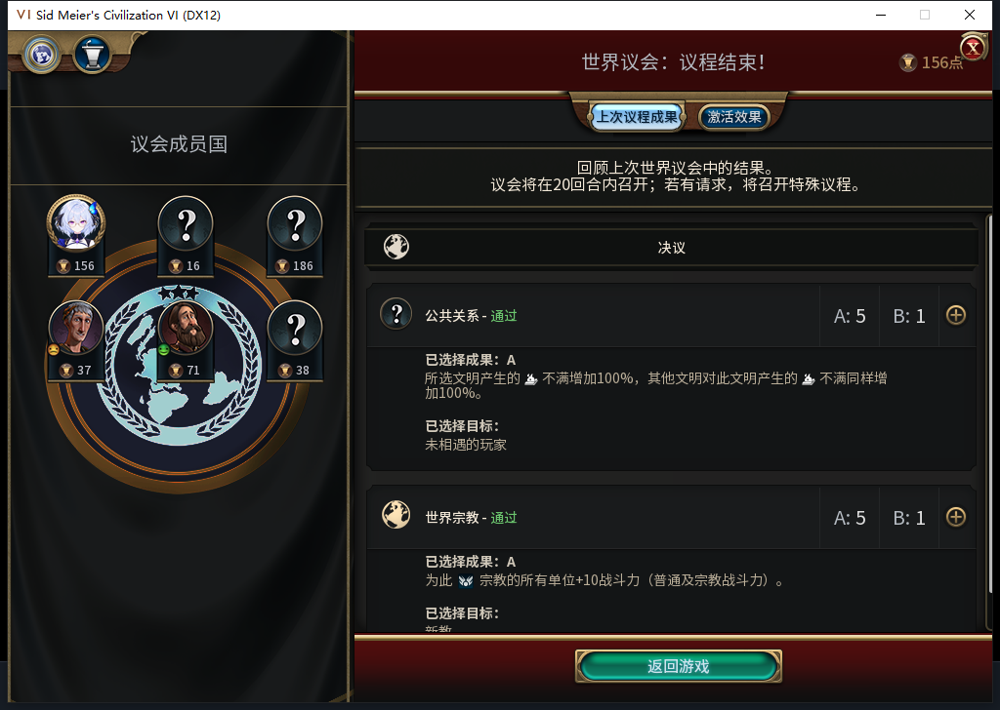

# 94实机：第八城上海出现负忠诚，验收未通过

后续已完成[138建城前警告复现和95软件守卫](baiqi-native-negative-warning-95.md)，95尚未安装实测。本页139FAIL及其存档保持，不能以软件结果覆盖。

139回合，AI自动在59,28建立上海，初始忠诚100、每回合−9.5625。选址安全记FAIL，尚未测试到叛离；发现负值后已停止结束回合并正式保存现场。太原和广州在同一窗口保持正忠诚，不能据此覆盖上海的问题。

[71行生产队列](shanghai94-130-139-queues.csv)、[71行城市状态](shanghai94-130-139-vitals.csv)、[逐项证据与模型审阅](../research/baiqi-p6-shanghai94-negative139-model547-evidence-2026-11-09.json)。源码／安装／实机仍94，未发布95。此前[太原完成态130读档](baiqi-rainforest-completed-reload-94.md)的窄通过保留。

截图显示当前忠诚100；每回合变化来自同回合Native独立读取，不能把100当成稳定。明细为人口压力−6.5625、宜居度−3、总督0、其他0。上海完整ID524295；新移民3211284从131排产0/130，经51、96产能，134自然完成、首都人口12→11，138抵达2131格，139被建城消耗。没有玩家指定城址、移动文职或补人口。

139建城后的可见半径9检查覆盖271格，只看到了己方城市，没有读取隐藏外国人口。最近己城广州距离4、人口2；距离比较未能防住此次人口压力。五名自有总督的忠诚加成均为8，单次调任不足以将−9.5625转正；现行救援还要求目标忠诚降至75以下。这是源码与当下数值的诊断，不是已完成的修复或未来失城时间预测。

太原458758仍忠诚100／+17，138粮仓完成，139纪念碑4/30。原定更长的黑暗时代观察因上海负忠诚停止，未达到二十回合，不能授长期扩张安全通过。

广州393221保持100／+18。135快照中2353格／59,31是矿山，136原版工业区实际放下，139进度42/94。这仍是矿山替代样本，不能补授尚缺的农场替代正案，也不能称区域已经建成。

135圣地资格另查：占星术已解锁，西安、北京、广州、太原原版完整生产资格为true，并有合法可见地块；邯郸、胶东、长沙被人口容量限制。七城当时都有生产，资格不是排产实效，也不能据此断言低优先级是唯一原因。宗教正向链仍未触发。

130罗马来访经原版再见一次。当前议会阻塞经原版入口查看，先显示等待，关闭后出现开始页；玩家实际投公共关系B／白绮1票、世界宗教A／新教1票，总花费0，提交及返回各一次。公共关系实际A5／B1、目标为未相遇玩家；世界宗教A5／B1通过，结果目标在画面下方，未独立完整读回。这些属于TEST_PLAYER外交，不能算后台自动外交。130→139共有9次直接普通结束、议会原版提交内部另发一次结束、9次实际换回合、28次玩家军队待命；0UserForced、0人工内政。

两次物理工具调用传入了不支持的完整路径，在输入前失败；改用正确文件名并重新比较静态区域后才一次告别，不归因于截图年龄。134的只读等待在135仍忙时触及上限，新标签只读确认就绪，没有重发END。139首次城市读取被前置状态守卫拒绝，新鲜就绪后完整读回才发现负值并停止。保存准备的重复分号在Lua5.1编译时失败，尚未调用Native；纠正后正式保存一次ACKtrue，1484056字节，SHA256为92bc4c916d82babff0958c4580ca47f32c7a741ea3f01fe8741c44f504051b5f，连续读取稳定。私人存档不上库，尚未加载该139档。

原版警告读者在六个当前可见邻格均返回UNKNOWN／缺少条目，未把缺失当0。547本地模型任务检查选中移民与水源镜头上下文：Nov9首次每日维护新鲜通过，OpenCode已安装／最新均1.19.5、未更新；一次HTTP完整stop／DONE／合法JSON，3011+1019=4030tokens，7.249秒。候选Lua5.1能编译，却直接使用全局而非传入环境、缺少异常保护和自有完整ID查找，代码拒绝、0采用、0原稿Native。正确的图标显示门槛不证明警告数据的缺失根因。负责人接管，准备从已保存130建立独立复现分支，建城前检查选中移民时的原版信息。

累计547任务／510完整JSON／34截断／3最终传输失败／577HTTP含30额外尝试；OpenCode新原生生成0，未知缓存tokens和人工节时保留null。没有新产品用例或全套重跑。旧92失城、ARMED／LEGACY恢复、宗教、Base／RF兼容、性能与完整40项继续开放。五张图均为已查看原图，未裁剪或修改数字。

Steam他机占用禁令持续：0模式切换、上线、登录、下载、上传器初始化或上传；公开Alpha2仍82／12图。
