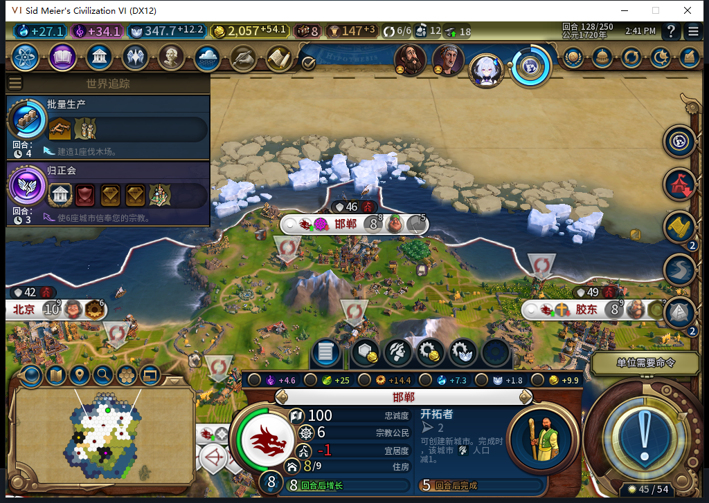

# 103冷实机128：移民队列与已完成创教保持

103已正式安装，108个文件与推送源码逐字节一致。启动前对当前Steam实例取得独立后台离线确认，距启动0.005423秒；没有选择上线、登录或初始化上传器。读入102正式128存档、原版继续一次后，实际世界也回到128，不能仅用Load ACK充当验收。

邯郸移民保持33/130、5回合，人口8。对照保存前逐行核验：世界经济／宗教行、7城队列、20栋建筑、19个区域、94个自有地块、17个单位，以及7城食粮／侧重读数全部一致。截图是现有生产保持证据，不能把图中开拓者说成神社。

佛教、两条信仰、信仰余额347.7890625、先知点41/+5保持；原先知2621455没有再出现，持久记录仍只有prophet:0:1、122回合OBSERVED、事件已见。没有在所测余额中重放祷告奖励或招募扣费。这只通过已完成状态从102到103的冷读保持，不授先知未决中断、旧移民ARMED恢复或完整矩阵通过。

神社尚未建，国内传教士仍0。新优先级是否实际排入、正常完工，以及合法采购、国内传播继续逐项验收。正式对照时0END128；之后继续正常回合，测试玩家仍只处理军队、外交与回合操作。

旧102正式退出后收尾残留超过180秒，存档再次校验、无窗口／端口、两秒CPU不变，才终止已核对路径和出生时间的自有游戏残留；没有结束Steam或其他人的游戏，干净退出不记通过。新游戏开始前首次离线查询不可用，因此没有启动；仅展开正式Steam菜单头部使项目可读，独立后台再确认“上线...”才启动。菜单导航有输入与激活，不能冒充只读查询或状态证据。

加载阶段4318拒绝、4319只读LSQ超时及一次归属复核拒绝均没有发送游戏CMD；原版继续后，重新确认4318属于自有进程且有唯一游戏上下文，随后读回。没有为了端口诊断重发Load或继续。新发令观察器在128对照后安装、零计数起步，启动阶段的发令次数未知，不能由新观察器推断为0。

本包0新模型请求／0产品代码改动；572采用与完整1562检查切点保持。Steam外机占用仍生效，整轮0模式切换／上线／登录／下载／上传初始化或上传，工坊Alpha2仍内部82。下一步是正常队列腾空后的神社建设与传教，旧恢复FAIL、布局／显示切换及基础版／迭起兴衰与完整40继续开放。

[结构化证据](../research/baiqi-p6-source103-cold128-existing-queue-and-completed-religion-evidence-2026-11-09.json) · [103排产规则及软件检查](baiqi-shrine-production-103.md) · [122创教两张原图](baiqi-normal-religion-founded-122.md)
