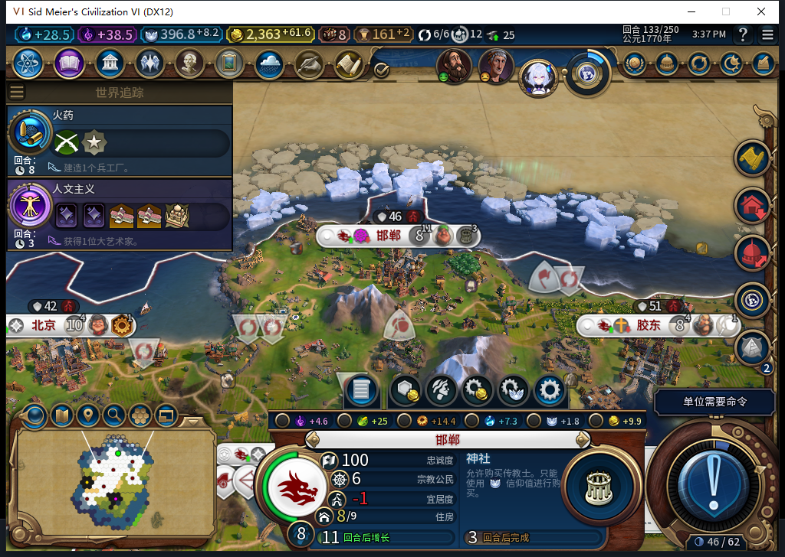

# 103实机133：移民完工，后台接续神社

升级保留的邯郸移民正常从128的33/130推进到55、77、98、120，133完成。白绮随后自行排入神社0/35、预计3回合。透明观察保留了一次133回合、城市196610、建筑神社的原版生产请求；测试玩家没有代排生产或购买。这次通过正常神社开工，完工与传教士采购继续验收。

133已正式保存1441573字节并核验摘要，保存切点0END133、尚未重载。信仰396.8046875，城市命令观察仍0条；实际传教士0。发令观察器787条、0错0丢，其中16条单位操作均为建造者或移民；两个观察器在切点仍挂着，不能假称全部撤除。

131和133分别采集7城信徒分布及实际传教士。一个关键反例是：没有传教士，邢州131也已自然信奉佛教；133人口2、佛教1人、无宗教1人，原生主流宗教仍为1。因此城市变为佛教，或者宗教图标出现，都不能单独证明后台传教成功。后续要配对采购回执、实际单位、后台传播请求、次数消耗和城市信徒变化。

新只读工具使用实际UI的平面单位宗教接口，只读自有城市与传教士；先暂存，再完整重读比对，范围130—160回合、单人活跃白绮。稀疏／重复／非法列表、信仰或上下文变化则返回UNKNOWN，没有半份KNOWN。零传教士是有效空样本。工具不进产品包、无发令或属性写入。

负责人一开始误将无宗教人口的Religion=-1排除，首次实机采样返回UNKNOWN。只读逐项核验发现原版明确返回该行及0信徒行，已保留原件、纠正提示合同与工具，增加对应测试后7项通过，131和133完整读回KNOWN。不能把这次输入合同错误归咎于模型，也不把工具失败算作游戏传教失败。

573模型原稿虽完整stop/DONE/JSON、Lua5.1可编译，但“一个pcall暗含新鲜性”不成立；它未重验上下文、缺多人守卫，跳过异常／稀疏信徒数据，TSV写成字面反斜杠。4个隔离对照分别证明信仰变动、多人、稀疏列表仍假报KNOWN，无宗教行被静默漏掉。原稿整份拒绝、0实机执行；负责人独立工具7项通过。模型1HTTP、4786+1263=6049 tokens、8.546672秒；累计573任务／534完整／36截断／3最终传输失败、603HTTP／30额外重试，新OpenCode原生生成0，未知成本null。这里只是7项工具检查，103完整1562切点保持，不冒报完整1569。

测试玩家129拒绝罗马铁交易；130拒绝巴西大使馆并再见。特别议程投一张免费反对票、复核总费用0，实际130为7反对4支持、未通过，返回游戏一次。紧接的常规议会130，各投免费A1，选择白绮文化炸弹与商业中心建筑加速，复核0费用；实际131通过目标是巴西和市中心，各A6，不能把选择当成结果。没有重发已提交END；这些均为玩家外交，不是模组后台行为或手补内政。

前次128原图、文档、BBCode固定提交公开GET3项200且字节一致。Steam他机占用禁令保持，0私自上线、登录、下载、上传初始化或上传；工坊Alpha2仍内部82。神社完工／采购传播、旧已发令移民恢复FAIL、小视口与显示故障、基础版／迭起兴衰和完整40继续开放。

[结构化证据](../research/baiqi-p6-religion573-shrine-native-start133-and-own-followers-evidence-2026-11-09.json) · [城市信徒CSV](../research/baiqi-source103-own-followers131-133.csv) · [只读工具](../../tools/lua/diagnostic_missionary_snapshot.lua) · [7项检查](../../tests/test_diagnostic_missionary_snapshot.py) · [128原队列图](baiqi-shrine-cold-readback-103.md)
