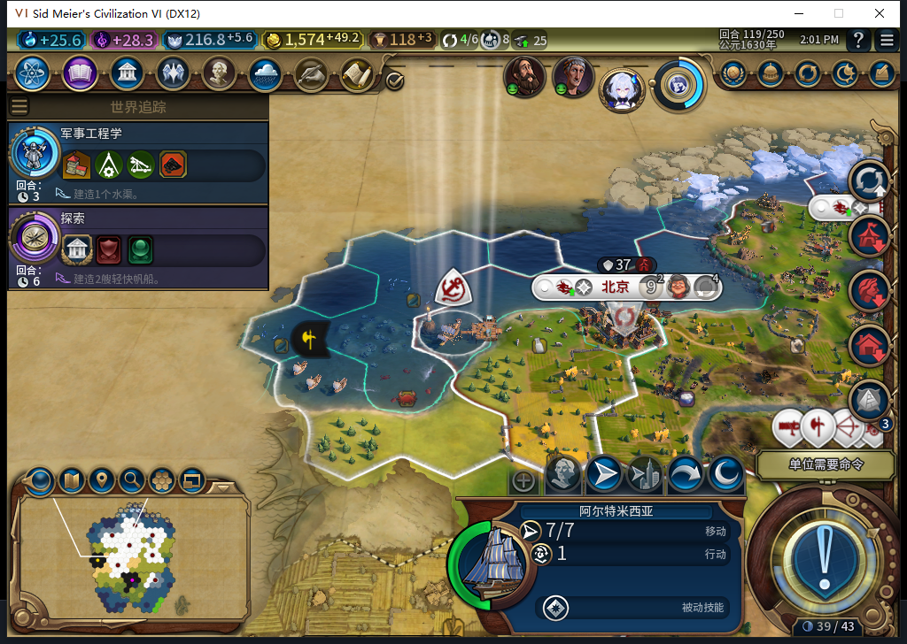
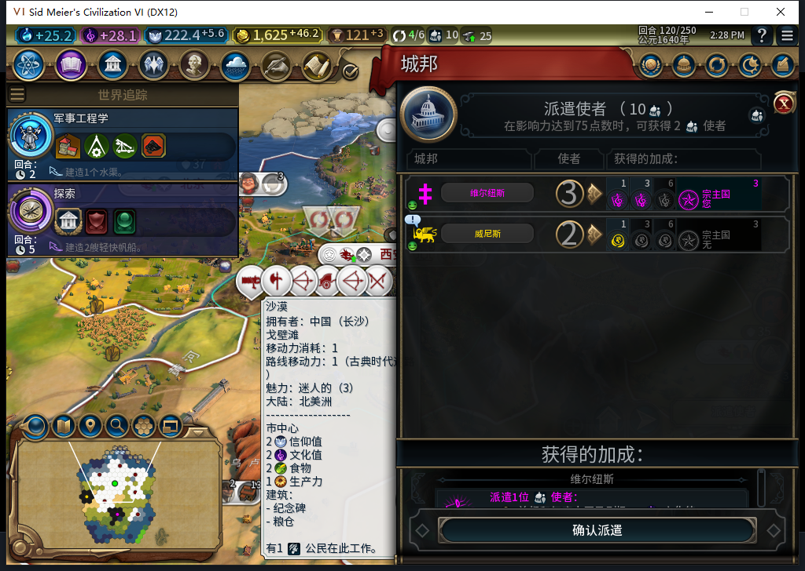
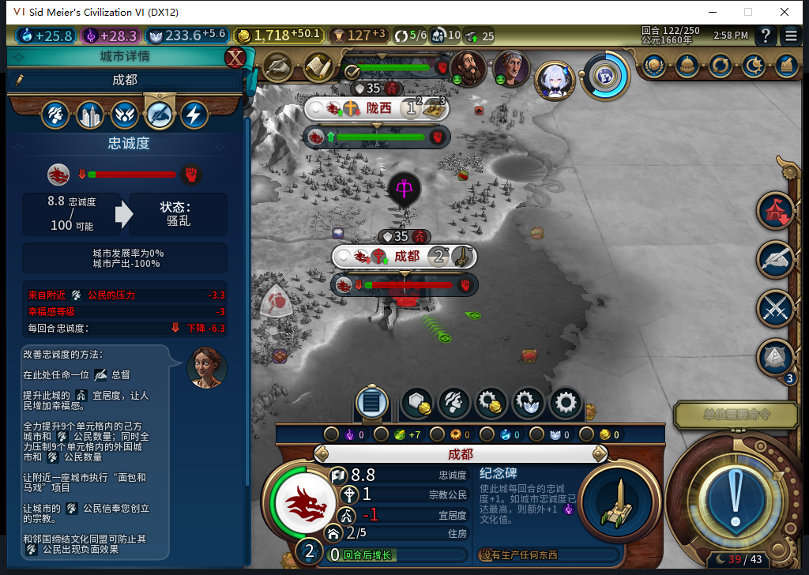

# 90版冷读与三个普通回合：生产接续，成都稳定性FAIL

90版已实际加载119备份，并从119推进到122。7城生产队列有接续，新增一名建造者和一名商人；成都却在122只剩8.83忠诚、每回合−6.28、产能为0。已保存复现点并停止结束122，继续修复。**这不是90宗教采购通过，也不关闭既有忠诚失城和恢复FAIL。** [精确证据](../research/baiqi-p6-source90-cold-smoke-and-command537-evidence-2026-11-08.json)包含软件、实机、输入及未知项的独立记录。

103文件与90产品pin逐字节一致。加载后的UI／Core世界、14完整单位行、7城市行与原87备份相符，UI的7队列头和7条已完成建城日志也相符。新采购模块和桥元数据在实际世界中存在；QA没有调用产品Inspect／Prepare／RunNow。Core只读审计工具536首次实际运行，三日志分别为自然学家ABSENT0、传教士ABSENT0、传播KNOWN0。第一次Core诊断误用了UI专属宗教getter，已保留失败原件并改用共同getter；不归为产品错误。

图中为119实际世界，不是加载ACK或前端截图。海军上将行动7/7，军队仍由玩家指挥。本方未创教（created−1）、无新先知／传教士，所以采购与传播正案尚未发生。

119→122实际前进3回合，共5次普通END请求及6次测试玩家军队SKIP；没有UserForced、人工内政、赠送或揭图。部分普通END只处理排队动作，后续均先读回实际状态再处理门槛。120原版使者提醒由测试玩家打开／关闭城邦页，10使者保留；巴西来访报价由测试玩家拒绝并再见，没有成交或后台外交。

此图说明实际回合门槛及查看页；确认禁用，没有分配使者。左侧保留原始地块提示。一次负责人编排错误在120未就绪时提前执行121检查，两份前置断言都在Select／SKIP／END之前失败；原件保留，等实际121后使用新命名空间执行，没有重放不明动作。

西安建造者54/55在120完成，随后移民进度0→79→120/130；不能将其说成移民已出生。邯郸工作坊89/97在120完成，随后商人0→32/40并在122出现新商人2621453，队列转为建造者。长沙工作坊12→31/97、陇西粮仓10→21/32。完整28行[队列采样CSV](source90-cold-smoke-119-122-queues.csv)保留各回合成本变化，点余额不冒充财政账本核对。

成都纪念碑在120／121／122都停在3/30，直接getter确认产能0。忠诚精确值8.828125／每回合−6.28125，原版明细为邻近人口压力−3.28125和幸福感−3。五名总督均在忠诚100且每回合+26或+29的己方城市，成都没有总督；原版CanAssignGovernor对五人去成都均true。现行Admin只按人口给未派任者分配城市，缺少危城调派。这是明确实现缺口；调任后是否实际增加忠诚、能否恢复生产，仍须修复后的实机证明。

122正式存档ACK为true，1375849字节，SHA256为d76d80ee93589d5e9c0fe00a9c2dcf1e27740637144cf5ad43173275a2093bfa，连续读取稳定；此新备份尚未加载，私人存档不上库。QA只选择城市、打开忠诚页，没有手动派总督或补内政。下一步是产品危城调度和扩张风险修复。

[537透明城市命令观察器](../../tools/lua/diagnostic_city_commands.lua)补上既有财政工具只观察RequestOperation的盲区。原稿5个边界失败，负责人修正整数检查及后置诊断保护后，1软件方法／21个Lua5.1场景通过。实际119安装、120和122读取、122恢复：BaiqiExecutor的RequestCommand计数／错误／丢弃／样本均0，命名空间已撤。仅证明该绑定该窗口的计数，不能扩大成全上下文零采购或采购成功；工具不进入103文件包，没有为纯QA重跑旧全量。

537为1次HTTP、完整SSE／stop／合法JSON；累计至537为537逻辑任务、501完整外层JSON、33截断、3最终传输失败、567HTTP／30额外重试。OpenCode原生生成仍0，成本／缓存未知保持null。另两个真实修复候选538／539已返回，尚待独立审编测，不属于90产品或537累计切点。

其他设备正在使用Steam的限制继续生效。本轮0上线、登录、下载、上传器初始化、上传或模式切换；两次90启动前均独立后台确认当前Steam离线。正式菜单头部导航曾激活客户端，已单独记为导航，不能冒充只读证明；离线不证明远端空闲。首次90启动未响应，只结束自己已核验启动，原因未知；旧87退出残留也不能记成干净退出。公开GitHub／Steam Alpha2仍82／12图，90没有上传。兼容、性能、完整40项及旧恢复FAIL继续开放。
