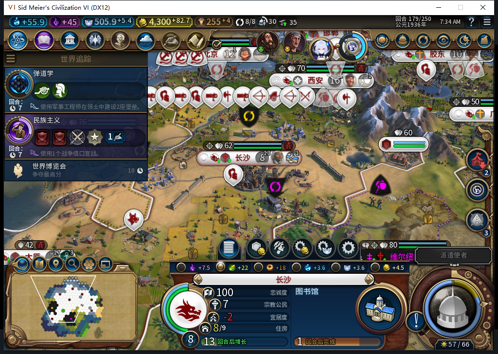
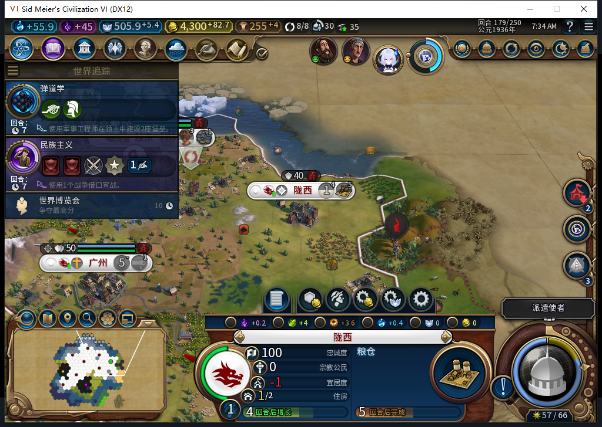
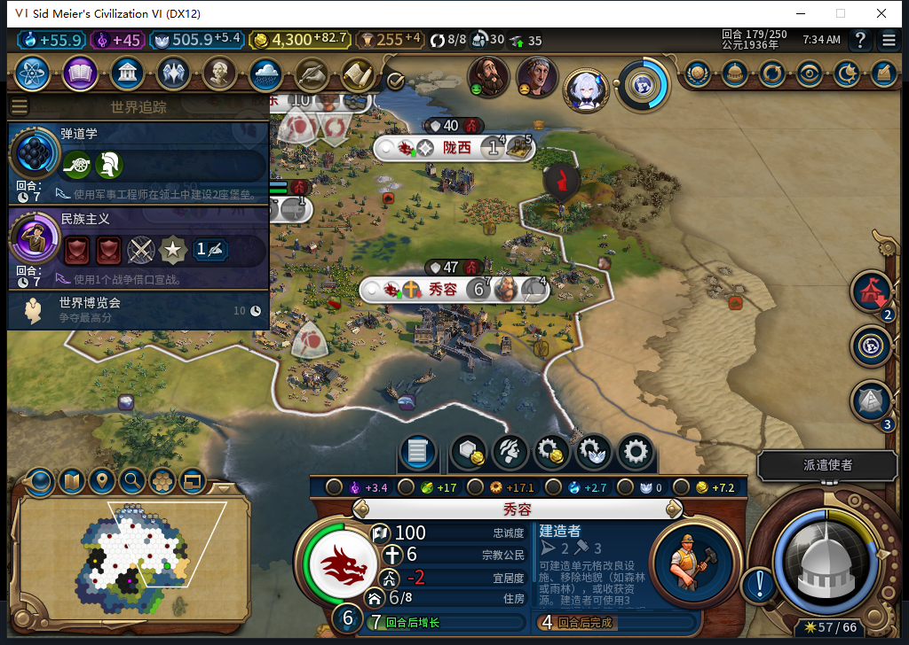
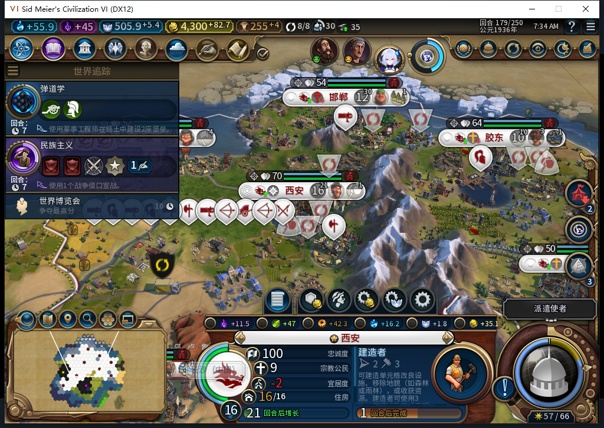

# 98离线冷读与三个普通回合：城市继续运转，界面估时另记缺口

98源码／安装107文件逐字匹配，从新进程正式读取97主线176存档一次，点击一次原版继续。当前Steam实例先经正式菜单头部导航，再独立后台只读看见“上线...”；证明距游戏启动0.003946秒，0模式切换、0上线／登录／下载／上传初始化／上传。其他设备占用约束持续有效。

冷读后，自有经济记录、9队列、56建筑、33区域、139可见自有地块、30单位，与97最后一次176样本逐项一致；九城粮食也一致。范围只包括所列自有样本，不推全世界相同或加载期间零后台动作。原陇西4063259／589832的OBSERVED及原请求令牌保持。

## 可以直接看见的变化

长沙176的7人口在177增长为8，之后保持；粮食侧重仍true。图中+22是粮食总产出，179原生净粮食为+6，食物7.8828125/44，饥荒倒计时−1。低宜居度−2也保留在图里，没有把城市描述成所有指标充足。玩家只是查看，生产及粮食操作仍由托管执行。

陇西原粮仓进度在176→179依次3、7、10、14/32；人口1、净粮食+2、忠诚100／每回合+17。图中+4是总食量，不能拿它代替净粮食。这段未再建新城，北京的新移民仍在训练，179为69/160。

秀容5→6人口，图中+17总粮食对应净粮食+5。这里新增一个待修项：卡片显示建造者1回合，截图前后独立原生队列均为29/83、剩4回合。原因尚未确认，可能涉及取数／缓存或界面更新；不授界面准确性通过。561已另行诊断，本页累计冻结到560。

西安人口经历16→15→15→16。177原版灾害历史读到千年洪水，位置2568／52,34，事件总PopLost=1；同窗5处农田及1处种植园变为NONE。它们支持洪水关联，但没有逐城／逐块损失回执，不能写成完整因果定论，也不写“本轮零人口损失”。首都每个样本净粮食均为正、饥荒倒计时−1。

## 实际回合与后台操作

实际推进176→179三个回合，测试玩家15次军队待命、4次普通结束。177首个普通结束后，原队列仍在执行；读回同回合且剩余原生军队待命均不合法后，才新提交一次正式结束。后来两次等待被巴西原版外交阻塞：177拒绝交易并再见、178对话再见，三次物理输入均属TEST_PLAYER。没有Shift+Enter、未知结束重放或文职／内政救场。

被动观察器784条：766招募评估、6城市操作、12单位操作；0单位命令、0错误、0丢样。12单位操作均为所有者0建造者，9移动／3建设调用；原调用无Lua异常、原生返回0值不能单独证明效果。共同可见地块净新增2项改良，不能把3次SDK建设写成3项新改良。179已撤除观察器。

期间完成西安星形要塞、北京城堡、广州银行；胶东与长沙既有学院完成。九城36行食物样本均非负且无饥荒倒计时，36行忠诚均100且每回合为正。广州净粮食一直0，余量依然薄。普通回合短验通过，不能代替长期与更多边界验收。

## 数据与继续验收的位置

- [36行真实生产队列](source98-cold176-179-queues.csv)
- [36行粮食与侧重](source98-cold176-179-food.csv)
- [36行忠诚／宜居度／总督](source98-cold176-179-vitals.csv)
- [4行自有经济](source98-cold176-179-world.csv)
- [8处共同地块变化](source98-cold176-179-plot-changes.csv)
- [12次后台单位调用](source98-cold176-179-background-unit-calls.csv)
- [120行单位快照](source98-cold176-179-units.csv)
- [4次原始扩张目标读取](source98-cold176-179-goals.csv)

179正式保存ACK true、文件稳定1724604字节，SHA256 `00551b876b2a9dfc5846b6ce4a1ea7ecc0bb548dc48035cbb5d255cd167d6462`，本阶段尚未再读此新档，私人存档不上库。升级前97独立176保存保留。正式退出旧游戏后只清理了已保存、无窗口／监听、两秒CPU不变且超过180秒的自有残留；没有结束Steam或他人游戏，残留根因未知。

98新“同回合未发令闭包”本窗没有自然触发，仍只有软件证据。旧已发令中断存读恢复FAIL、LEGACY_UNKNOWN等待、自然宗教链、秀容显示估时、完整40用例继续开放。公开Alpha2仍内部82；本页四图与BBCode仅在仓库准备，Steam外链显示尚未复验。

[完整结构化证据与边界](../research/baiqi-p6-source98-cold179-native-evidence-2026-11-09.json)、[98软件修复](baiqi-live-unissued-found-98.md)、[旧中断存读FAIL](baiqi-settlement-lifecycle-recovery-82.md)、[待发布BBCode](../workshop/v0.1.0-alpha.2/pending-source98-native179-2026-11-09.bbcode.txt)。
