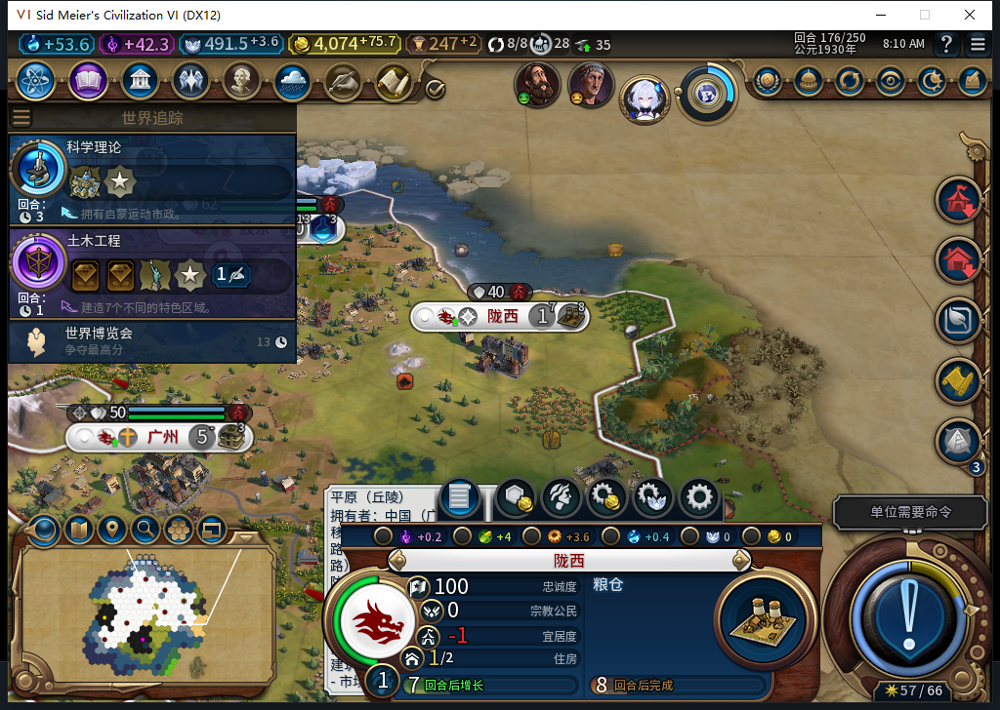

# 98正常建城实机：独立173分支自行建成陇西并开始粮仓

98修改后的正常建城路径已补实机：正式读取独立保存的97／173分支，原移民4063259从61,34自行到62,34；175观察到一次后台FOUND，8→9城，新城陇西589832。176粮仓0→3/32，人口1、净粮食+2、忠诚100／每回合+17。没有人工移民命令、建城或排产。

这份记录对应98源码／安装／运行pin9f474f8，原生请求为`0:175:18`、令牌`settle:0:9`。它与97主线继承的`0:175:193`分别记账，不能混作同一次发令。只是重新读取既有173分支，独立179正例已预先保存，没有覆盖。

## 核对了哪些实际效果

173、174为8城；175、176为9城。175粮仓0/32、176为3/32；四次目标读取由1目标／1移民变为0／0。34行全城粮食样本均非负、饥荒倒计时−1，34行忠诚均100且每回合为正；广州净粮食0仍保留为薄余量。

175的UI回读已找不到原移民，名册0个、30单位；同次独立Core回读仍返回旧对象，名册1个、31单位。该次未采死亡／离图标记，不能追认“Core175也已不存在”。176再读，UI和Core均30单位，原完整ID的lookup=nil、名册0，OBSERVED／令牌／请求／城市一致。两次上下文读取不是原子快照。

透明观察器655条：635招募评估、5城市操作、15单位操作，0单位命令／错误／丢样。单位调用均为自有白名单文职，11移动、1建设、2国内商路、1建城，176已撤除。实际城市、原移民和粮仓读回构成效果证据，原生无返回值本身不算成功。

实际推进173→176三个普通回合，测试玩家15次军队待命、5次正式结束，0Shift+Enter／文职内政救场。174首次结束后仍在同回合，接下来读取遇到Core忙，工具停止；后来重新读取同174主动空闲且剩余军队原生待命均不合法，才新提交一次正常结束。没有重放未知结果。

## 保存及返回主线

独立176正式保存ACK true、文件稳定1689811字节，SHA256 `db646a047538afeac3dba2df599c40d28b236f253433445e50001aee0076d97a`，此新文件尚未再加载，私人存档不上库。

随后正式返回已保存的98主线179一次并点击一次继续。九城食物、经济、队列、建筑、区域和可见自有地块与之前179样本一致；一名建造者继续移动，不说所有单位或整个世界不变，也不宣称加载时零后台动作。当前179已就绪，本分支没有结束179。

本轮只验证正常新建城。98的“确认后最后资格暂失、同回合稍后首次发令”特殊路径没有独立自然触发记录，仍只有软件证据；旧已发令ARMED存读恢复FAIL和LEGACY_UNKNOWN没有因此通过。宗教链、完整40用例、兼容及性能继续验收。

Steam其他设备使用约束保持。本次沿用已离线启动的同一文明VI进程，0新进程启动／模式切换／上线／登录／下载／上传初始化／上传。公开Alpha2仍内部82，本图只入仓库。

- [34行生产队列](source98-natural173-176-queues.csv)
- [34行粮食与侧重](source98-natural173-176-food.csv)
- [34行忠诚／宜居度／总督](source98-natural173-176-vitals.csv)
- [4行经济](source98-natural173-176-world.csv)
- [4次原目标与移民读取](source98-natural173-176-goals.csv)
- [15次后台单位调用](source98-natural173-176-background-unit-calls.csv)

[结构化证据与UI／Core原始读数](../research/baiqi-p6-source98-natural-found176-evidence-2026-11-09.json)、[98软件合同](baiqi-live-unissued-found-98.md)、[独立179主线](baiqi-source98-cold-followup-179.md)、[旧中断恢复FAIL](baiqi-settlement-lifecycle-recovery-82.md)。

[本页与陇西新原图的固定提交公开访问核对](../research/baiqi-p6-source98-sixth-public-original-image-2026-11-09.json)：均HTTP200，字节／SHA与已推送pin完全一致。连同前轮五张，98共六张不同原始PNG已核对公开可取；这不代表Steam已更新或外链显示已验。
