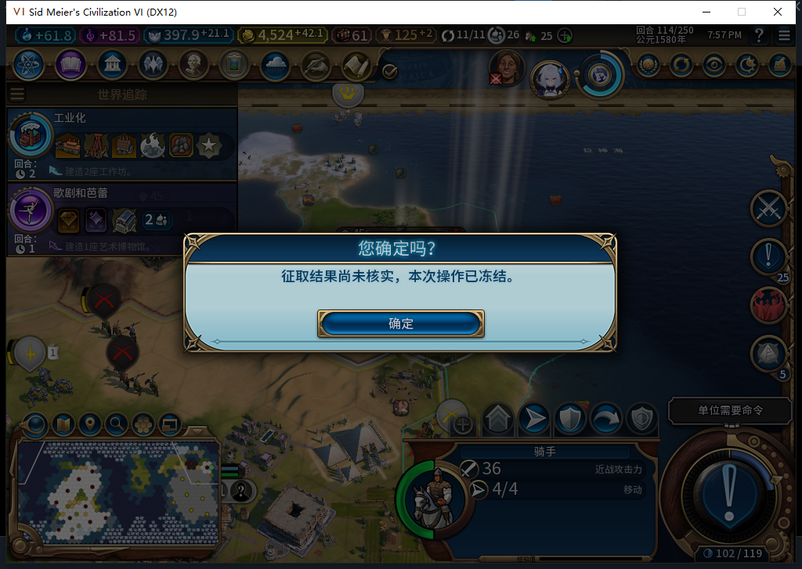
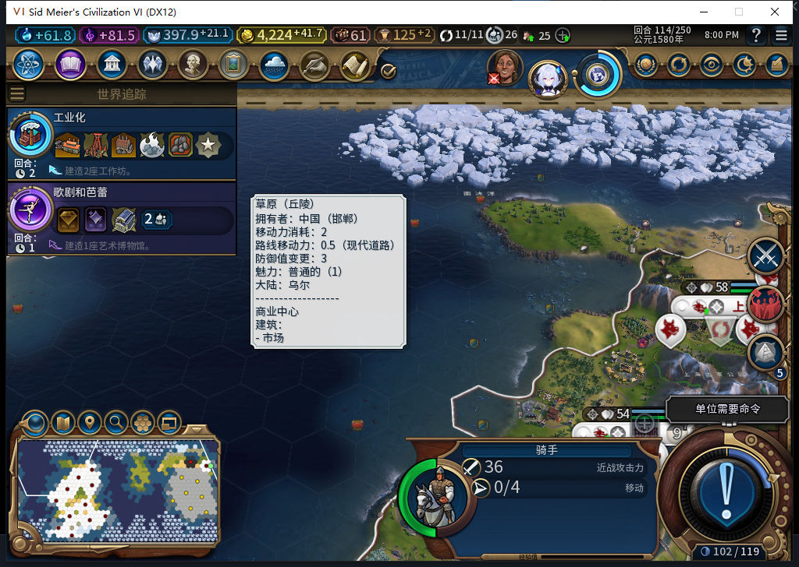

# 75版：已转城、未扣款的正凭证恢复

2026-11-05，BF-202609141645，75源码／安装／运行，沿用完整1048项软件通过的代码1961f911。[实际阶段、回执及原件指纹](../research/baiqi-p6-capture417-positive-transferred75-evidence-2026-11-05.json)。

独立QA驻军114存档中，测试玩家真实右键敌城并确认一次300金币。临时故障只拦截真正转城回执之后、写扣款意图之前的余额合法性检查；没有改journal、金币或军令。原生转城1，Finish0，故障命中两次、透传35次、匹配错误0。记录真实停在UNKNOWN／TRANSFERRED，transferObserved=true、新城0/851979；收费前后余额及chargeObserved字段仍为空。

正式保存该阶段568777字节，SHA256为187584d43f7e2e8fdb38cc3436bd704bc7ebaed9cdf9232121bf977f5219debe。保存时故障仍临时占位，以保持真实待恢复阶段；输入及原生观察绑定已清理。故障没有写入游戏属性，加载前正式恢复原绑定，并独立确认仍未收费。

| 实际状态 | 保存时 | 原进程正式重载后 | 新进程首载同一保存点后 |
| --- | --- | --- | --- |
| 记录 | UNKNOWN／TRANSFERRED | COMMITTED／DONE | COMMITTED／DONE |
| 金币 | 4524.2734375 | 4224.2734375 | 4224.2734375 |
| 收费肯定回执 | 尚无 | before／after及chargeObserved=true齐全 | 齐全 |
| 骑手 | 4行动、冷却空 | 0行动、冷却114 | 0行动、冷却114 |
| 完成后两次Recover | — | 转城0、Finish0 | 转城0、Finish0 |

两个分支分别从同一个未扣款保存点恢复、分别核算300金币差值。没有直接拦截国库收费函数；启动自动恢复的转城／Finish调用数未知，不把完成后0／0探针写成启动总数。

冷恢复同时暴露一次退出收尾异常：原自有进程正式退出后，窗口与监听接口已关闭、日志显示EOS shutdown及模组服务释放，但超过371秒仍在，2秒CPU变化0。核验原正常存档和待恢复保存点指纹后，只终止这个已关窗的自有QA游戏残留进程；Steam及其他游戏进程终止次数0。新进程15788从主菜单首载成功，启动前只读Steam离线确认距启动0.067374秒。**此次不能授干净关机通过**；异常原因未定位，也没有原版退出对照，不能归因于模组。

完成后新进程独立恢复原Farm114，三上下文核验11城、4524.2734375金币、397.94140625信仰、原军队／建造者、空征取journal，全部诊断绑定清。75未上传；公开Alpha附件固定74。军队保留同ID的延迟销毁、干净退出后的此阶段复测及完整矩阵仍待验。
