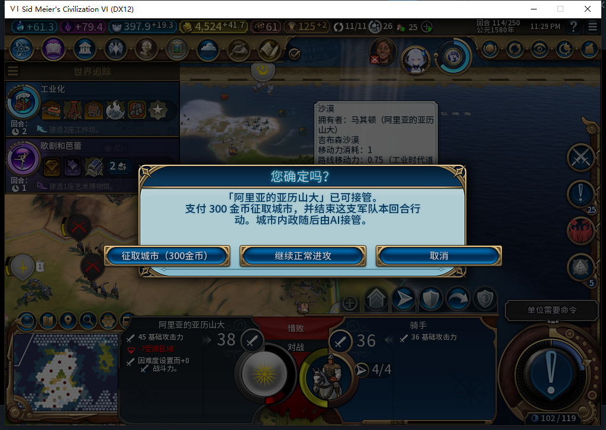
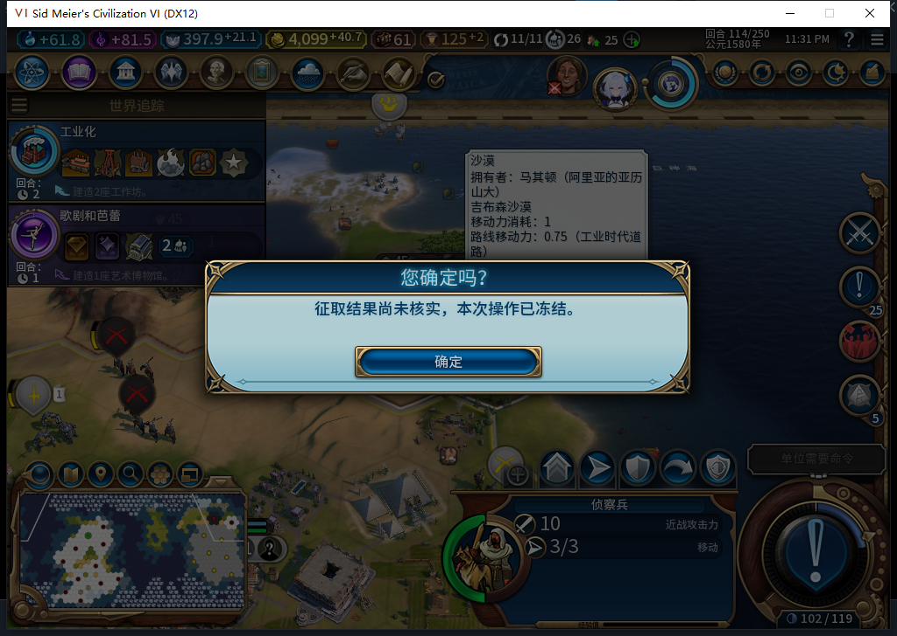
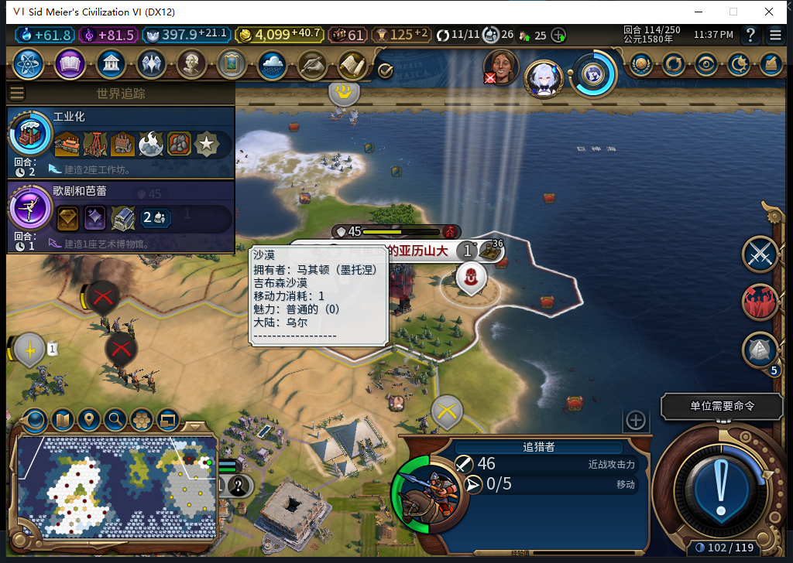

# 75版：执行骑手升级后，旧完整ID仍在Core，恢复保持冻结

后续：[76同驻军旗帜冷验](baiqi-garrison-flag-native-76.md)已关闭本页所发现的确认绕过窄FAIL。本页75当时实测失败及升级中断冻结数据保留；已发布Alpha74不因开发版修复而追认通过。

2026-11-05，BF-202609141645，75源码／安装／运行、代码1961f911。本轮补齐实际执行军队的延迟销毁场景，同时发现驻军旗帜绕过城市征取确认的新问题。[阶段、保存点、原始指纹及模型审阅](../research/baiqi-p6-capture425427-upgraded-actor75-evidence-2026-11-05.json)。

先在独立正常Farm114进行普通军事升级对照：只读核骑手0／2162700在10,12自有陆地、4行动、未编队，原版宽松／严格UPGRADE资格均真，费用125，目标追猎者UNIT_COURSER。没有补科技、资源或资金。测试玩家仅升级一次，金币4524.2734375→4399.2734375，新追猎者6815791在原位置、0行动。UI旧骑手nil、单位数47；Core旧完整ID仍存在，坐标-9999,-9999、4行动、IsDead=false／IsDelayedDeath=true，单位数48。这是实际己方军队对象寿命，不是软件替身或灭亡敌军推断。对照保存568992字节，SHA256 c90c044d515581786c133540dea3612936449f29f44ed5b80f71412fabb3d2e4。

接着正式加载独立驻军准备档。首次右键坐标520,377命中了城市内的驻军旗帜，尽管光标地块确为目标城877，WorldInput四项输入观察均0、付费请求0，没有弹窗；原版战斗已消耗骑手行动并造成25伤害，城防损伤150→175，钱和城市归属不变。原版UnitFlagManager源码直接发MOVE_TO／RANGE_ATTACK，确实绕过地图地块的WrapMove。**该城市确认入口记FAIL，修复与实机复测待完成。**这里的模组Lua转城／Finish观察0，不表示没有原生战斗动作。负责人停止后续操作、清全部绑定，正式恢复新准备副本，没有补回军队行动／伤害或重放未知付费。

新副本改点城市地块490,390，光标仍为877，这次实际出现300金币弹窗；只有一次物理确认、一笔付费请求。原生转城1，测试故障在原生结束行动前阻断2次、没有透传或匹配错误，Finish观察0，形成真实UNKNOWN／FINISHING。城市0／851979、人口1，金币4524.2734375→4224.2734375，账本肯定记录原扣款，原骑手仍4行动、冷却114。

此时再严格核骑手位于新自有土地，普通UPGRADE仍合法；测试玩家升级一次，另付125。新追猎者6815791在42,19、0行动；UI原骑手nil，Core原2162700仍owner0、-9999,-9999、4行动、IsDead=false／Delayed=true、旧冷却114。账本仍指向原骑手，而非替换后的新完整ID。金币4099.2734375包含300征取和125军事升级两种明确支出，不能把后125说成征取重复扣款。

| 恢复窗口 | 实际账本 | Lua原生转城／Finish观察 |
| --- | --- | --- |
| 升级后、测试故障仍在 | UNKNOWN／FINISHING，旧骑手离图 | 累计1／0 |
| 精确撤故障后两次LiveRecover | 仍UNKNOWN／FINISHING，金币4099.2734375 | 仍1／0，无新增 |
| 全绑定清理、保存点正式重载 | 仍UNKNOWN／FINISHING；Core原完整ID仍延迟销毁 | 加载阶段计数未知 |
| 重载后新观察窗两次Recover | 仍冻结、无新增扣费观测 | 0／0，错误0 |

这次直接验证75不会把“完整ID还能找到、IsDead=false”当作健康军队，不会对离图旧对象补结束行动或错误标记完成。UNKNOWN保留已经发生的城市移交与扣款，属于安全冻结；不退款、不清旧回执、不把它说成完整征取成功。

正式保存569101字节，SHA256 b0dc40bb8ea82ae82e592fb4643079316338e7bc678d0b567645c0f43525409b；同进程重载后仍保留Core旧完整ID，UI新追猎者0行动及账本保持。首次Continue检查时仍是加载画面，门拒绝且没有按键；后续新鲜就绪检查通过才按一次Continue，没有失败后串接游戏查询。

最后独立恢复原Farm114，三上下文核实11城、4524.2734375金币、397.94140625信仰、原骑手4行动、建造者1次及空征取账本，全部诊断绑定清除。本轮无产品改动，沿用75完整1048项软件基线；Steam离线、Alpha74未更新。仅授本次同回合FINISHING升级替换与同进程保存重载的冻结边界，其他阶段、移除方式、冷进程及完整矩阵仍部分。驻军旗帜确认FAIL和417退出残留原因另待修复／核验。
