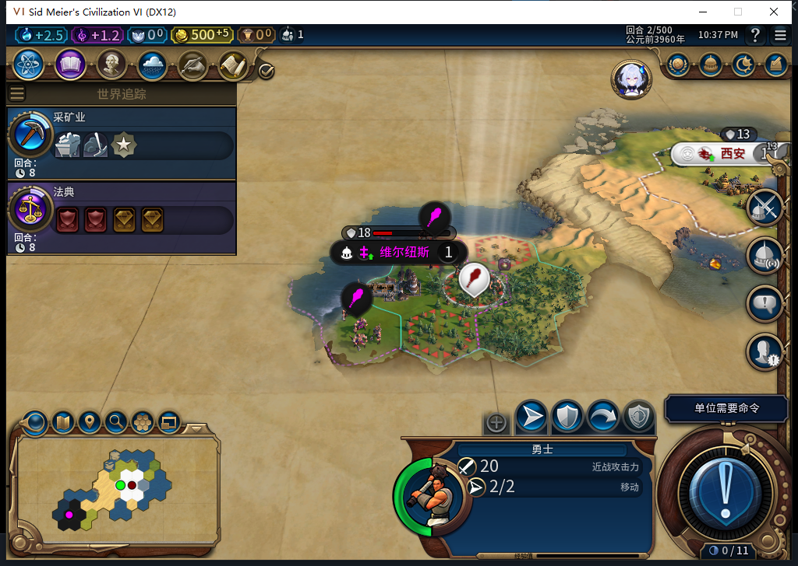
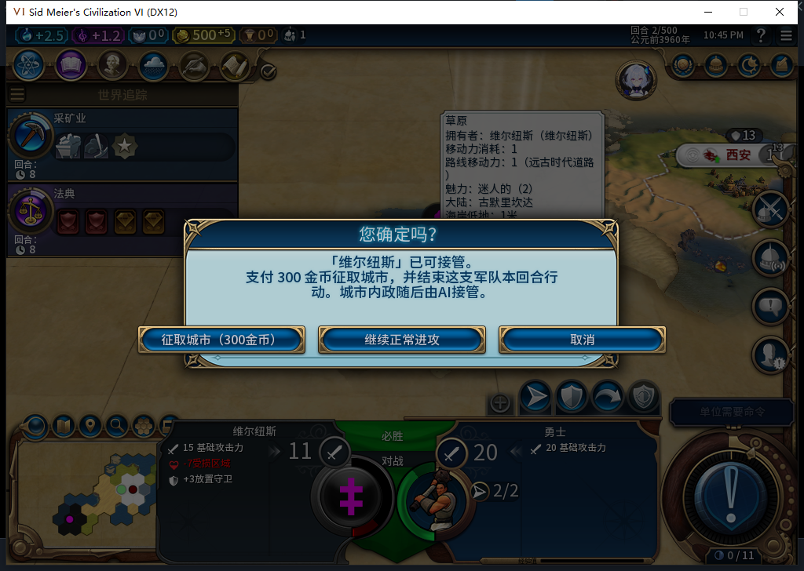
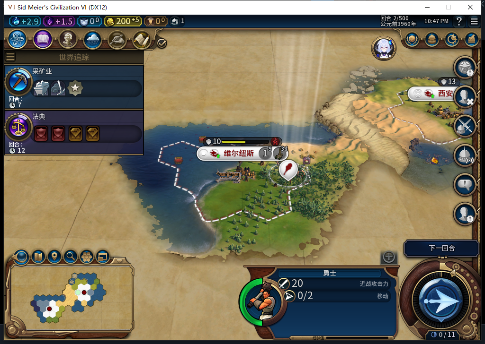

# 75版：维尔纽斯最后一城的300金币征取

后续：[正常下一回合自动生产补验](baiqi-vilnius-production-turn3-75.md)已取得后台排纪念碑、进度0→1／60与忠诚100的单回合实机证据；本页原即时／读档结果保持，长期与建筑完工仍未验。

2026-11-05，BF-202609141645，75源码／安装／运行，代码1961f911；完整1048项软件检查为既有基线。本次在独立旧33世界的第2回合测试，和此前误标“城邦62”的自由城市样本分开。[实际观测、保存点及模型审阅](../research/baiqi-p6-capture421423-vilnius75-evidence-2026-11-05.json)。

Core与UI核实目标6为`LEADER_MINOR_CIV_VILNIUS`／`CIVILIZATION_VILNIUS`／`CIVILIZATION_LEVEL_CITY_STATE`，界面名称“维尔纽斯”，仅一座人口1城市65536，坐标5,15。原白绮勇士131073在10,18，2行动，金币20。

测试准备显式宣战0→6、加480测试金币、将唯一选定且未编队的己方勇士放到相邻空陆地6,15，恢复放置时清零的2行动，并设目标城防损伤150／200。没有指挥其他军队或代做文职。**这些是QA布景，不算自然战斗、正常收入或外交按钮通过。**正式保存准备点639787字节，SHA256 c16ab1c83feca76aaca78cd5f9bc10eab0450c0d643938c002b59a323532eba1。

选中勇士后，测试玩家物理右键城市；新鲜光标核验为plot665。弹窗明确300金币，也保留“继续正常进攻”和“取消”。确认前付费请求数0；物理确认仅一次，实际请求数1，模组执行原生转城1、结束行动1，观察错误0。

| 核对项 | 准备前态／实际结果 |
| --- | --- |
| 城市 | 6／65536 → 白绮0／131073；5,15；人口1保持 |
| 金币 | 500 → 200；账本肯定回执before500／after200 |
| 己方勇士 | owner0／131073仍在6,15；2行动→0；冷却2 |
| 账本 | 一笔COMMITTED／DONE，价格300，转城与扣款肯定回执 |
| 完成后两次Recover | 连续观察仍转城1／Finish1、金币200，无新增调用 |
| 城邦 | IsAlive变false，城市数0；其军队没有转给白绮 |

资产结果有明确限制：UI遍历138种建筑，转移前仅有宫殿及1个空巨作槽，转移后建筑和槽均为0。宫殿在此次原生转城中被移除；没有做原版对照来归因，也不能宣称建筑全部保留。这座城没有普通建筑、奇观或已放置巨作，相关矩阵没有由此补齐。

两支原城邦勇士的表现也必须分上下文记录：UI集合为0且原完整ID新查询为nil；Core集合仍有2个对象，新查询owner6／131073和196610，均坐标-9999,-9999、IsDead=false、IsDelayedDeath=true。读档后仍如此。这次直接看到了**军队保留完整ID但已离开地图、延迟销毁**，支持75资格防护的必要性；它们是被灭亡城邦的敌军，尚不等于复现“付费中断时执行征取的己方军队被移除”。不能把Core对象数当作地图上仍有敌军，亦不能把UI的nil改写成Core也nil。己方勇士与敌军恰好同ID131073，必须同时核所属玩家；新城市ID也同数值，不能混用集合。

清除观察绑定后正式保存641271字节，SHA256 e997831ed33e61ae8fee494d8bf8c5cc4328a6693959262f110caaab6d4311e7。同进程正式读档，Core／UI均确认城市、金币200、勇士0行动、冷却2、一笔DONE及资产结果保持。加载期间首次Continue前置门发现窗口暂忙，未发按键；负责人仍误接了两个只读查询，连接拒绝／超时，之后停链等终态。待新鲜就绪画面复核后只按一次Continue，最终独立读回才作为验收依据，没有重复加载或重放付费动作。加载期间原生调用总数未知；不能用余额稳定替代调用计数。

最后独立恢复原Farm114，三上下文核实11城、4524.2734375金币、397.94140625信仰、原军队／建造者、两目标地块、空征取账本及临时绑定清除。本轮无Steam上线或上传。75未替换已发布Alpha74；长期忠诚度、接管后的正常生产、其他城邦与特殊资产、执行军队移除及完整矩阵仍待验。此前[自由城市分类更正](baiqi-free-city-classification-audit-75.md)继续有效。
