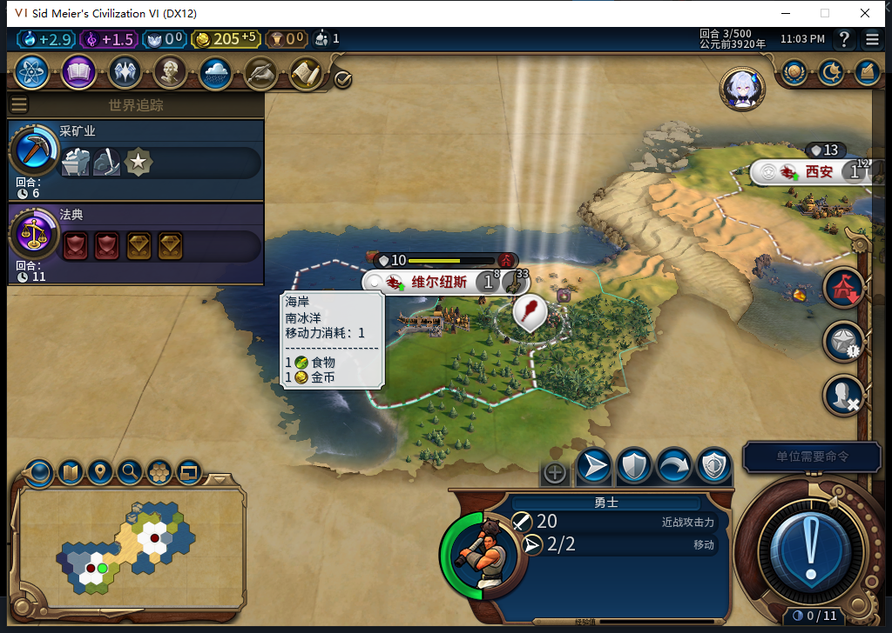

# 75版：征取维尔纽斯后，正常下一回合开始生产

2026-11-05，BF-202609141645，75源码／安装／运行。正式加载[上一项城邦征取](baiqi-vilnius-city-state-capture-75.md)的Committed2保存点：641271字节、SHA256 e997831ed33e61ae8fee494d8bf8c5cc4328a6693959262f110caaab6d4311e7。测试玩家没有手动选生产、改队列或执行文职动作。[完整读回、日志及模型审阅](../research/baiqi-p6-capture424-vilnius-normal3-evidence-2026-11-05.json)。

游戏日志在上一项征取完成标记之后，实际记录`source=BACKGROUND`、`city=131073`、`type=BUILDING_MONUMENT`，随后记录同请求0:2:1的队列hash -2025065568。日志是当前自有进程跨多次加载的累积文件，按城市／回合／请求及邻接征取记录对应，不伪装为本窗口新安装的调用计数。

| 读取项 | 第2回合 | 正常第3回合 |
| --- | --- | --- |
| 城市 | 白绮0／131073，5,15，人口1 | 保持 |
| 生产 | 单项纪念碑，0／60，尚未建成 | 仍为纪念碑，1／60，尚未建成 |
| 忠诚 | 100／100，每回合+17 | 保持 |
| 金币 | 200，净收入5 | 205，净收入仍5 |
| 己方勇士 | 0行动，征取冷却2 | 恢复2行动，旧冷却仍2 |
| 征取账本 | 一笔DONE，原before500／after200 | 原记录保持 |

测试玩家仅调用一次原版`ACTION_ENDTURN`，无REASON／UserForced、跳过军队或军队移动。ACK之后分别读回UI与Core的实际回合3和城市身份。金币增加5与前一回合净收入相符；本窗口未安装Treasury或Native调用观察器，不能把余额吻合说成底层调用次数实测。

敌军清理差异仍在：UI没有城邦6单位，Core按原完整ID仍能新查询到两支-9999,-9999、延迟销毁的军队；这次正常换回合没有清除它们。本轮没有操作这些对象，不据此说地图上还有敌军，也不授“执行征取的己方军队移除”通过。

负责人初次读者把Core没有的占领／忠诚接口放入受保护组，实际输出UNAVAILABLE；随即将Core基本身份和UI占领／忠诚拆开，增加实际缺失端口诊断（两读者各8例），换回合前重新读取通过。没有把该不可用读数当作0或产品失败。模型原UI候选缺end、建筑进度接收者也错，未进Native。

正常3保存点682511字节，SHA256 eaf477d911dc5bdccea546a391f90b39545baa91a36aae48566f4958f04bac71；随后独立恢复原Farm114，三上下文核实11城、原资金／信仰／军队／建造者及空征取账本。支持范围为该新城自动排产并在一个正常回合积累1点生产；不授纪念碑完工、长期忠诚稳定或全部城邦通过。产品源码未改，沿用75完整1048项软件基线；本轮Steam离线，Alpha74未更新。
