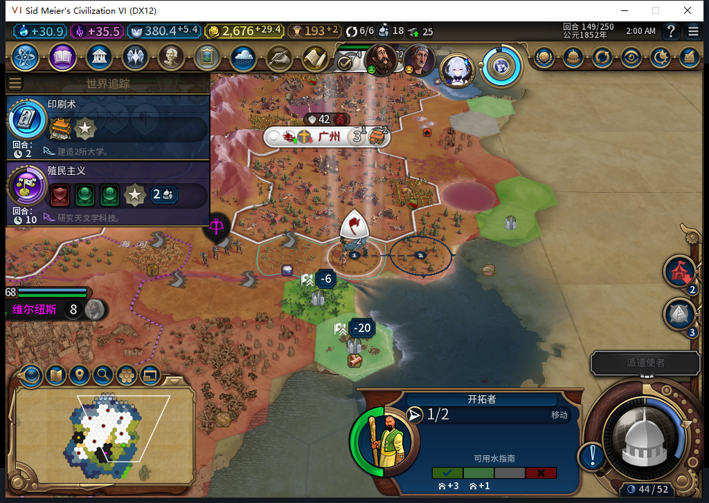
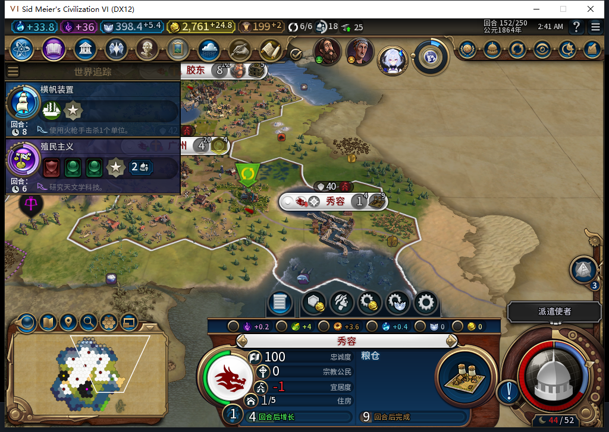
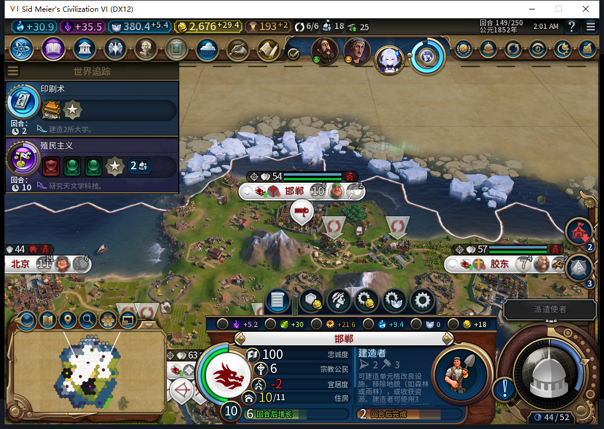
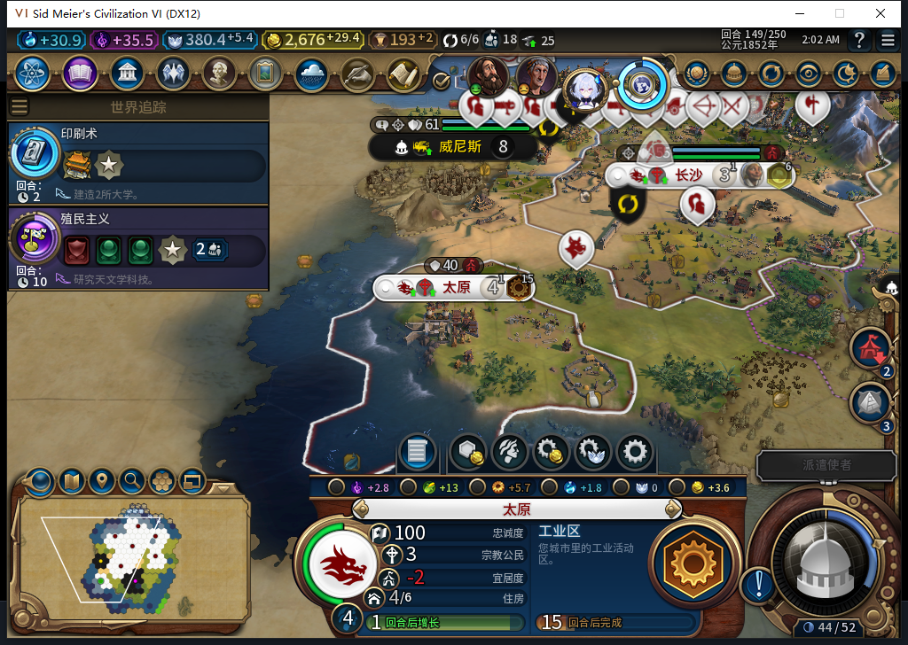
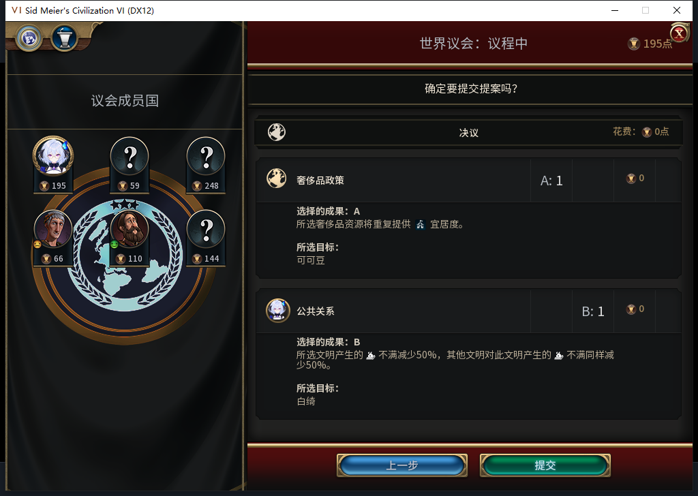
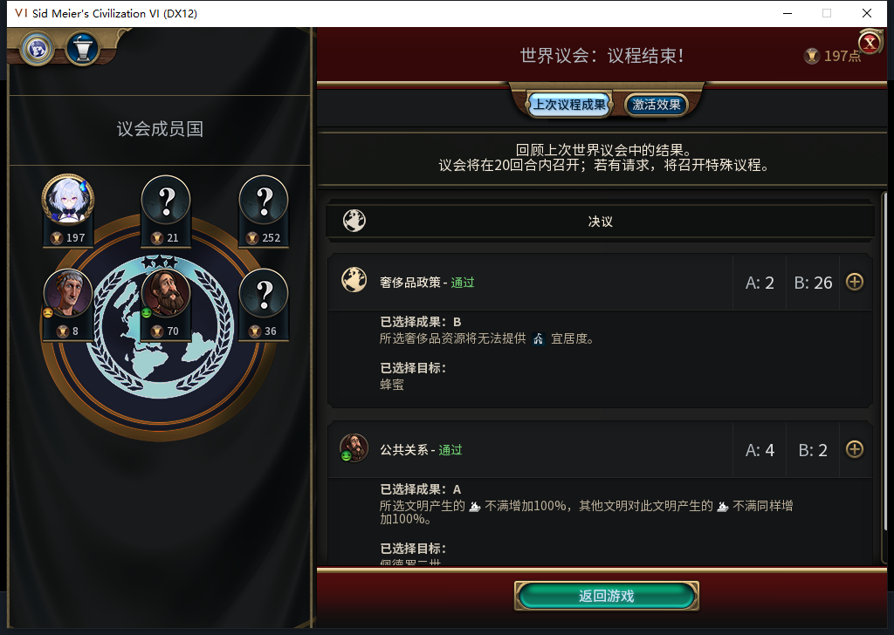

# 95 实机续验：农场学院完工，秀容初始忠诚仍失败

2026-11-09，BF-202609141645。源码、安装、实机均为 95，产品 pin `af6c43e06ee6a42bfa1767f0abd908c329134096`。同一独立 138 存档继续普通回合，到 152 新城出现负忠诚后立即停止结束回合。**农场替换学院的一个完整样本通过；扩张初始稳定仍 FAIL，完整 40 项未通过。**

[机器可核证据](../research/baiqi-p6-warning95-followup152-evidence-2026-11-09.json)、[生产队列 CSV](warning95-138-152-queues.csv)、[城市状态 CSV](warning95-138-152-vitals.csv)、[移民目标与演员 CSV](warning95-138-152-route.csv)。138—152 共 15 份快照、106 行队列和 106 行城市状态；其中 138—139 与[上包](baiqi-native-negative-warning-live-95.md)重叠，不累计冒充新样本。

## 移民绕开旧坏址，但新城仍负忠诚

同一名正常训练的移民完整 ID `3211284`，139 未在旧址 `2131@59,28` 建上海，目标先改为 `1902@52,25`，144 又改为 `2282@62,30`。第二次改址原因未单独隔离。149 到 `59,29`，151 到 `61,30`，152 移动后在目标建秀容。

149 的真实画面。这里没有授目标 2282 忠诚安全；画面的 −6、−20 也不能替代目标 2282 建城前的逐点读回。

152 实际变为 8 城，移民消耗、原目标提案清空。观察器中该演员有且只有 **1 次 FOUND**，在 152；不是测试玩家手动建城。

秀容实例为 `524295@62,30`，与另一读档分支旧上海 `524295@59,28` 不是同一城市；跨读档不能只用完整 ID 认城市。实际只读拆分：

| 项目 | 每回合忠诚变化 |
| --- | ---: |
| 人口压力 | +0.3125 |
| 总督 | 0 |
| 幸福度 | −3 |
| 其他 | 0 |
| 合计 | **−2.6875** |

初始忠诚仍 100，粮仓 0/32、产能 3.6015625。这不是已叛乱，也不是长期保城通过。其余 7 城在所有成功采样中均忠诚 100、变化为正。

95 的负警告否决只解决了已知负警告样本，不能保证总忠诚。**2282 发出 FOUND 前的警告值没有采集。** 建城后该己方城市索引的原始警告条目为 nil，这不能追认为建城前就是 nil、0 或安全，更不能确定是哪一支放行。当前总督救援还要求忠诚 ≤75，故初始 100 的下降未被提前处理；提前干预的软件修复和冷实机另验。

## 农场地块上的学院确实建成

邯郸 `196610@56,38` 的 `2795@57,37`：144 可见己方地块为农场、没有区域；145 模组实际提交学院坐标，146 进度 38/60；147 已完成，149 与 152 仍完成。19 次城市请求的既有观察中保留了 145 的真实参数：城市 196610，区域 Hash `1910099296`，坐标 57,37。请求返回不单独算完工，完工由后继地图／城市区域读回确认。

截图只展示完成后的城市与后续生产，农场前态、区域类型、坐标和完成时间由逐回合原件核对。这个 FARM→CAMPUS 样本窄通过，不能覆盖 TC-009 全部区域／改良矩阵。

另外两处农场替换仍在建：长沙商业中心 `53,29` 与太原工业区 `50,27`，145 农场、146 放置，152 尚未完成。首都工业区已完成，但前态采样没有覆盖其地块，因此不把首都这处也算农场替换。

## 旧新城的生长和生产继续

广州 `393221@59,32` 的矿山替换工业区 143 完成，151 工作坊完成，随即排新商业中心。太原 `458758@49,27` 在 138 已有粮仓，146 纪念碑完成，人口从 138 的 2 到 149 的 4、150 起为 5；本窗口忠诚保持 100、变化为正，工业区仍在建。

太原实际建于 94 的 129 回合，因此 129→149 的 20 回合是 **94／95 混合版本存档链**，不能写成 95 单独连续 20 回合或全部压力场景通过。原 94 上海、92 等失败存档继续保留。

## 正常测试玩家输入与清理保存

实际推进 14 个回合，14 次直接原版 END；另有 1 次议会原版提交回调内部 END。玩家军队待命 51 次，0 UserForced、0 手动内政。144 在第二次选择前置拒绝后停止，重新读取当前状态，再从未执行的序号继续；没有重放已成功的待命或结束回合。

150 议会由测试玩家选择奢侈品 A1 可可豆、公共关系 B1 白绮，预览总花费 0。

结果是奢侈品 B26/A2、蜂蜜；公共关系 A4/B2。第二项最终目标在本图底部被裁，不能仅凭这张图确认完整名称。投票意图与最终结果分开，后台没有代投外交票。

被动观察器最终 2530 条，序号 1—2530 恰好各一次：招募检查 2416、城市请求 19、单位操作 94、单位命令 1，0 errors／drops。唯一命令为 142 的大工程师 `3670042` 激活，效果未单独隔离；不是海军统帅或军队命令。仅覆盖 Executor 的绑定，不声称全上下文零调用。已恢复原函数并确认观察器 namespace 为 nil。

负忠诚后 **0 次 END152**。原版保存 ACK=true 且重复读取稳定：私人 `Baiqi_P6_20261109_V95_XiurongNegative152.Civ6Save`，1556866 B，SHA-256 `f46b12c4a7544a874608d3f5b81c8eb2b503e56a5642aa2e2e8a75ca70913532`，未加载。私人存档不入库。证据导出器首次语法拒绝、后一次文件名匹配遗漏 END 导致断言；修正后只校验已有文件字节一致再续导出，未重放任何游戏动作。

Steam 有其他设备占用，本轮 0 模式切换／上线／登录／下载／上传器初始化／上传。公开 Alpha 2 仍为 82／12 图；[GitHub 风险补记已发布](../releases/v0.1.0-alpha.2/risk-addendum-publication-2026-11-09.json)，本页 6 图尚未上传工坊。原未决 ARMED／旧档等待 FAIL、自然创教／采购传播正案、Base／RF、性能与完整 40 项仍开放。仅增加 Native 证据，未重复运行已绿的 1351 pass／1 SDK 环境 skip 软件基线。
