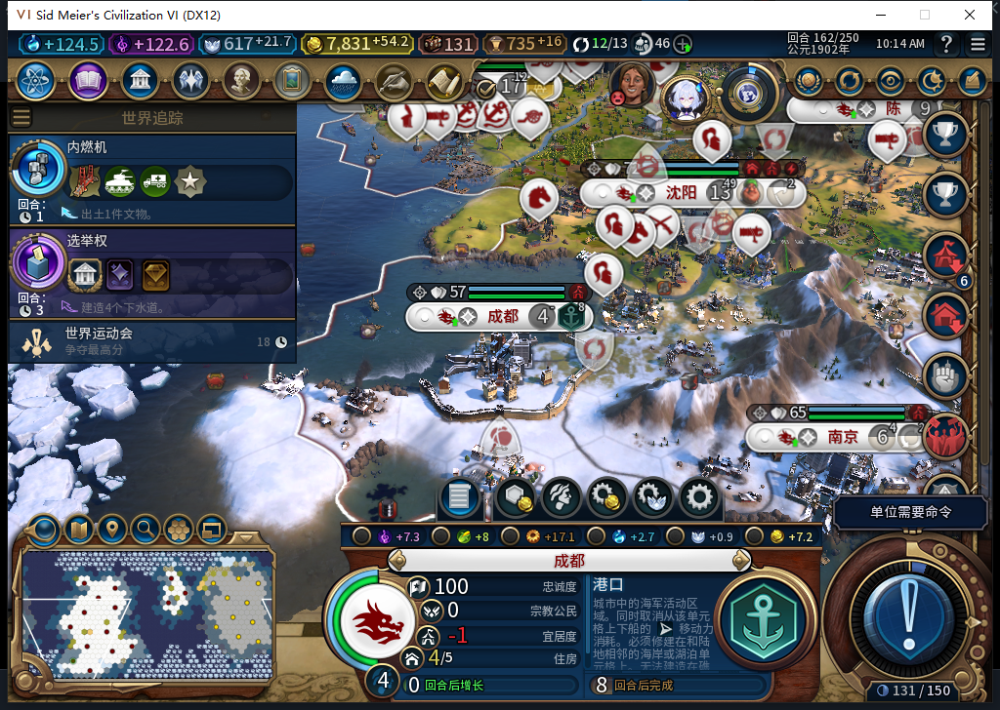
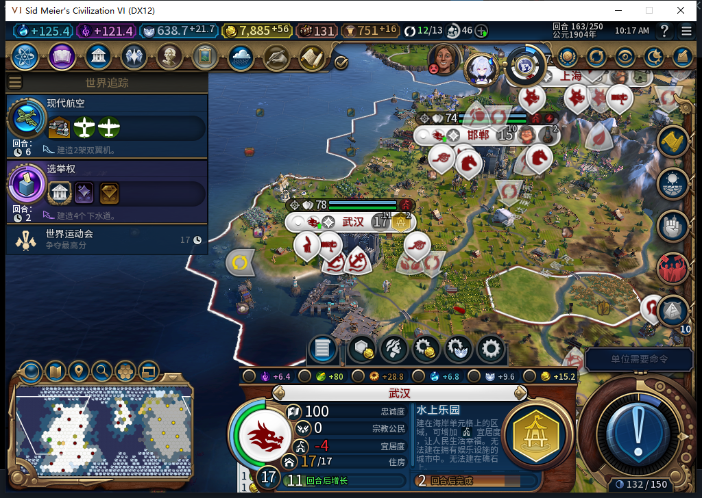
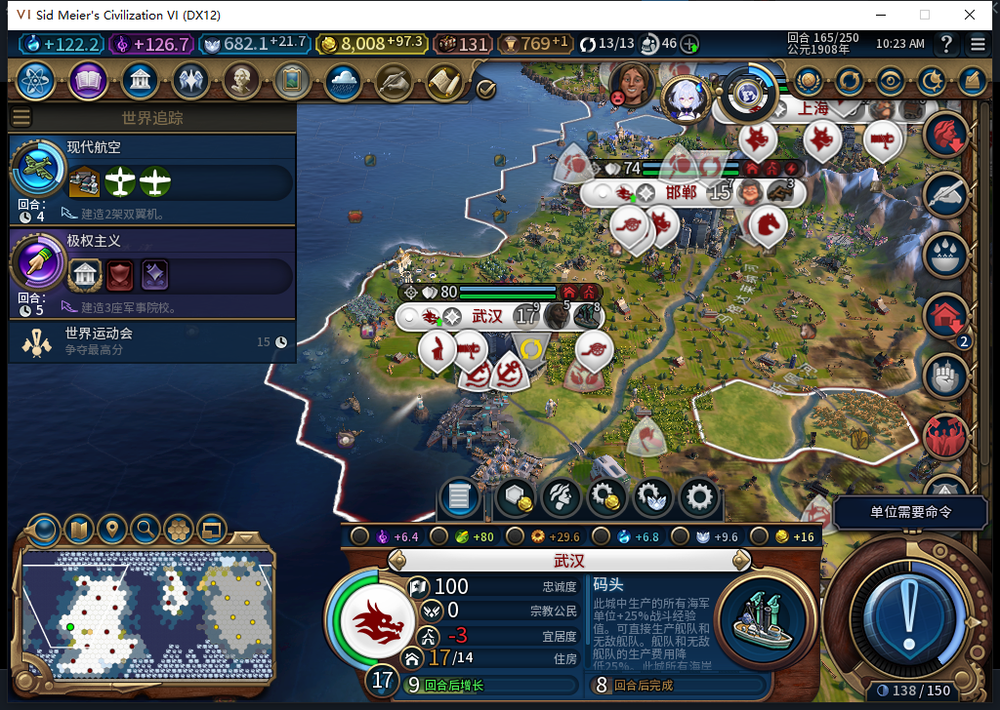
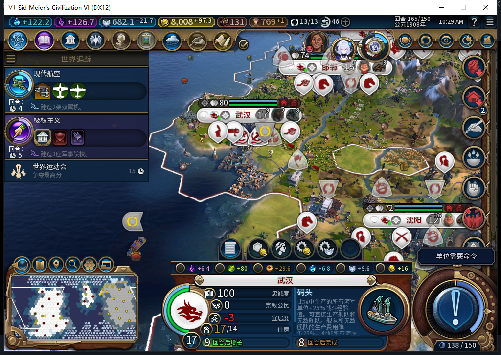

# 水上乐园建成；成都增长后自动新放港口

77开发版主线正常推进160→165。武汉159自动放置的水上乐园在165真实建成，接续码头建筑，正式存读档后完成状态保持。成都从3人口满容量长到4人口后恢复区域资格，工坊完工时后台自主选择了新港口；该港口仍在建。

本页新增4张未编辑实机图，分别说明新选址、尚在建、已完成与重载后的地块。完整TC-009和全部40项仍未全验，工坊仍Alpha74。

## 成都：名额恢复后使用空余容量

153成都3人口、容量1/1，学院有自然存在的干净合法地块53(9,1)，但完整生产资格false。154自然增长到4人口；160与161同城容量1/2、学院两种原版资格true，原地块仍无改良、地貌或资源。不过城市原有工坊没有被测试玩家取消，仍按正常产能完成。

162工坊完成后，后台实际选择港口(6,3)：请求前4人口、容量1/2，两种原版资格、科技、市政、选址均通过。新实例3407922从0/187入队。这补上增长后实际恢复区域建设的样本，不把学院“可以造”写成“已经造”。

同一港口163推进37/187，164为59/187，165为76/187；最后仍未完成。162新放置后原生容量计数一度仍1/2，163才读到2/2，因此不声称区域放置和容量计数立即原子更新，也不单凭162学院资格变false断言唯一原因。

## 武汉：同一水上乐园的完成链

武汉的新水上乐园实例3342385位于(8,8)，区别于既有港口和圣地。159选址已在[此前报告](baiqi-district-growth-harbors-77.md)记录，本轮不重复算一次新放置。

| 回合 | 实际进度／完成状态 |
| --- | --- |
| 160 | 44/177，未完成 |
| 161 | 73/177，未完成 |
| 162 | 102/177，未完成 |
| 163 | 130/177，未完成 |
| 164 | 159/177，未完成 |
| 165 | 同一Native对象IsComplete=true，后台接续BUILDING_SEAPORT |

原版对这次完成发出两条通知，仅计一处真实资产。Core独立读回该地块的完整区域ID、类型和所有者；完成依据来自UI原生对象与未取消的完成事件，不冒称Core完成接口也已验证。

## 观察范围与剩余条件

城市请求观察实际覆盖161安装至165精确清理，16次BUILD、4次区域、0单位／军事；四次区域请求前均有空余容量，两种原版资格、前置与实际坐标合法。错误、未知、外方、溢出和容量读取错误均0。除成都港口，另三项是165新入队的胶东商业中心、长沙工业区、秀容工业区，均未授建成。

160第一次城市观察器接入因沿用了148回合断言而被拒绝。负责人在同批操作中继续了事件安装和普通回合链，违反失败后停链要求；该错误保留，160→161城市派发缺口不补成0。161实际前态核实后才以新意图修正接入，后续依赖链按退出码和语义确认继续。事件观察160→165共45条、0错误／丢失，3个处理器均已移除。观察器重用既有资格，不冒计新产品测试通过。

测试玩家处理了亚历山大两次来访、161→162世界议会及普通军事跳过。原版议会提交一次、显示0外交支持费用；投票选择和议会最终结果分开记录。161、162第一次普通结束先执行既有排队移动并停在同一回合，读取当前队列后再作新的普通结束，没有强制结束、手动补文职或清理路线。首次165空闲读回后又出现处理状态，最终资产与请求计数重新核对，未把Ready当成全结算的原子门。

观察器精确还原后，正式保存165：652093字节，SHA256 2ae64f7fef8bebe012480c54c2c7857bcb12081b9325545b07b7f9dd2ec67d0c。加载期间一次“继续”守卫因尚未就绪拒绝输入，待实际就绪才进入。正式加载一次后实际15城、金币8008.64453125，水上乐园已完成；成都港口、九江工业区仍未完成，完整ID、坐标与状态均保持，临时绑定不存在。私人存档不公开；不是冷进程重启验收，加载启动派发次数未知。

没有产品代码改动，77既有1064项软件通过未重跑。本次模型455因长度截断整份丢弃，未读半稿、未在游戏或产品中执行，负责人复用已核的原生读取口接管。九江工业区165仍76/177，成都港口仍76/187，学院没有实际排产；它们继续待验。Steam保持离线、0上传。[结构化实例、事件、派发及模型证据](../research/baiqi-p6-district455-native77-water-completion-evidence-2026-11-06.json)。
