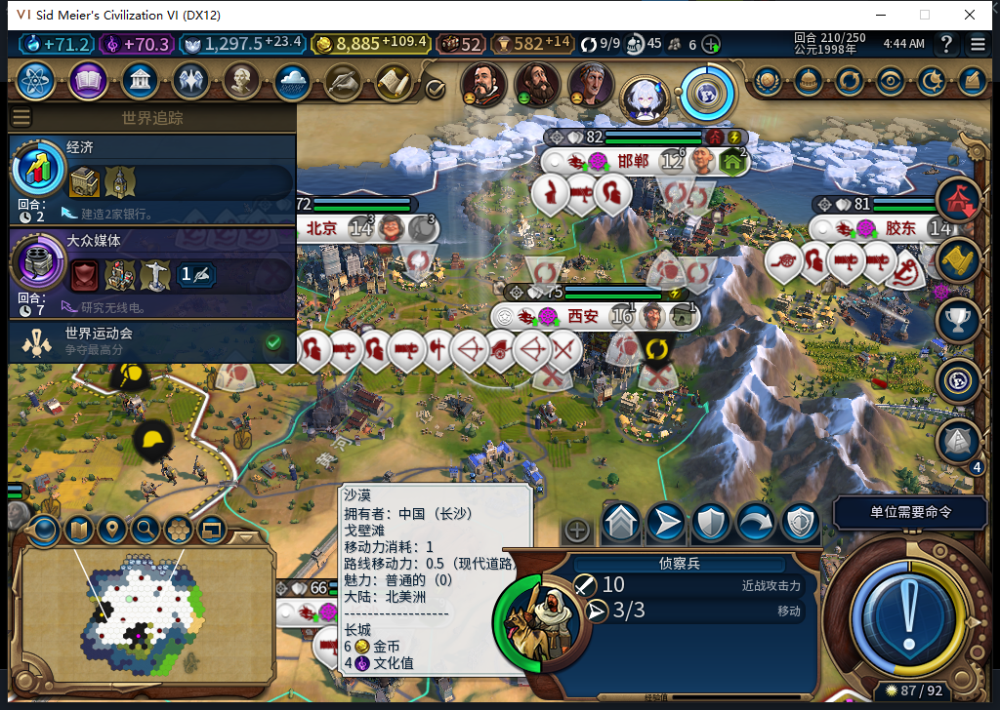

# 111正式冷验：原版运动会打开、确认与重开

2026-11-11，BF-202609141645，源码／安装／运行111，113文件与仓库逐字节一致，210十城。旧110已官方保存并正式退出；25秒时仍在，180秒后已自行退出，未终止旧游戏残留、Steam或其他游戏。与前次109残留清理不同，本次terminate=0。

Steam模式先unavailable，UIA头部Invoke0匹配／0输入；仅导航正式Steam菜单头部，不选模式项。UTC2026-11-10T20:36:25.635779+00:00独立后台读到“上线…”确认离线，查询0输入／激活／焦点变化／移动／截图，以0.004013秒新鲜证明启动自己的111。0切上线／登录／下载／上传。原Before111210存档一次加载（1890304字节，SHA-256为87e63ba1affd3e0f5f91bdeaba20644c379f7e044c8a8e14d9af4e1548f4eafb），原加载继续按钮一次；ACK与实际世界另记。

冷读时原弹窗隐藏、窗口768，正式模块已自然加载，未自动打开竞赛。通过原版OnEmergencyAvailable读取当下真正的14／−1世界运动会数据，正式ShowEmergency入口自动适配，无临时预验、无直接Apply或尺寸setter。等待原动画后读取与截图。

第一次在完整可见的原版“确定”中心305,680物理点击一次，原关闭动画完成，Context隐藏读回true，左侧运动会出现已处理标记。

只读确认真正的数据仍可查看后，从隐藏状态再次经原入口打开，15控件和首次完全一致：Window689、确定y630..671、关闭y0..34，显示图拉真获胜、白绮无奖励。再物理确认一次并实际关闭。

这次包含原版TEST_PLAYER确认：原Close源码会用ACCEPT_EMERGENCY标记已看过，不能称所有游戏操作为0；它不是模组后台外交。未安装底层操作观察器，具体Native接受调用次数未知。可确认的是2次物理确认、2次实际关闭、0END／人工内政／临时接线。

冷读后与两轮界面后十城粮食和vitals全部相同，三个时点均净粮食非负、饥饿−1、忠诚100且速率非负；邢州仍8人、净0、库存1.74609375。110保存前与111冷读相比，武汉589832盈余3→4、预计增长23→17、生产20.703125→22.5，原因未隔离，不归因于界面模块或宣称无害。负责人组装证据时先断言三帧全相同，在公开写入前失败，逐行审后纠正，原件保持。以下六组并不包含全部城市产出，采样相同不能抹掉这处差异，更不是全世界完全一致或后台零订单。

| 组 | 前／冷／界面后行数 | 前冷相同 | 冷后相同 |
| --- | --- | --- | --- |
| WORLD | 1／1／1 | True | True |
| CITY | 10／10／10 | True | True |
| BUILDING | 93／93／93 | True | True |
| DISTRICT | 50／50／50 | True | True |
| PLOT | 168／168／168 | True | True |
| UNIT | 42／42／42 | True | True |

测试查看标记已清，正式BaiqiCrisisViewport保留。已官方另存V111_CrisisVerified210：1889713字节，SHA-256为a5a0232c37c0d077f6e15c239ddd213e6116593f46dc1d968c4d72d77b47fe85，ACK=true、未加载；私人存档与原日志不上库。Modding明确应用BaiqiWorldCrisisViewport（ReplaceUIScript），结合安装清单与自然模块读回确认入口；日志未直接输出新Lua文件名，debug不可用，负责人原文件名断言已按实际组件记录纠正，冻结日志不改。数据库既有重复本地化错误仍存在，不宣称全日志无错。

通过范围仅为689客户区、已完成世界运动会的正式冷打开／确认／真正重开／确认。活动竞赛加入／拒绝、600与宽视口、合成滚轮仍未验收；粮食未知请求跨保存重载、无闲地、旧FOUND ARMED恢复FAIL、水坝／队列／性能和完整40例继续。Steam保持离线，工坊仍82／93文件／12图。

[完整证据、安装指纹和三组采样比较](../research/baiqi-p6-worldcrisis111-cold210-evidence-2026-11-11.json)。
