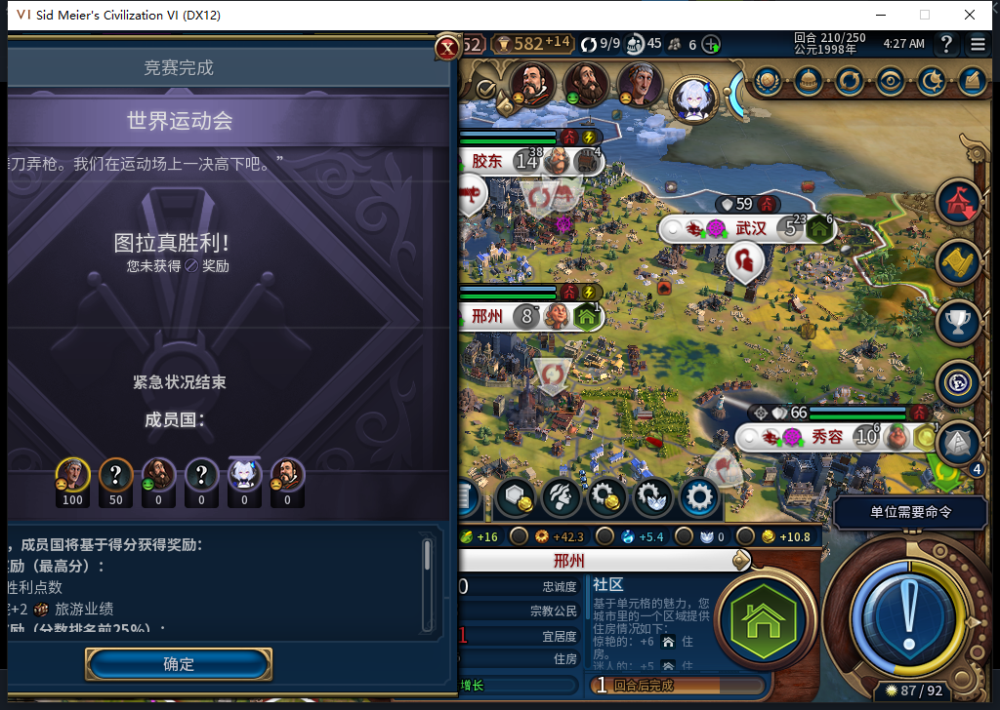
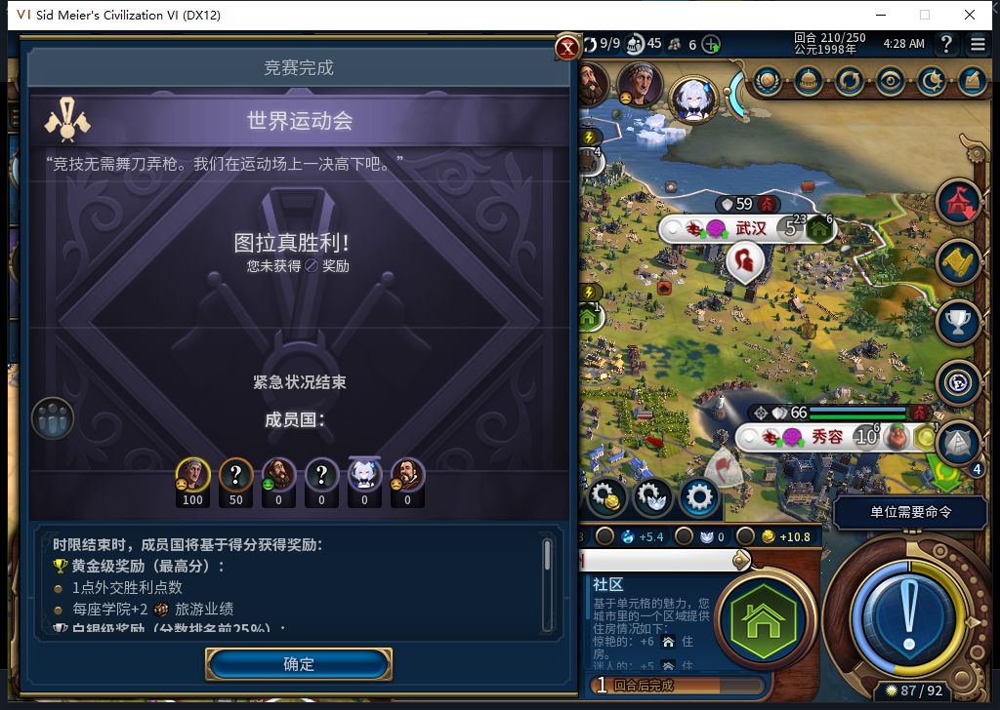

# 111模块接入原入口：210实机预验

2026-11-11，BF-202609141645。模块源码111，安装／基础运行仍110、210十城、1008×689客户区。不同于[六处手动尺寸预验](baiqi-worldcrisis210-preview.md)，本次加载已通过[完整1653项软件检查](baiqi-worldcrisis-viewport-111.md)的实际模块，由原版OnEmergencyAvailable读取真正的世界运动会数据，原ShowEmergency填充后模块自动适配。没有直接调用Apply，没有改写加入／拒绝／确认回调。

实际两次安装／还原周期，分别刷新原版视图2次和1次。三次的15控件尺寸／显隐一致，Window689、确定y630..671、关闭y0..34，仍显示图拉真获胜、白绮无奖励。它们是同一当前竞赛的重复刷新，不等于三场竞赛或关闭重开通过。

第一次截图拍到原版滑入动画中段，左边尚在视口外；同一时段GetScreenOffset逻辑坐标已是0，不能由这个getter推断每一显示帧已到终点。保留原图后，在独立还原／再安装周期刷新一次，显式等待1.2秒再取图。

负责人第一条资格检查误把Native列表当1起始dense数组，使用#actual==1；实际只有key0，#为0。原ERR原件保留，随后只读确认刷新计数0，证明尚未调用原界面；更正私有资格读取为有界pairs后才新调用原入口，产品源码未改。不能把这次负责人探针错误写成模块失败，也不能重放未知UI动作。

两轮均恢复精确原ShowEmergency与BaiqiConfig绑定、15控件宽高／偏移／屏幕坐标／显隐及两个滚动值，模块与临时命名空间清空。原竞赛弹窗仍开、恢复原版裁切，尚未确认。0END／人工内政／直接游戏订单／Steam上线或上传。原模组后台仍在运行，不推断全局零订单。

通过范围仅为原版真实数据入口触发实际111模块的当前689预验。正式111安装／UI替换入口冷读、真正关闭重开、600／宽视口实机、合成滚轮路径仍待验；旧恢复FAIL、水坝／队列／性能和完整40例继续。工坊仍82。

[三次读数、两轮精确还原与输入错误分账](../research/baiqi-p6-worldcrisis111-hook210-evidence-2026-11-11.json)。下一步保存当前210并正式离线安装111。
