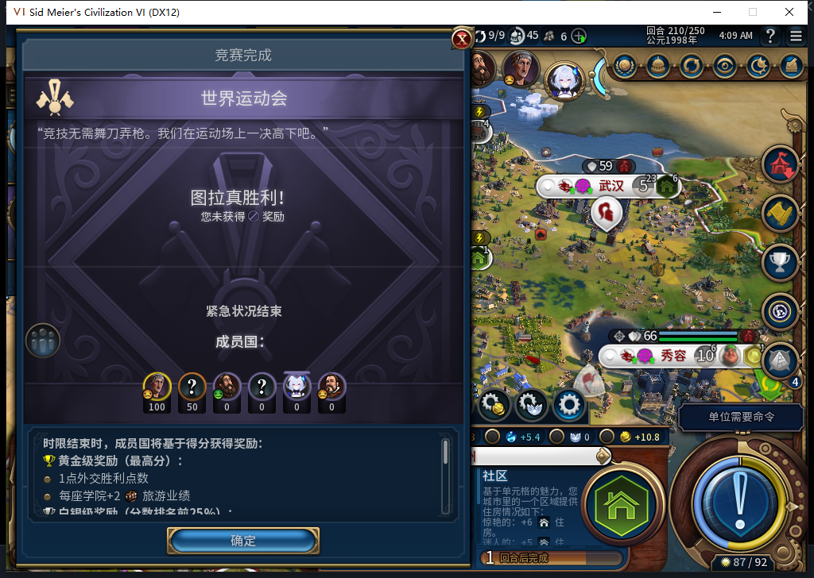
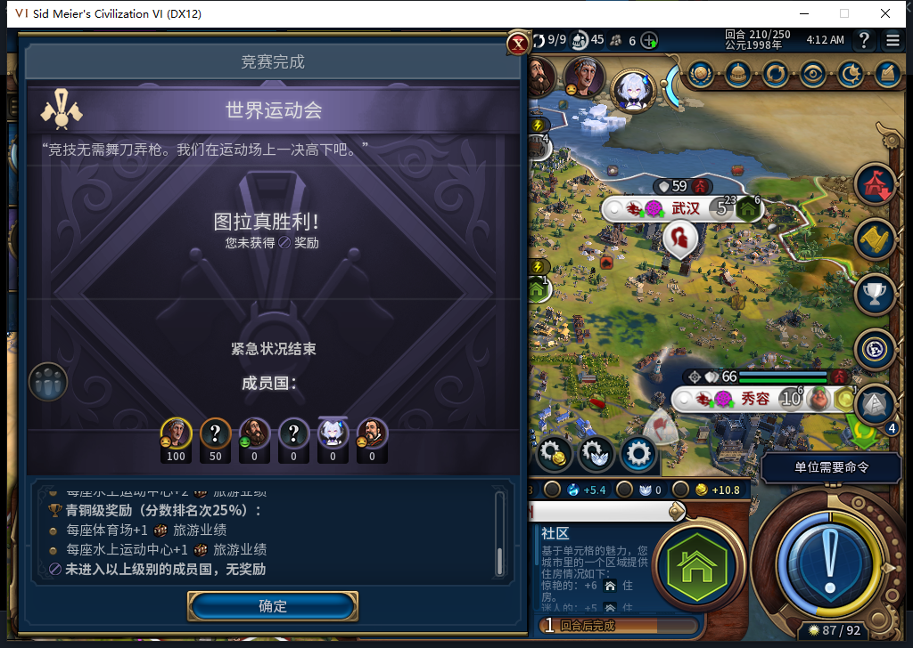
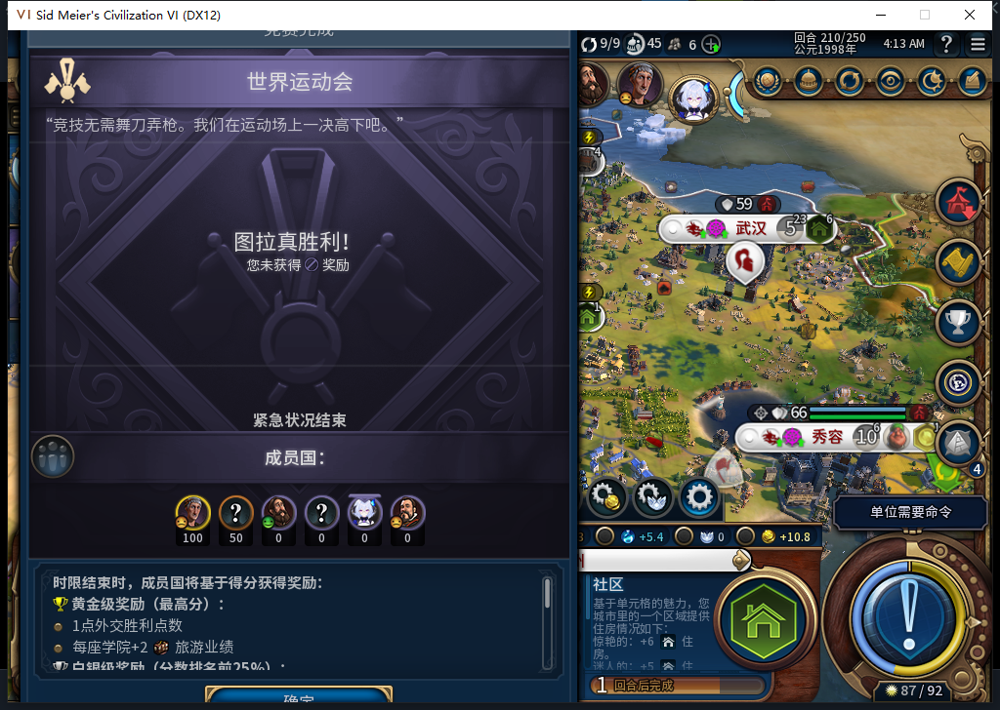

# 210世界运动会：可撤销的小窗口预验

2026-11-11，BF-202609141645，源码／安装／运行110，210十城，Steam离线。真实世界运动会结算在1008×689客户区中裁切：[正式冷验原图](images/source110-cold208-210/worldgames210-clipped.png)。本次对实际可见原版弹窗预验，尚无正式产品适配模块。

采用同一高度差79：SlideOnShow／DropShadow760→681，Window／Title768→689，背景523→444，详情滚动区220→141，BaseStack由原版CalculateSize自动660→581。避免606已拒方案重复计算parent+8。保持原来的奖励滚动区96、按钮41与所有按钮显隐／回调。

实际窗口y=0、height689；确定y630..671，关闭y0..34。窗口／确定／关闭／详情／奖励滚动区均在视口内。未用裁剪或绘图修改游戏截图。

原版奖励滚动条下轨一次物理点击使GetScrollValue从0→1、末尾可读，上轨一次点击回0。此前合成滚轮−6没有使值变化，也没有画面滚动，轮子路径保持未通过／原因未知，不能把坐标输入成功当成滚动成功。两次点击均仅查看奖励，未确认／加入／拒绝竞赛。

结束后15控件的宽高、偏移、屏幕坐标和显隐逐项精确等于预验前；两个滚动值也回原值，临时命名空间已清。0END、0直接游戏订单、0回调改写、0Steam上线／上传；不据此声称运行中的原模组后台完全零订单。弹窗仍打开且未确认，等待正式适配。

600与宽视口、软件模块、重复打开及正式冷装都尚未验收。此前606方案整拒不变，本次负责人几何与实机结果不追授模型采用，0新HTTP。旧粮食无闲地情形／未知请求重载、FOUND ARMED读档FAIL、水坝／MOVE队列／性能和完整40例仍开。

[15控件前后还原、物理输入及滚动分账](../research/baiqi-p6-worldcrisis210-preview-evidence-2026-11-11.json)。下一步将验证过的六处尺寸计算接入原版ShowEmergency调用之后。
