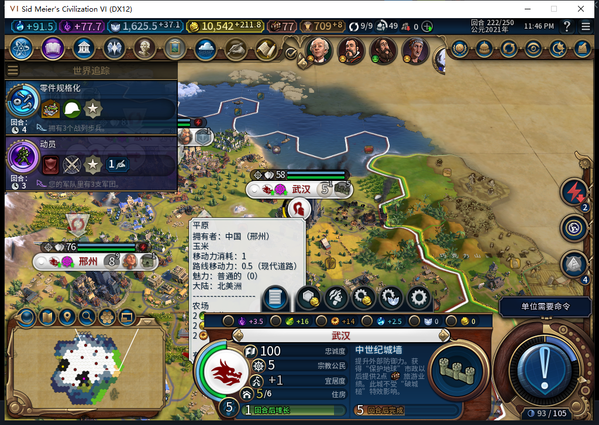

# 116：自动建沈阳，武汉人口下降待定位

116 正式冷读后，220→222 两个普通回合中，后台旧移民 6029348 在 52,25 建成沈阳，城市 10→11，新城已托管排入粮仓。测试玩家只做 8 次军队待命和 2 次普通 END；加拿大来访造成等待超时后，通过原版“再见”一次继续，未重复 END。

但武汉 589832 的人口为 6→6→5。三个读数的粮食库存为 14.09765625、20.68359375、23.96484375，净粮均 +6，城堡生产 0→23→40/110，没有移民在这个队列中。当前正粮和新城出现都不能直接解释回合交界的掉人口。222 原版通知没有现存饥饿条目，当前武汉格无活动风暴；Lua 日志在 220、221 有灾害动画略过记录，但没有灾害类型、位置和损失，暂不归因为灾害或饥饿。

人口守卫已叫停后续结束回合，222 现场已另存，未重载。负责人在失败后仍把下一条独立诊断安装调用发出，违反失败停链；钩子已立即精确撤除，期间没有新增 END 或人工内政。未把短暂安装当作自然样本。

623 方案没有解决评分函数缺城市 ID 的关联，也未给正确撤钩合同，未采用。负责人候选选择／请求透明观察器的 7 个隔离合同通过，但本轮 0 自然目标。624 的事件订阅方向部分保留；其按灾害中心匹配城市和用当前正盈余弱化饥饿的推断不采用。下一步从已保留的 220 存档开独立复现分支，观察人口与灾害先后，原主线 222 保持。

[原始读数摘要、现场指纹、模型与负责人分账](../research/baiqi-p6-source116-population222-evidence-2026-11-11.json)。116 基础产粮建筑实效、115 新商路排序和 213 人口损失仍未关闭。Steam 保持离线，工坊 82 未更新。

[三轮后续复现](baiqi-wuhan-population222-trace-116.md)已排除把陨石／建城直接当作前因，读到整场龙卷风累计损失，但武汉逐城归因仍未关闭。
