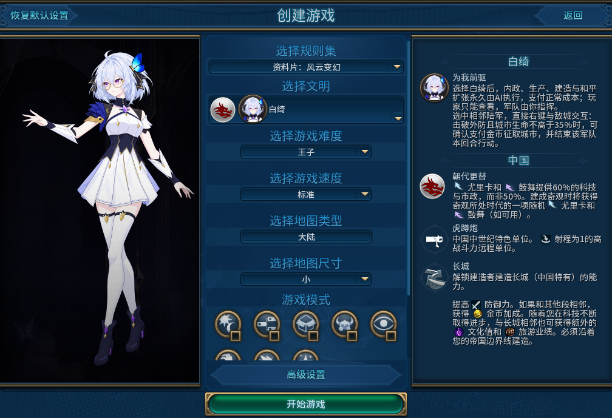
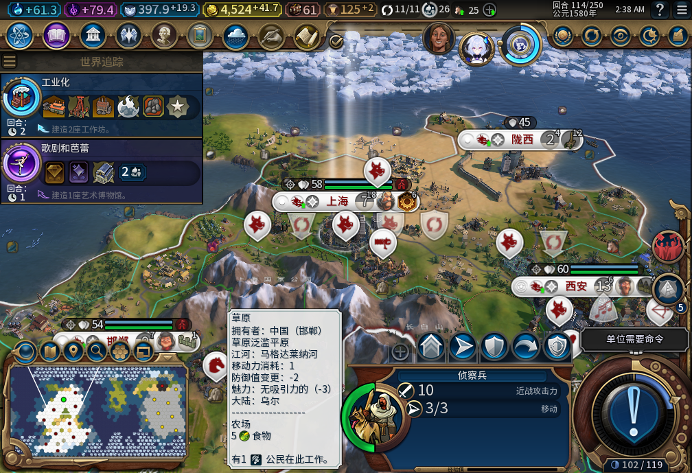
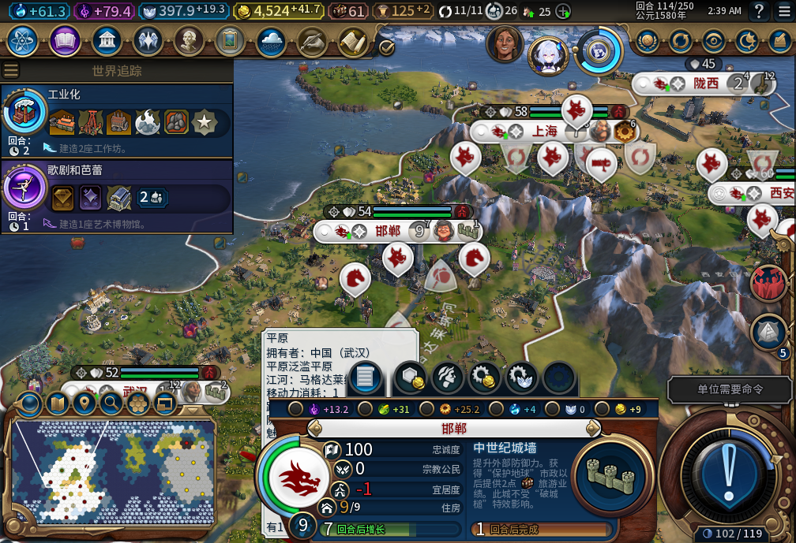
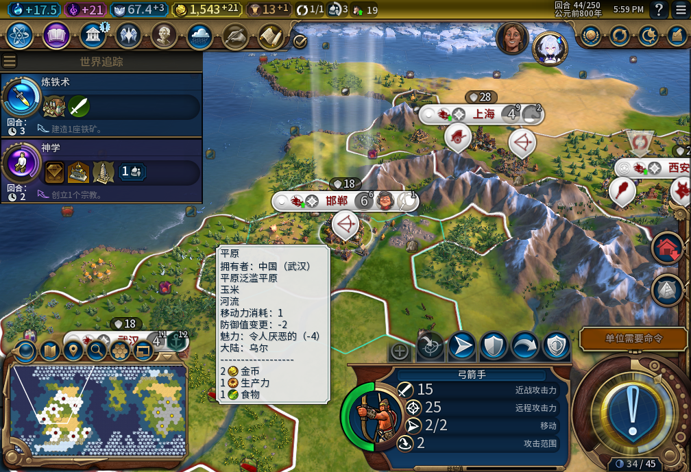
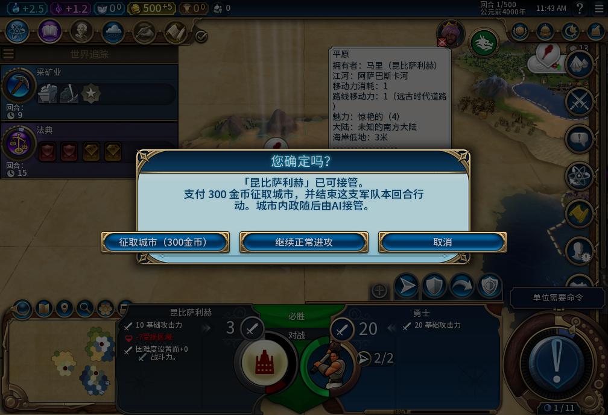
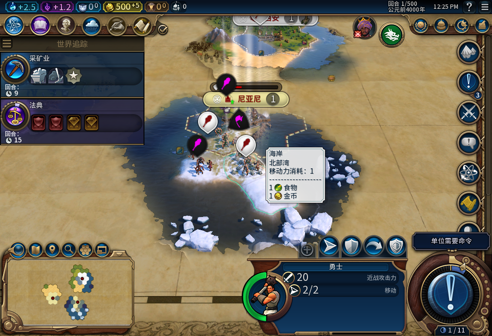
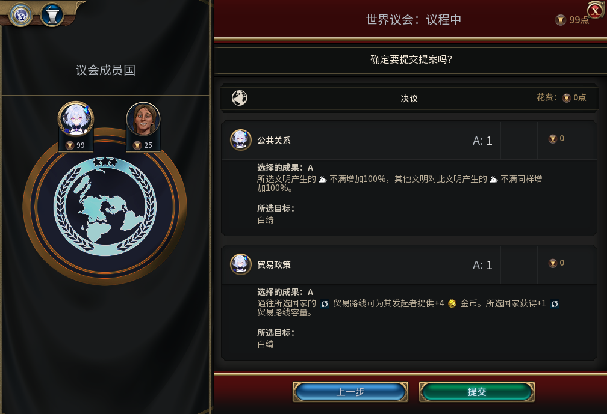

# 白绮【为我前驱】

选择白绮，把内政交给她，把军队和外交留给自己。

研究什么、城里造什么、哪里修改良、移民去哪里建城，由模组安排。你仍能打开城市查看进度，但不能改排产，也没有暂停或临时接管。

选择白绮就采用这套分工。30版选人实机。

## 一个回合，你做什么

看地图和城市进度，决定军队往哪里走、打谁、何时停手；处理外交，再结束回合。新训练出来的军队等你的命令，模组不会替你调兵、宣战，或借护送文职把军队带走。

74版，114回合：城市继续发展，选中的军队仍由玩家指挥。开发存档含历史QA准备。

这套玩法要接受的取舍是：城市不再逐项按你的手法优化。你得用手头的兵力和国库作决定，让内政按它的节奏推进；发现排产不合心意，也不能临时接回来改。

74版城市查看界面：可以看，不能手动改生产。

32版实机：从五城准备档推进20回合后的44回合，期间没有手动内政。历史开发样本，非74版重测。

## 破城之后，多一个选择

合格陆军贴近已经破防、生命不高于35%的敌城后，直接在地图上右键点城。你可以继续正常进攻，也可以确认报价，用金币接管整座城，或取消这次操作。

27版QA敌城场景：人口1，报价300金币。征取、正常进攻、取消，都在这一个地图确认框里。

当前报价是200＋100×人口金币。还须处于交战、相邻、部队可行动且没有护送编队；成功接管会结束该部队本回合行动。是否值得动用国库，由你决定。

27版QA场景：玩家选了正常进攻，勇士实际参战。该分支没有付征城费。

## 外交仍由你拍板

宣战、议和、交易、城邦使者和世界议会都留给玩家。和平扩张走移民建城；国内传教士由托管处理，使徒、审判官和上师仍由你指挥。

67版，101回合：测试玩家亲自选择并提交世界议会投票，模组不代投。

## Alpha 1 试用说明

内部构建74，全功能实机验收尚未完成。可能出现托管停滞；征城结果未知时会冻结后续冲突操作。特殊城市资产、长期忠诚度与经济、护送和兼容边界仍有未验范围。没有手动接管兜底。

当前验收环境为Windows、Steam版DX12、单人《风云变幻》。建议新开一局并保留原档。正常游玩不需要在线模型服务。

这里共7张真实游戏截图。27／30／32／67版图片是对应开发记录，已在图下注明；不是把旧图当作本次Alpha的新验收结果。部分场景含QA准备。宣传封面另为AI辅助插画，不计入实机图。

[完整风险](../../releases/v0.1.0-alpha.1/KNOWN_ISSUES.zh-CN.md) · [安装说明](../../releases/v0.1.0-alpha.1/README.zh-CN.md) · [逐图来源与范围](screenshot-commentary.md) · [反馈问题](https://github.com/XenoAmess/civ6_dev/issues)

[Steam工坊](https://steamcommunity.com/sharedfiles/filedetails/?id=3833805495) · [GitHub下载](https://github.com/XenoAmess/civ6_dev/releases/tag/v0.1.0-alpha.1) · [BBCode](description.bbcode) · [发布与上传源码记录](PUBLISHING.md)

[2026-11-05新增风险BBCode准备稿](known-issues-update-2026-11-05.bbcode)已入库，尚未上传，不改写既有发布回执。包括74的软件恢复资格缺口、75有限修复证据及一次未归因的退出收尾残留；新的Steam联网／上传须先取得新鲜可靠占用状态。

风险补充稿另已加入[历史样本身份更正](../../testing/baiqi-free-city-classification-audit-75.md)：62是自由城市，撤回该样本城邦验收。BBCode仅本地入库，尚未更新工坊页面。

[75真正城邦实机补验](../../testing/baiqi-vilnius-city-state-capture-75.md)与风险已加入待上传BBCode；含三张内嵌实机图。当前工坊与Alpha74仍未变更。
