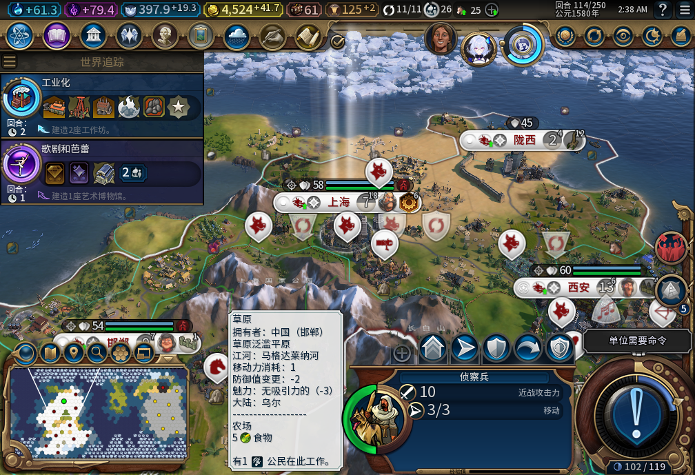
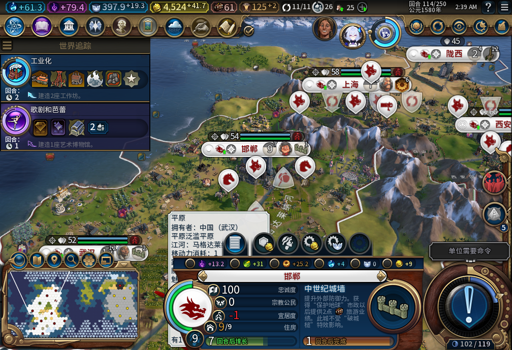
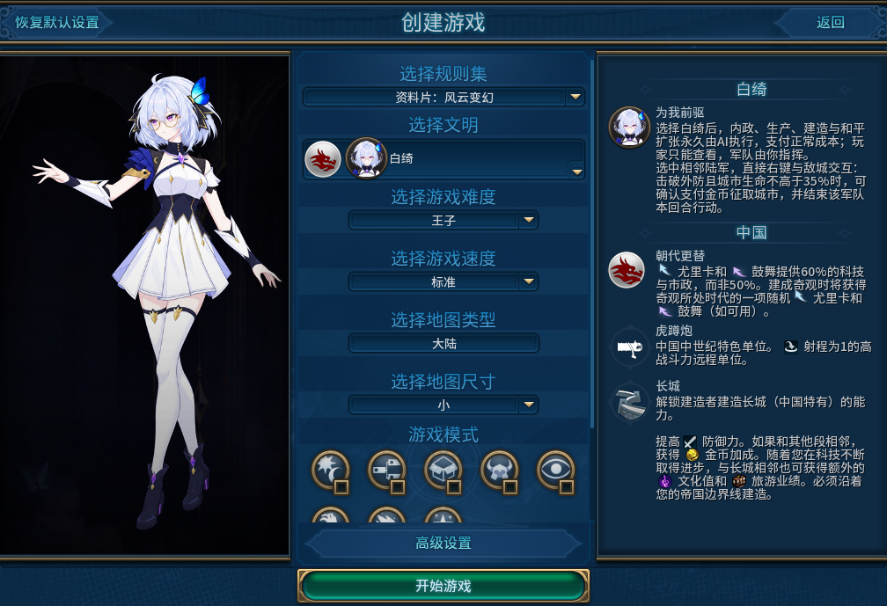
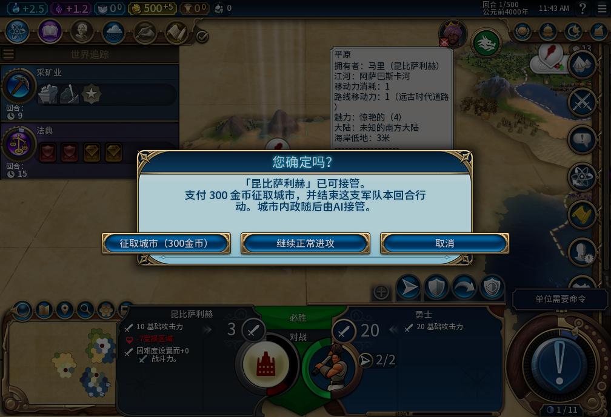
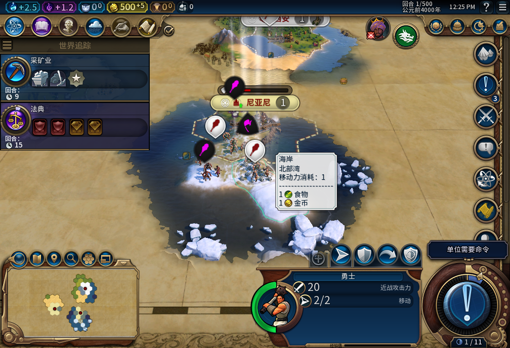
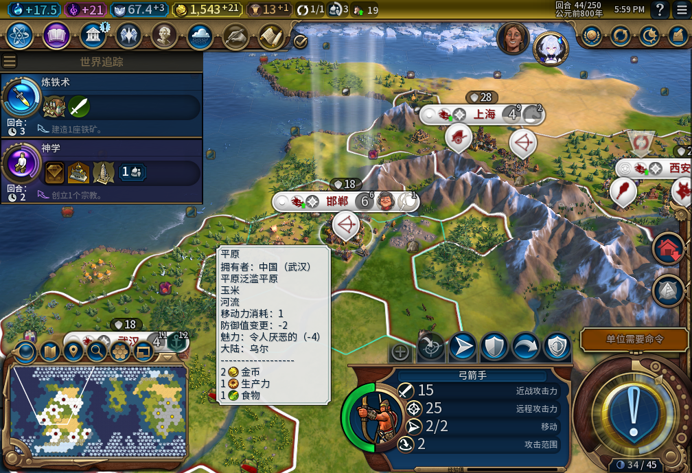
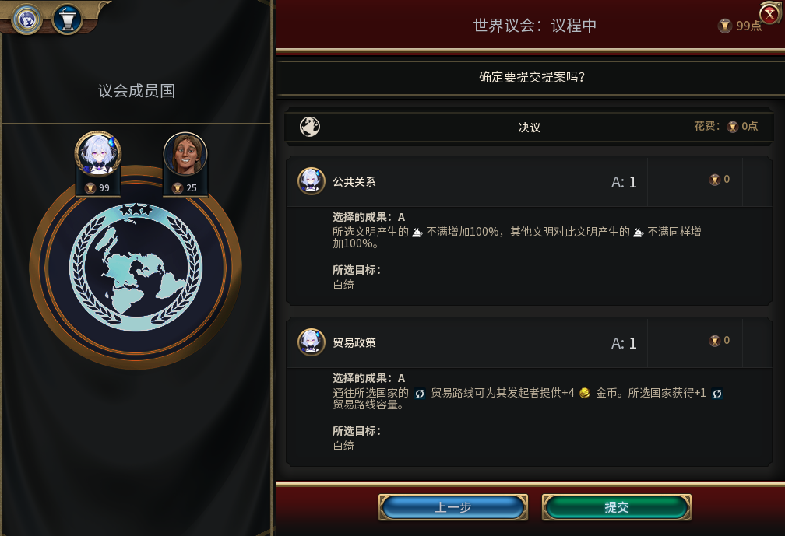

# Alpha 1 实机图解读

现共7张实机图。最初两张原始PNG与GitHub Alpha包逐字节相同，来自2026-11-05内部74版真实游戏客户区、正常恢复档114回合。没有修图、文字覆盖或界面合成；截图排除了桌面、任务栏与Steam窗口。游戏窗口约1024×728，实际客户区图片1008×689。工坊上传副本仅做JPEG压缩以满足小于1MB的预览限制，尺寸不变，原PNG继续公开。该开发存档包含历史QA准备，不能把现有城市、资源和单位数量当作全程自然发展结果。

## 画廊图1：局内总览

这张图展示白绮在实际游戏地图中的城市、地形和军队界面。模组的玩法分工是后台执行内政与和平扩张，玩家指挥军队和处理全部外交；静态截图只证明当时的可见界面，不能独自证明从未越权下令、完整自动化周期或某笔结算正确。

建设的前后变化可查[建造者实际抵达、农场与次数扣除](../../testing/baiqi-queued-move-observation-73.md)；74版经济约束可查[库存对照](../../testing/baiqi-finance-native-pair-74.md)与[合成负收入／恢复](../../testing/baiqi-finance-pressure-recovery-74.md)。这些是具名窄样本，不能扩展成全部地形、真实敌方掠夺或长局稳定结论。

工坊图片说明可粘贴：

> 内部74版真实局内总览，恢复档114回合。存档包含历史QA准备，城市／资源不是全程自然发展证明。静态图不代替军队隔离、自动建设和费用的前后验收。

## 画廊图2：城市信息

玩家仍可选城查看信息。截图时生产和市民入口禁用有独立控件状态读取记录；不能仅凭灰色按钮推断所有入口均安全。队列换序、队列第二项右键的普通领袖／白绮对照分别见[换序实机](../../testing/baiqi-two-item-queue-70.md)与[右键实机](../../testing/baiqi-queue-right-click-73.md)，剩余输入及其他缩放仍待验收。

工坊图片说明可粘贴：

> 内部74版城市信息界面，允许查看、强制托管。生产／市民禁用另有控件读取，图片不等于全部快捷键、队列与分辨率通过。没有手动接管、暂停或逐城开关。

## 主封面：宣传插画

宣传图延续项目既有人物的银发、眼镜、蓝蝶和白蓝金配色，使用imagegen辅助生成，明确标示“ALPHA 1”“测试版 · 功能尚未全部验收”。它不展示游戏运行结果，不作为实机证据。生成原图、上传压缩图和哈希均入库，来源见[美术记录](art-provenance.json)。

截图捕获参数与原始哈希见[Alpha准备证据](../../releases/v0.1.0-alpha.1/preparation-evidence.json)，软件与87个产品文件验证见[发布验证](../../releases/v0.1.0-alpha.1/verification.json)。私人存档、账号资料和机器原始日志不公开。

## 第二版新增的5个实机场景

以下是对应开发版本的真实截图，仅截取客户区和JPEG压缩，未修图或用生成图补内容。它们不是74版重新拍摄；逐图原始哈希、裁切和范围见[素材记录](revision2-media.json)。

### 选择白绮

选择白绮后即采用强制托管玩法。30版选人实机；不是74版重拍。 [对应实机证据](../../research/baiqi-art30-escorts-native-evidence-2026-11-01.json)。

### 在地图上决定如何拿城

27版QA敌城场景，地图右键后报价300金；可征取、继续正常进攻或取消。图中人口1，报价不是所有城市固定300金。 [对应实机证据](../../research/baiqi-p6-ordinary-native27-evidence-2026-11-01.json)。

### 也可以继续正常进攻

27版QA场景，玩家选择正常进攻后的战场；独立记录显示金币未付征城费，勇士实际战斗受伤并消耗行动。 [对应实机证据](../../research/baiqi-p6-boundary-map-native27-evidence-2026-11-01.json)。

### 让城市自己发展，军队等你下令

32版五城起点的20回合验收终点44回合，发展变化见配套前后记录。准备档含历史QA；不是74版长局或全自然开局证明。 [对应实机证据](../../research/baiqi-p6-long-native32-evidence-2026-11-01.json)。

### 世界议会仍由你投票

67版101回合实际世界议会提交前界面；票由测试玩家选择和提交，模组不代投票。开发存档有历史QA前置。 [对应实机证据](../../research/baiqi-p6-congress323-native-training-start-evidence-2026-11-04.json)。
