# Alpha 2逐图解读与来源

计划更新同一工坊条目3833805495：保留7张旧图，新增5张82自然新局图，共12张实机；另有AI宣传封面，不计实机图。当前为离线材料，尚未上传；BBCode的新图先用仓库HTTPS地址，图库上传后换成SDK读回的Steam图片地址并核对显示。

图片按正文顺序列出。新增图仅JPEG编码，未裁剪、修图、添加标注或生成游戏画面；原PNG与公开验收记录保留。历史图原有来源和转换说明沿用，不能当82重拍。

## first-capital

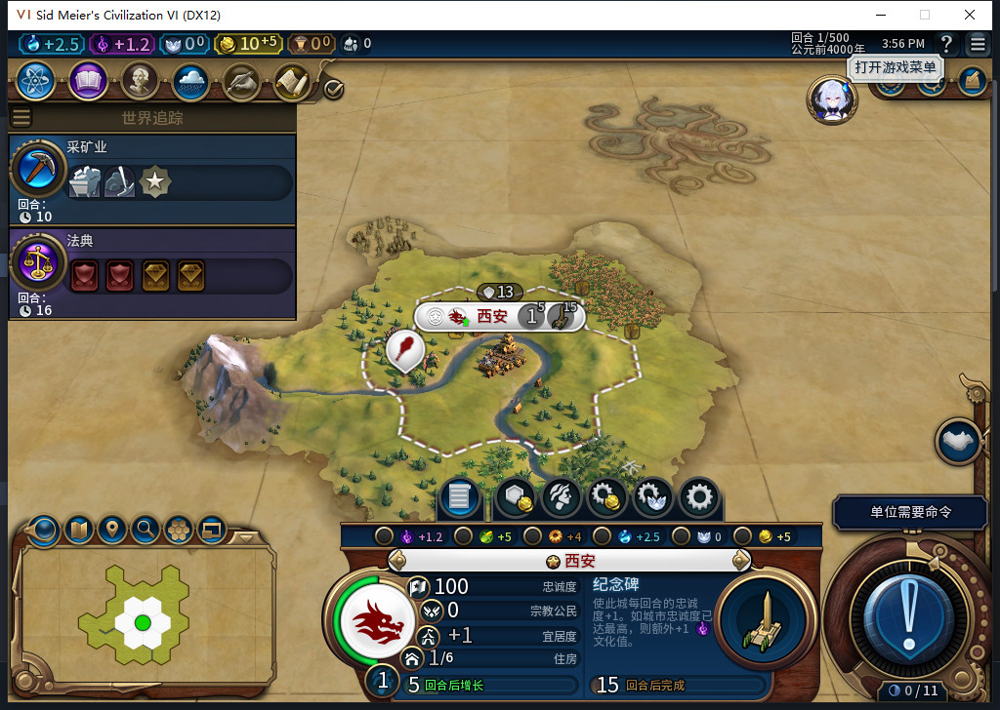

82新局第1回合，首移民自行建都；未手动建城、未补资源。

[未修改原PNG](../../testing/screenshots/newgame82/first-capital1.png)，SHA256 `fc6f240cd8be5d5562b2fcc22a30dcac46af63a53ae8079287b052cd8ac8edb2`。

## policies

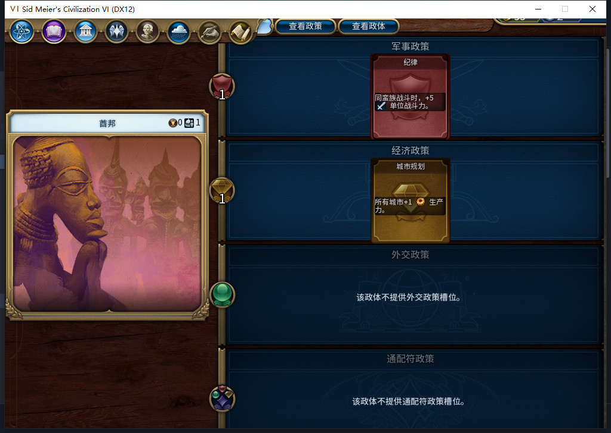

82新局第18回合政府查看页，纪律与城市规划实际在槽。不是14回合截图；首次读到装卡是在14回合。

[未修改原PNG](../../testing/screenshots/domestic481/policies18.png)，SHA256 `569a7fa59347279f829ddcf26c17e0fd9125dc9cb203e312feb9b58a19b4f213`。

## first-slinger

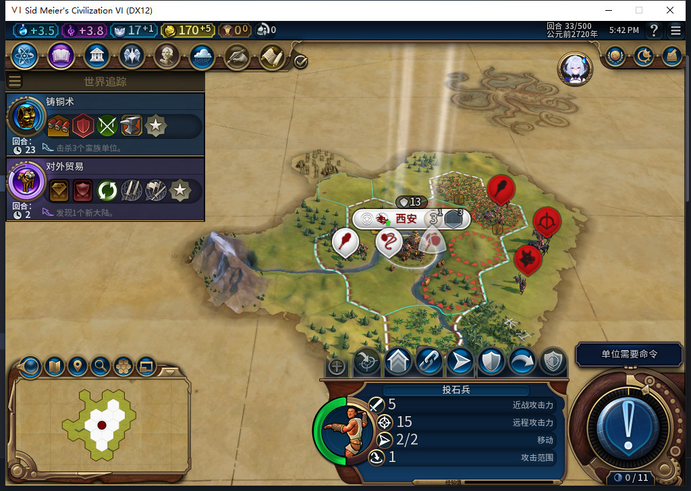

82新局第33回合，投石兵自然训练后仍留在首都；军队操作留给玩家，非后台侦察。

[未修改原PNG](../../testing/screenshots/production482/slinger33.png)，SHA256 `2bc861661e44c5b772f149c69de803dcf310b72aac99eb4e149a32e679c8d9ef`。

## farm

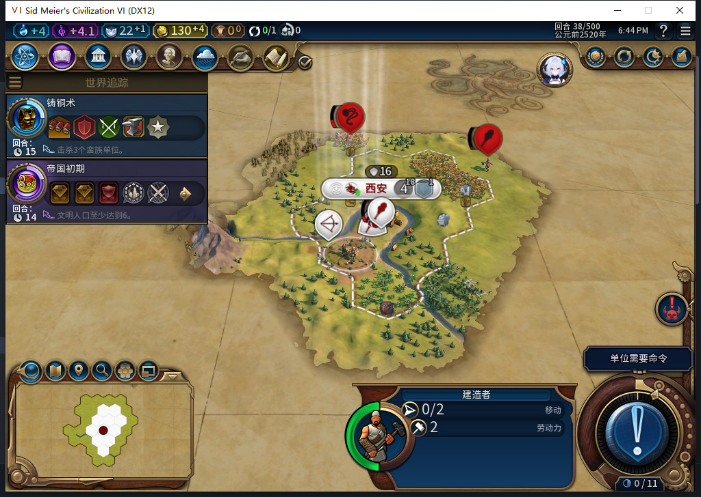

82新局第38回合正式重载后，农场与剩余2次劳动力保持。44矿山与45另一农场是后续文字证据，不是图中时点。

[未修改原PNG](../../testing/screenshots/threat484/farm-reload38.png)，SHA256 `bb5529ef37faa17ca9ebfef5e2da9efc15f90d991e5a1f50c7b60e5f1fc0173c`。

## settler-born

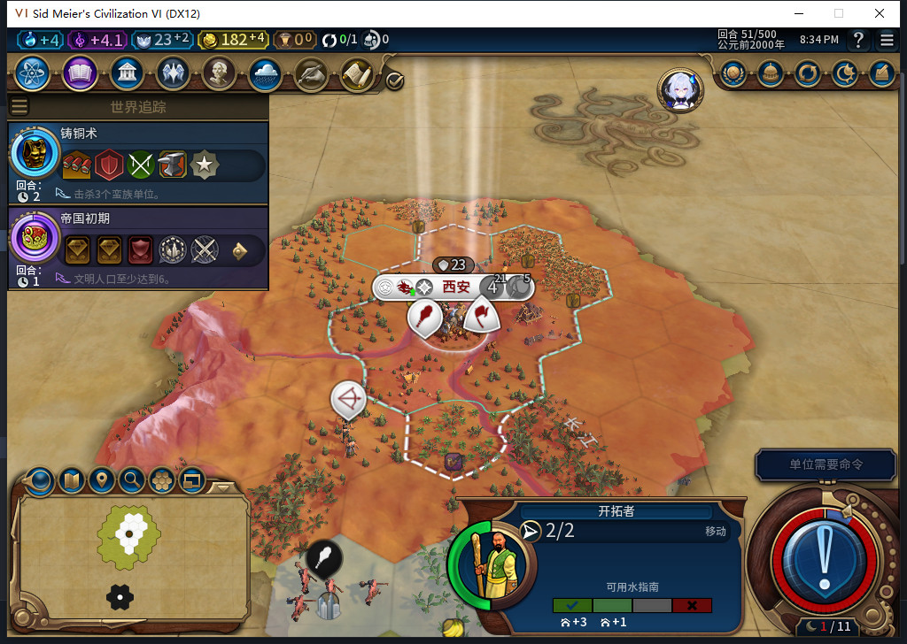

82新局第51回合移民自然完工，文职操作为空；本图不证明已出城、建第二城或人口扣减。

[未修改原PNG](../../testing/screenshots/frontier486/settler-born51.png)，SHA256 `33bf20ac4927f2b18b4e5cbba0b765d1c1afdc224c4aba238d3f063307a7d89c`。

## requisition-confirmation

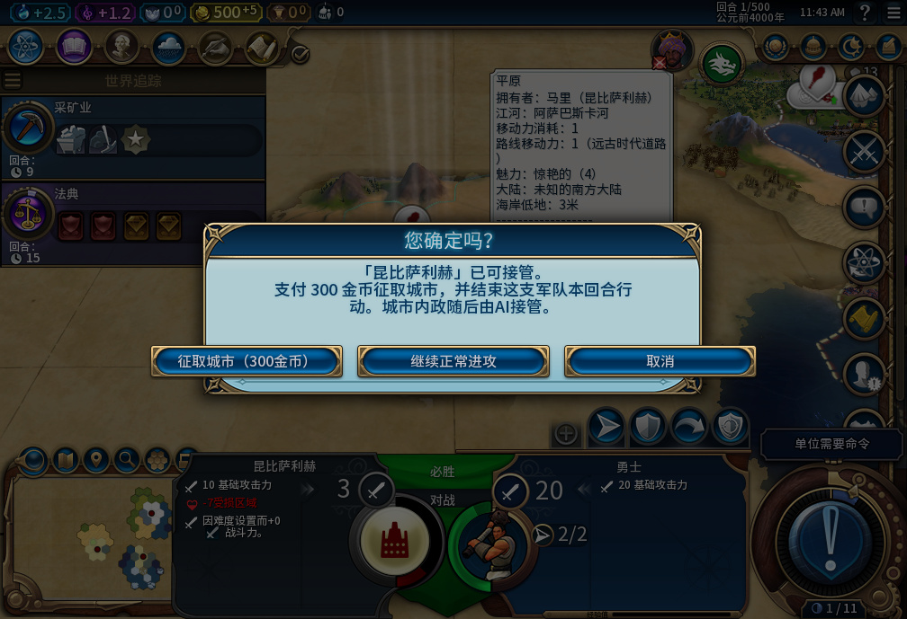

27版QA敌城场景，地图右键后报价300金；可征取、继续正常进攻或取消。图中人口1，报价不是所有城市固定300金。

## normal-attack

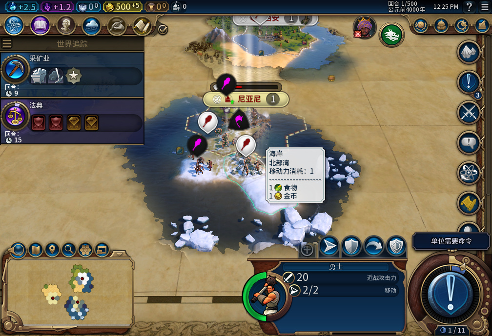

27版QA场景，玩家选择正常进攻后的战场；独立记录显示金币未付征城费，勇士实际战斗受伤并消耗行动。

## leader-selection

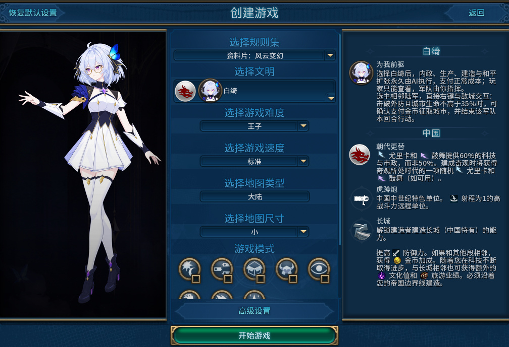

选择白绮后即采用强制托管玩法。30版选人实机；不是74版重拍。

## gameplay_overview

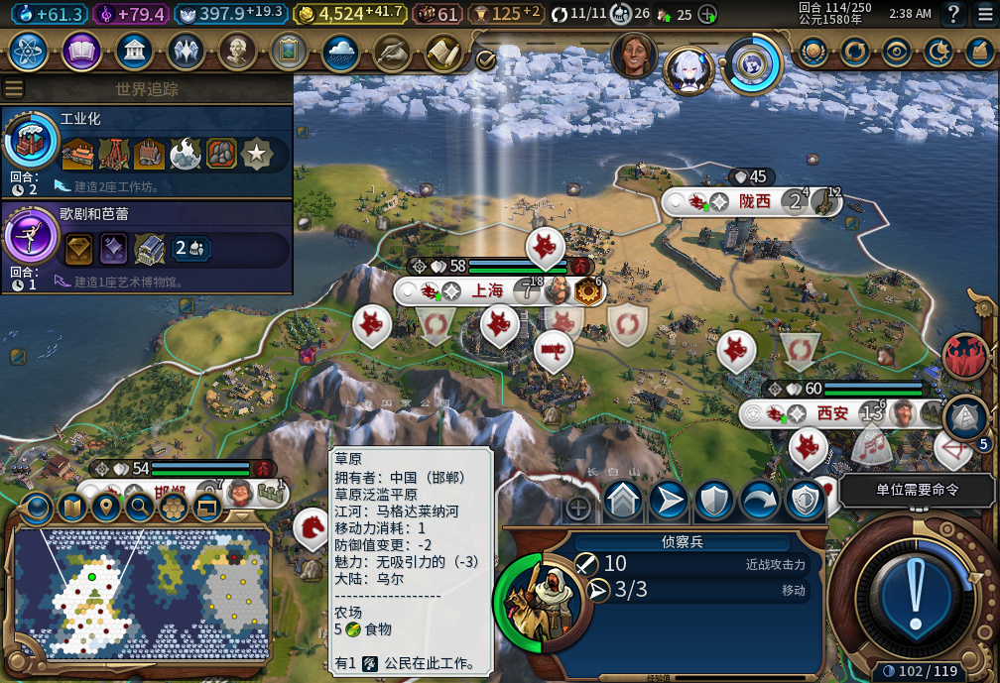

内部74版真实局内总览，恢复档114回合。存档包含历史QA准备，城市／资源不是全程自然发展证明。静态图不代替军队隔离、自动建设和费用的前后验收。仅JPEG压缩，原PNG公开。

## gameplay_city

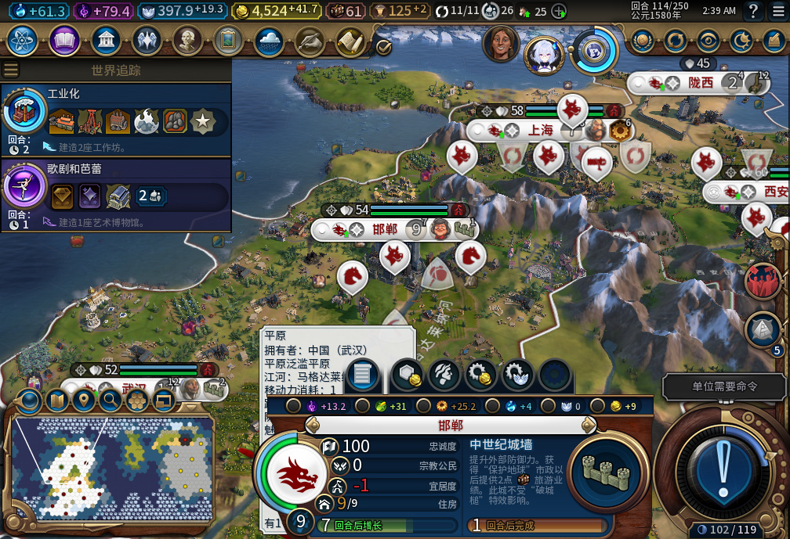

内部74版城市信息界面，允许查看、强制托管。生产／市民禁用另有控件读取，图片不等于全部快捷键、队列与分辨率通过。没有手动接管、暂停或逐城开关。仅JPEG压缩，原PNG公开。

## development-20turns

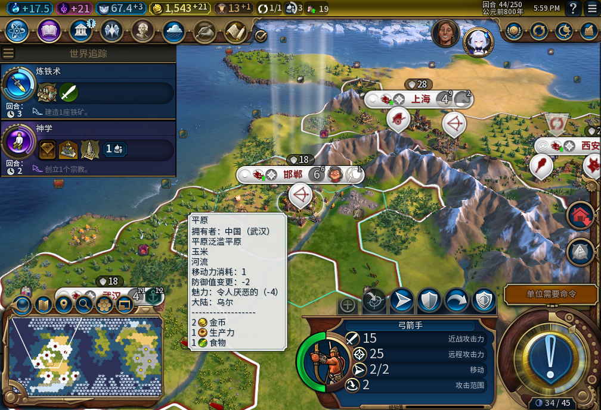

32版五城起点的20回合验收终点44回合，发展变化见配套前后记录。准备档含历史QA；不是74版长局或全自然开局证明。

## world-congress

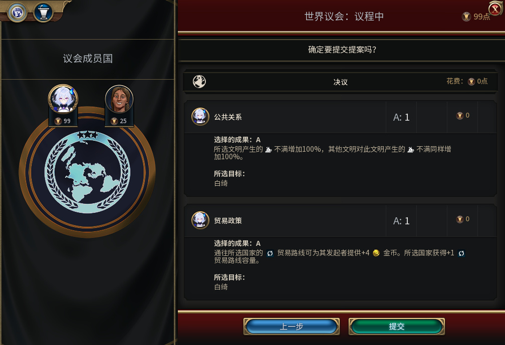

67版101回合实际世界议会提交前界面；票由测试玩家选择和提交，模组不代投票。开发存档有历史QA前置。

[本轮逐项验收](../../testing/baiqi-newgame-natural-settler-and-path-wait-82.md)与[旧7图完整来源](../v0.1.0-alpha.1/screenshot-commentary.md)。
